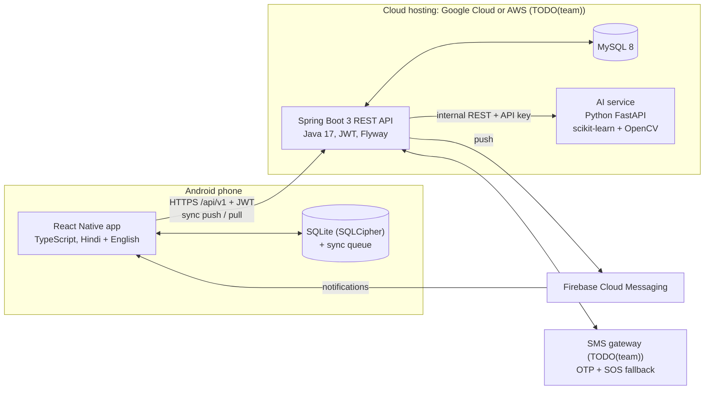

# JanSetu AI – Smart Healthcare and Social Welfare System

**One offline-first mobile app that helps Anganwadi workers keep young children healthy and helps NGOs keep elderly women safe.**

[](LICENSE)
[](.github/workflows/ci.yml)
<!-- TODO(team): after pushing to GitHub, replace the build badge with:
[](https://github.com/<org>/jansetu-ai/actions/workflows/ci.yml) -->


> B.Tech **EPICS (Engineering Projects in Community Service)** project, VIT Bhopal University.
> **Status: Phase I (requirements & design).** This repository holds the specification and a working scaffold. Most features are specified but not yet implemented.

---

## The problem

**Children at Anganwadi centres.** India's Anganwadi centres serve children aged 0–6 with nutrition, growth monitoring, immunisation
mobilisation and pre-school education. Child undernutrition remains high: NFHS-5 (2019–21) reported about **35 % of under-5 children stunted,
19 % wasted and 32 % underweight**. Growth is still often tracked in **paper registers**, so z-scores are rarely calculated, a child
who is slowly faltering is noticed late, missed vaccinations and repeated absence go unfollowed, and the quality of the daily meal is hard to check.

**Elderly women living alone.** Many elderly women in rural India, especially widows whose children have migrated, live **isolated**, with
uncontrolled hypertension or diabetes, missed medicines, and **no quick way to call for help** in an emergency. They are often eligible for pensions and
other welfare they never receive. NGOs support them with home visits, but their records are on paper and WhatsApp, so no one can see who is at risk or who was missed.

**Connectivity and devices.** Field workers use **low-end Android phones** in villages with **intermittent or no mobile data**, and many are more comfortable in **Hindi** than English.
A system that needs the internet to save a record will not be used.

**JanSetu** ("people's bridge") connects these communities with the care they're entitled to, through one app that works offline, speaks Hindi and English,
and uses AI only to help humans prioritise.

## Three pillars

| Pillar | Focus | Who uses it |
|---|---|---|
| **1. Anganwadi child health & nutrition** | Child register, WHO growth monitoring, vaccination (UIP), attendance, meal quality | Anganwadi workers, parents, health professionals, ICDS supervisors |
| **2. Elderly women care & safety** | Beneficiary register, BP/glucose & medicines, **SOS**, welfare & schemes, NGO visits | NGO workers, NGO administrators, health professionals |
| **3. Common platform** | AI risk alerts (human-reviewed), notifications, dashboards & reports, offline sync, auth | Everyone |

## Modules

| # | Module | What it does | Primary roles | Spec |
|---|---|---|---|---|
| 01 | Authentication & User Management | Mobile + OTP login, roles, profiles, sessions, offline PIN unlock | All | [01-authentication.md](docs/modules/01-authentication.md) |
| 02 | Anganwadi Child Management | Digital child register with unique child ID, guardian consent, health history | AWW, GS | [02-child-management.md](docs/modules/02-child-management.md) |
| 03 | Child Growth & Nutrition Monitoring | Weight/height/MUAC, WHO z-scores, growth charts, referrals, risk alerts | AWW, HP, GS | [03-growth-nutrition.md](docs/modules/03-growth-nutrition.md) |
| 04 | Vaccination & Healthcare Management | UIP schedule, due/overdue alerts, doses, checkups | AWW, HP, PG | [04-vaccination-healthcare.md](docs/modules/04-vaccination-healthcare.md) |
| 05 | Attendance Management | One-tap daily attendance, monthly reports, repeated-absence alerts | AWW, GS | [05-attendance.md](docs/modules/05-attendance.md) |
| 06 | QR-Based Digital Health Card | Signed-token QR per child/beneficiary, role-based scan views | AWW, NGW, HP | [06-qr-health-card.md](docs/modules/06-qr-health-card.md) |
| 07 | Midday Meal Quality Monitoring | Daily meal log, photo verification, hygiene checklist, AI quality flag | AWW, GS | [07-midday-meal-quality.md](docs/modules/07-midday-meal-quality.md) |
| 08 | Elderly Women Registration & Management | Beneficiary register, contacts, living arrangement, assigned worker | NGW, NGA | [08-elderly-registration.md](docs/modules/08-elderly-registration.md) |
| 09 | Elderly Healthcare Management | BP & glucose, medicines & reminders, appointments, health risk alerts | NGW, HP | [09-elderly-healthcare.md](docs/modules/09-elderly-healthcare.md) |
| 10 | **Emergency SOS & Safety** | SOS button, notify worker + contacts, SMS fallback, response tracking | Beneficiary, NGW, NGA | [10-emergency-sos.md](docs/modules/10-emergency-sos.md) |
| 11 | Elderly Social Welfare & NGO Assistance | Assistance records, scheme applications, legal aid, counselling | NGW, NGA | [11-welfare-ngo-assistance.md](docs/modules/11-welfare-ngo-assistance.md) |
| 12 | NGO Worker & Caregiver Management | Caseloads, visit plans, follow-ups, activity reports | NGA, NGW | [12-ngo-worker-caregiver.md](docs/modules/12-ngo-worker-caregiver.md) |
| 13 | AI-Based Intelligence & Analytics | Malnutrition/elderly risk, meal image analysis, prioritisation, human review queue | HP, GS, NGA | [13-ai-analytics.md](docs/modules/13-ai-analytics.md) |
| 14 | Notifications & Reminders | Push, local, SMS; lock-screen-safe, bilingual | All | [14-notifications.md](docs/modules/14-notifications.md) |
| 15 | Admin Dashboard & Reports | Role-gated dashboards in the app, PDF/Excel exports, centre & NGO management | SA, GS, NGA | [15-admin-dashboard-reports.md](docs/modules/15-admin-dashboard-reports.md) |
| 16 | Offline Mode & Data Sync | Local-first SQLite, sync queue, duplicate detection, conflict resolution | AWW, NGW | [16-offline-sync.md](docs/modules/16-offline-sync.md) |

## Roles

| Code | Role | Sees |
|---|---|---|
| SA | Super Admin | Everything (audited) |
| AWW | Anganwadi Worker | Children of their own centre |
| NGW | NGO Worker | Elderly beneficiaries assigned to them |
| HP | Healthcare Professional | Referred patients, time-limited access after QR scan |
| PG | Parent / Guardian | Their own child only |
| NGA | NGO Administrator | Their own NGO |
| GS | Government Supervisor | Centres in their jurisdiction |

Full role × module permissions and how they map to Spring Security `@PreAuthorize`: **[docs/rbac-matrix.md](docs/rbac-matrix.md)**.

## Architecture



More: [docs/architecture.md](docs/architecture.md) (request flow, offline sync design, conflict rules, deployment) ·
[docs/data-model.md](docs/data-model.md) · [docs/api-overview.md](docs/api-overview.md) · [docs/ml-overview.md](docs/ml-overview.md) ·
[docs/privacy-and-security.md](docs/privacy-and-security.md)

## Tech stack

| Component | Technology |
|---|---|
| Mobile application | React Native + TypeScript |
| Backend | Java 17+ + Spring Boot 3 (Maven), Spring Data JPA, Bean Validation |
| Database | MySQL 8, schema migrations with Flyway |
| AI/ML | Python + scikit-learn, served via a FastAPI microservice |
| Image processing | OpenCV (Python) |
| Authentication | Spring Security + JWT (access + refresh tokens), OTP |
| QR code | ZXing (backend generation), react-native-vision-camera or similar (scanning) |
| Offline storage | SQLite on device + sync queue |
| Notifications | Firebase Cloud Messaging (+ SMS gateway TODO(team) for OTP/SOS fallback) |
| Reports export | Apache POI (Excel), OpenPDF (PDF) |
| API docs | springdoc-openapi (Swagger UI) |
| Local dev | Docker Compose (MySQL + backend + ai-service) |
| Cloud deployment | Google Cloud / AWS (TODO(team): pick one) |

## Repository structure

```
jansetu-ai/
├── mobile/                         React Native app (TypeScript), Android + iOS projects
│   └── src/
│       ├── screens/<module>/       auth, home, child, growth, vaccination, attendance, healthcard, meal,
│       │                           elderly, elderlyhealth, sos, welfare, caregiver, insights, notifications, admin, sync
│       ├── navigation/             RootNavigator (role-gated)
│       ├── services/api/           fetch client, ApiResponse types
│       ├── db/                     SQLite (SQLCipher) schema + migrations
│       ├── sync/                   sync queue (outbox)
│       ├── store/                  auth/session state (tokens in Android Keystore)
│       ├── i18n/                   en.json, hi.json
│       ├── constants/roles.ts      roles + module access
│       └── utils/                  uuid
├── backend/                        Spring Boot 3 (Maven, Java 17)
│   └── src/main/java/in/jansetu/
│       ├── config/ security/       JPA auditing, OpenAPI, SecurityConfig + JWT filter
│       ├── common/                 exceptions, ApiResponse wrapper, BaseEntity, audit log
│       └── <module>/               controller/ service/ repository/ entity/ dto/  (16 modules)
│   └── src/main/resources/         application.yml, application-dev.yml, db/migration/V1__init.sql, V2 seed
├── ai-service/                     Python FastAPI
│   ├── app/                        main.py, routers/ (growth, malnutrition, meal_image, elderly_risk), models/, schemas/
│   ├── notebooks/  data/           READMEs only, no real data
│   ├── tests/                      pytest
│   └── requirements.txt
├── docs/
│   ├── modules/                    01-authentication.md … 16-offline-sync.md
│   └── architecture.md  rbac-matrix.md  data-model.md  api-overview.md  ml-overview.md  privacy-and-security.md
├── .github/                        issue templates, PR template, workflows/ci.yml
├── docker-compose.yml  .env.example
└── README.md  CONTRIBUTING.md  CODE_OF_CONDUCT.md  LICENSE
```

## Getting started

### Prerequisites

| Tool | Version | Used for |
|---|---|---|
| JDK | 17+ (Temurin recommended) | backend |
| Maven | 3.9+ | backend |
| Node.js | 22.11+ (see `mobile/package.json` engines) | mobile |
| Python | 3.11 | ai-service |
| Docker + Docker Compose | recent | local MySQL + full stack |
| Android Studio | recent, with an Android emulator (API 28+) or a real phone | mobile |

### 1. Clone and configure

```bash
git clone https://github.com/<org>/jansetu-ai.git   # TODO(team): real URL
cd jansetu-ai
cp .env.example .env
# Edit .env: set DB_PASSWORD, MYSQL_ROOT_PASSWORD, and
#   JWT_SECRET=$(openssl rand -base64 48)
#   AI_SERVICE_API_KEY=$(openssl rand -hex 32)
```

### 2. Run everything with Docker

```bash
docker compose up --build
```

| Service | URL |
|---|---|
| Backend health | <http://localhost:8080/api/v1/health> |
| **Swagger UI** | <http://localhost:8080/swagger-ui.html> |
| AI service health | <http://localhost:8000/health> (API docs at <http://localhost:8000/docs>) |
| MySQL | `localhost:3306`, database `jansetu` |

Flyway creates the schema on first start (`V1__init.sql`) and seeds the UIP vaccine schedule (`V2`).

### 3. Or run each part locally (for development)

**Backend** (MySQL from Docker, app from your IDE/terminal):

```bash
docker compose up -d mysql
cd backend
set -a && source ../.env && set +a      # exports DB_PASSWORD, JWT_SECRET, ...
mvn spring-boot:run                     # http://localhost:8080
mvn verify                              # build + tests
```

**AI service:**

```bash
cd ai-service
python3.11 -m venv .venv && source .venv/bin/activate
pip install -r requirements-dev.txt
AI_SERVICE_API_KEY=dev-key uvicorn app.main:app --reload --port 8000
pytest && ruff check .
```

**Mobile app** (Android):

```bash
cd mobile
npm install
npm start                # Metro bundler
npm run android          # in a second terminal, with an emulator running or a phone connected
npm run lint && npm run typecheck && npm test
```

The app talks to `http://10.0.2.2:8080/api/v1` (the host machine as seen from the Android emulator). Change `API_BASE_URL` in
[`mobile/src/services/api/client.ts`](mobile/src/services/api/client.ts) for a real phone. **Note:** the login screen calls the OTP endpoints
specified in [Module 01](docs/modules/01-authentication.md), which are not implemented yet (Phase II).

## Roadmap

### Phase I: Requirements, design, prototype *(current)*

- [x] Problem statement, pillars, 16 module specifications
- [x] RBAC matrix, data model, architecture, API conventions, ML plan, privacy & security design
- [x] Repo scaffold: Spring Boot (security, entities, Flyway schema, health endpoint), FastAPI (health, z-score formula, stubs), React Native (navigation, i18n, roles, SQLite schema, sync queue)
- [x] CI for all three components
- [ ] TODO(team): validate requirements with the partner Anganwadi supervisor and NGO (interviews, field visit)
- [ ] TODO(team): low-fidelity UI prototype (Figma or paper) tested with 3–5 field workers
- [ ] TODO(team): resolve open decisions (`grep -rn "TODO(team)"`): cloud provider, SMS gateway, SOS device model, HP access rules
- [ ] TODO(team): Phase I report and review presentation

### Phase II: Implementation, field pilot, evaluation

- [ ] Implement modules in priority order: 01 → 02 → 16 → 03 → 10 → 05 → 04 → 08 → 09 → 12 → 14 → 07 → 06 → 11 → 15 → 13
- [ ] Add WHO LMS tables, validate z-scores against WHO Anthro
- [ ] Field pilot at TODO(team) Anganwadi centre(s) and with TODO(team) NGO, after consent forms and ethics approval
- [ ] Evaluate usability (task time, error rate, SUS questionnaire in Hindi), sync reliability, SOS drill response times
- [ ] Train and evaluate ML models only on consented, approved data
- [ ] Final report, handover documentation for partners

## Team

| Name | Reg. No. | Role | GitHub |
|---|---|---|---|
| TODO(team) | TODO(team) | TODO(team) (e.g. Team lead / Backend) | TODO(team) |
| TODO(team) | TODO(team) | TODO(team) (e.g. Mobile) | TODO(team) |
| TODO(team) | TODO(team) | TODO(team) (e.g. AI/ML) | TODO(team) |
| TODO(team) | TODO(team) | TODO(team) (e.g. UI/UX & field research) | TODO(team) |
| TODO(team) | TODO(team) | TODO(team) (e.g. QA & documentation) | TODO(team) |

**Faculty supervisor:** TODO(team): name, department

**Community partners:** TODO(team): Anganwadi centre / ICDS project and NGO, added only with their permission.

## Acknowledgement

This project is carried out under **EPICS (Engineering Projects in Community Service) – VIT Bhopal University**.
We thank our faculty supervisor and the Anganwadi workers, NGO staff and community members who share their time and experience with us.

## Contributing

Read **[CONTRIBUTING.md](CONTRIBUTING.md)** (branching, commit style, reviews, data rules) and the **[Code of Conduct](CODE_OF_CONDUCT.md)**.
Never commit real beneficiary data, secrets or keys.

## License

[MIT](LICENSE) © 2026 JanSetu AI Team – EPICS, VIT Bhopal University
