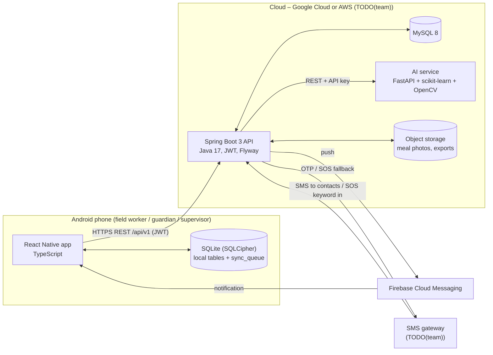
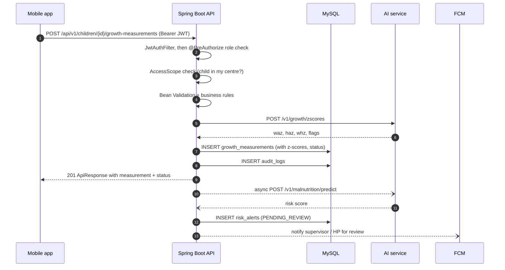
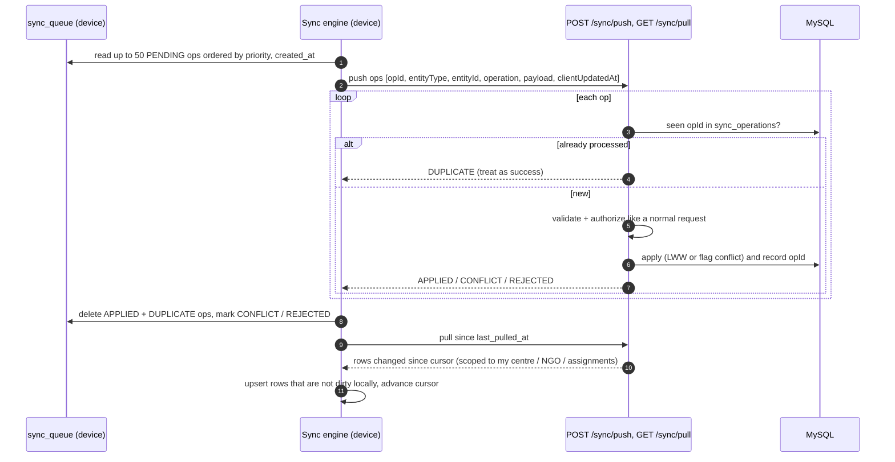
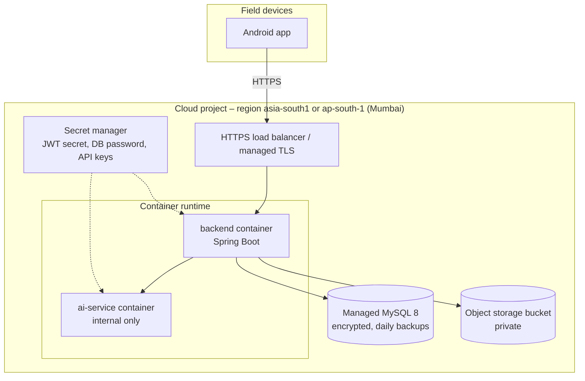

# Architecture

## Goals that drive the design

1. **Offline-first.** An Anganwadi worker must be able to register a child, record growth, mark attendance and log a meal with **no network for days**.
2. **Runs on low-end Android.** 2–3 GB RAM, Android 9+, small storage, shared family phones.
3. **Safety-critical SOS.** An SOS alert must reach a human even when mobile data is down.
4. **Privacy by design.** Health data of children and elderly women (see [privacy-and-security.md](privacy-and-security.md)).
5. **Buildable by a 5-person student team.** One mobile app, one backend, one small Python service. No microservice sprawl.

## Components

| Component | Responsibility | Code |
|---|---|---|
| Mobile app | All UIs (field, guardian, supervisor, admin screens are role-gated in one app), local DB, sync engine, QR scanning, SOS button | [`mobile/`](../mobile) |
| Spring Boot API | Auth, RBAC + data scoping, business rules, sync endpoint, notifications scheduler, report export, QR token signing | [`backend/`](../backend) |
| MySQL | System of record. Schema owned by Flyway | [`db/migration`](../backend/src/main/resources/db/migration) |
| AI service | Z-scores, risk models, meal image analysis. Stateless and internal | [`ai-service/`](../ai-service) |
| FCM | Push notifications (reminders, alerts, SOS) | — |
| SMS gateway | OTP, SOS fallback when data is unavailable | TODO(team) |

**Why one Spring Boot app (a modular monolith) instead of microservices?** One deployable is easier to run on a student budget and easier to debug.
The modules are separate *packages* (`in.jansetu.<module>`), each with its own controller/service/repository/entity/dto, so we can split later if ever needed.

**Why a separate Python service?** The ML ecosystem (scikit-learn, OpenCV, pandas) is in Python. It is kept stateless and off the critical
path: if it is down, records are still saved and predictions are retried.

## Request flow (online)

The AI calls happen **after** validation, and the malnutrition prediction is asynchronous. The worker never waits for the model.
Z-scores are also computed **on the device** from the bundled WHO tables, so the worker sees the result immediately when offline.
The server recomputes them and its value wins.

## Offline sync design

Full spec: [Module 16 – Offline Mode & Data Sync](modules/16-offline-sync.md). Summary of the design decisions:

### Local-first

- Screens read and write **only the local SQLite DB**. The network is never in the UI path for field-worker features.
- Each write runs **in one SQLite transaction**: update the local row (`dirty = 1`) **and** append an entry to `sync_queue` (the outbox).
  A change can therefore never be saved without being queued ([`syncQueue.ts`](../mobile/src/sync/syncQueue.ts)).
- The local DB is encrypted with SQLCipher. The key is generated on first launch and kept in the Android Keystore.

### Client-generated UUIDs

- Every record created on the device gets a **UUID v4 id on the device**. The server stores that id as the primary key (`CHAR(36)`).
- This means no ID remapping after sync, children/visits/measurements can reference each other offline, and a retried push is recognised.
- Human-readable codes (`child_code`, `beneficiary_code`) are **assigned by the server** on first sync, because the device cannot know the next number. Until then the app shows "Pending ID".

### Push and pull

Triggers: app start, network regained (NetInfo), every 15 min while online, and immediately for SOS.
Ordering: SOS first (`priority 0`), then health data, then routine records, then photos (uploaded last over Wi-Fi or a good signal, resumable).

### Conflict resolution

Each synced row carries `updated_at` (client time of the change) and `version`.

| Situation | Rule |
|---|---|
| Server row unchanged since the device last pulled it | **Apply** |
| Both changed, **non-clinical / low-risk fields** (attendance status, visit notes, contact phone, meal notes) | **Last-write-wins by `updated_at`**. The losing value is kept in `sync_operations.detail` for audit |
| Both changed, **clinical or identity fields** (DOB, sex, weight/height, vaccination given date, medical history, guardian) | **Manual review.** The server keeps its value, returns `CONFLICT`, and the record shows in the *Sync Conflicts* screen for the AWW/NGW, with GS/NGA as fallback |
| Append-only records (growth measurement, vital reading, SOS event, attendance per day) | Never conflict, because each is a new row. Same child + same date gives duplicate handling instead |
| Delete vs. edit | Edit wins and the delete becomes a conflict for review (we never silently lose clinical data) |

Clock skew: cheap phones often have wrong clocks. The app records `clientUpdatedAt` **and** the server records `receivedAt`. If
`clientUpdatedAt` is more than 24 h in the future, the server clamps it to `receivedAt` and flags the device.

### Duplicate detection

Two workers (or one worker on two phones) may register the same child or beneficiary offline.

- **Child:** same `centre_id` **and** normalised name (lower-case, transliteration-folded, spaces removed) **and** `date_of_birth` ± 30 days **and** guardian mobile.
  Also a weaker match: same guardian mobile + same DOB.
- **Elderly beneficiary:** normalised name + village + (mobile **or** approx. age ± 2).
- Strong match: the push returns `CONFLICT` with `DUPLICATE_SUSPECTED` and the candidate id. The worker chooses **Same person → merge** or **Different person → keep both**.
  Merges need GS / NGA approval ([Module 02](modules/02-child-management.md#business-rules--validation)).
- The same checks run **on the device** at registration time against the local DB, so most duplicates are caught before they are created.

## Deployment view

- **Region:** an Indian region (Mumbai) keeps data in India, which fits DPDP expectations and gives lower latency.
- **TODO(team): pick a cloud.** On Google Cloud: Cloud Run + Cloud SQL (MySQL) + Cloud Storage + Secret Manager. On AWS: ECS Fargate or Elastic Beanstalk + RDS MySQL + S3 + Secrets Manager.
  Both have student credits. Pick the one the team or faculty already has access to.
- **Environments:** `dev` (docker compose on laptops), `staging` (cloud, synthetic data, used for the field demo), `prod` (pilot, real data, only after consent forms and approvals are in place).
- **Local dev:** [`docker-compose.yml`](../docker-compose.yml) runs MySQL + backend + ai-service.
- **CI:** [`.github/workflows/ci.yml`](../.github/workflows/ci.yml) builds and tests all three parts. TODO(team): add CD to staging.

## Cross-cutting concerns

| Concern | Approach |
|---|---|
| i18n | App strings in `mobile/src/i18n/{en,hi}.json`. API returns codes. Numbers and dates are formatted on the device |
| Accessibility | ≥ 48 dp touch targets, ≥ 16 sp text, icons + text labels, colour never the only signal (e.g. SAM = red **and** the word "Severe") |
| Low-end devices | Hermes engine, FlatList virtualisation, images compressed before storage, no heavy chart library on startup, APK size target < 40 MB |
| Observability | Structured JSON logs (no personal data), `/api/v1/health`, error tracking TODO(team) |
| Audit | `audit_logs` for reads/writes of health data, QR scans, SOS actions, exports |
| Time zone | Store UTC, show IST. "Today" for attendance/meals = IST calendar day |
