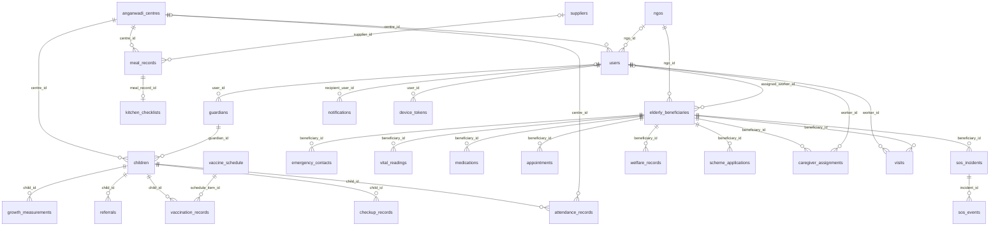
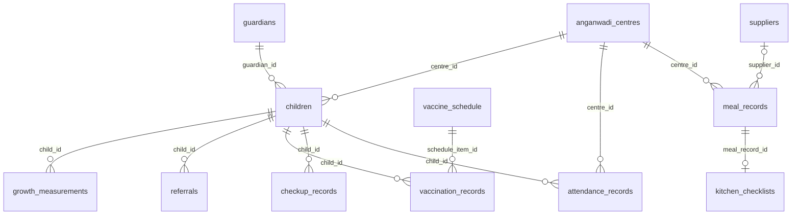
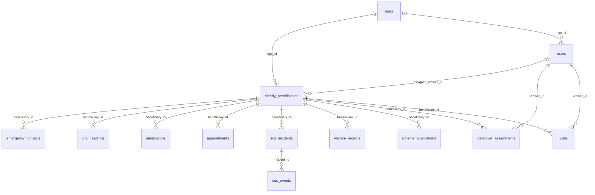

# Data Model

The MySQL 8 schema is owned by Flyway ([`V1__init.sql`](../backend/src/main/resources/db/migration/V1__init.sql),
[`V2__seed_uip_schedule.sql`](../backend/src/main/resources/db/migration/V2__seed_uip_schedule.sql)). JPA entities live in
`backend/src/main/java/in/jansetu/<module>/entity/`. Hibernate runs with `ddl-auto: validate`, so the app refuses to start if
entities and migrations disagree. Field-level detail for each table is in the **Data model** section of its module doc.

## Conventions

| Convention | Why |
|---|---|
| **`id CHAR(36)` UUID primary keys**, generated on the device for offline-created rows | No ID remapping after sync, retries are idempotent ([architecture.md](architecture.md#client-generated-uuids)) |
| Human-readable codes (`child_code`, `beneficiary_code`) assigned by the server on first sync | The device can't know the next serial number |
| Common columns on every table ([`BaseEntity`](../backend/src/main/java/in/jansetu/common/entity/BaseEntity.java)): `created_at`, `updated_at`, `created_by`, `updated_by`, `version`, `deleted` | Audit, last-write-wins (`updated_at`), optimistic locking (`version`), syncable soft delete (`deleted`) |
| **Soft delete only** | Deletes must sync to devices as tombstones and remain auditable |
| References are plain UUID columns (`child_id`) with DB foreign keys, not JPA `@ManyToOne` | Simple, explicit, sync-friendly payloads. Add JPA associations only where navigation is needed |
| Enums stored as `VARCHAR(30)` strings | Readable, and adding a value needs no `ALTER TABLE ... ENUM` |
| Times in UTC (`DATETIME(6)`), dates as `DATE` (IST calendar day) | Attendance/meals are per local day |
| `utf8mb4_unicode_ci` | Hindi (Devanagari) names |
| Derived values (z-scores, nutrition status) stored | Fast dashboards. Recomputed when inputs change |
| No Aadhaar, caste, religion or bank fields | Data minimisation ([privacy-and-security.md](privacy-and-security.md#data-minimisation-what-we-do-not-collect)) |
| **Never edit an applied migration.** Add `V3__…sql` | Flyway checksums |

## Complete ER diagram

Relationships only (columns are in the module docs). Actor columns such as `measured_by` / `recorded_by` → `users` are left out for readability.

### Pillar 1: Anganwadi children

### Pillar 2: Elderly women

## Entities

### Common & administration

| Table | JPA entity | Module | Description |
|---|---|---|---|
| `anganwadi_centres` | [`AnganwadiCentre`](../backend/src/main/java/in/jansetu/admin/entity/AnganwadiCentre.java) | [15](modules/15-admin-dashboard-reports.md#data-model) | An Anganwadi centre (AWC). Scope for AWW data. |
| `ngos` | [`Ngo`](../backend/src/main/java/in/jansetu/admin/entity/Ngo.java) | [15](modules/15-admin-dashboard-reports.md#data-model) | A partner NGO. Scope for NGW/NGA data. |
| `users` | [`User`](../backend/src/main/java/in/jansetu/auth/entity/User.java) | [01](modules/01-authentication.md#data-model) | Every login account, any of the 7 roles. `centre_id` / `ngo_id` give the data scope. |
| `refresh_tokens` | [`RefreshToken`](../backend/src/main/java/in/jansetu/auth/entity/RefreshToken.java) | [01](modules/01-authentication.md#data-model) | Hashed, rotating refresh tokens per device. |
| `otp_challenges` | [`OtpChallenge`](../backend/src/main/java/in/jansetu/auth/entity/OtpChallenge.java) | [01](modules/01-authentication.md#data-model) | Hashed OTPs with expiry and attempt count. |
| `notifications` | [`Notification`](../backend/src/main/java/in/jansetu/notification/entity/Notification.java) | [14](modules/14-notifications.md#data-model) | Push/SMS/in-app notifications and their delivery status. |
| `device_tokens` | [`DeviceToken`](../backend/src/main/java/in/jansetu/notification/entity/DeviceToken.java) | [14](modules/14-notifications.md#data-model) | FCM tokens per user device. |
| `sync_operations` | [`SyncOperation`](../backend/src/main/java/in/jansetu/sync/entity/SyncOperation.java) | [16](modules/16-offline-sync.md#data-model) | Processed client sync ops (idempotency + conflict audit). |
| `risk_alerts` | [`RiskAlert`](../backend/src/main/java/in/jansetu/analytics/entity/RiskAlert.java) | [13](modules/13-ai-analytics.md#data-model) | AI/rule-based risk alerts awaiting or after human review. |
| `health_cards` | [`HealthCard`](../backend/src/main/java/in/jansetu/healthcard/entity/HealthCard.java) | [06](modules/06-qr-health-card.md#data-model) | QR health card: random token id inside a signed QR, revocable. |

### Pillar 1 – Anganwadi children

| Table | JPA entity | Module | Description |
|---|---|---|---|
| `guardians` | [`Guardian`](../backend/src/main/java/in/jansetu/child/entity/Guardian.java) | [02](modules/02-child-management.md#data-model) | Parent/guardian of one or more children, with DPDP consent record. |
| `children` | [`Child`](../backend/src/main/java/in/jansetu/child/entity/Child.java) | [02](modules/02-child-management.md#data-model) | A child (0–6) enrolled at a centre. Anchor for Pillar 1. |
| `growth_measurements` | [`GrowthMeasurement`](../backend/src/main/java/in/jansetu/growth/entity/GrowthMeasurement.java) | [03](modules/03-growth-nutrition.md#data-model) | One weight/height/MUAC measurement with derived WHO z-scores and status (append-only). |
| `referrals` | [`Referral`](../backend/src/main/java/in/jansetu/growth/entity/Referral.java) | [03](modules/03-growth-nutrition.md#data-model) | Referral of a child to NRC/PHC/CHC/ANM with follow-up tracking. |
| `vaccine_schedule` | [`VaccineScheduleItem`](../backend/src/main/java/in/jansetu/vaccination/entity/VaccineScheduleItem.java) | [04](modules/04-vaccination-healthcare.md#data-model) | UIP master schedule (seeded by V2). |
| `vaccination_records` | [`VaccinationRecord`](../backend/src/main/java/in/jansetu/vaccination/entity/VaccinationRecord.java) | [04](modules/04-vaccination-healthcare.md#data-model) | One row per child per scheduled dose: due / given / missed / deferred. |
| `checkup_records` | [`CheckupRecord`](../backend/src/main/java/in/jansetu/vaccination/entity/CheckupRecord.java) | [04](modules/04-vaccination-healthcare.md#data-model) | Child health checkups and doctor visits. |
| `attendance_records` | [`AttendanceRecord`](../backend/src/main/java/in/jansetu/attendance/entity/AttendanceRecord.java) | [05](modules/05-attendance.md#data-model) | Daily present/absent per child (unique per child per day). |
| `suppliers` | [`Supplier`](../backend/src/main/java/in/jansetu/meal/entity/Supplier.java) | [07](modules/07-midday-meal-quality.md#data-model) | Food / THR suppliers. |
| `meal_records` | [`MealRecord`](../backend/src/main/java/in/jansetu/meal/entity/MealRecord.java) | [07](modules/07-midday-meal-quality.md#data-model) | Daily meal log per centre with ratings, photo and AI suggestion. |
| `kitchen_checklists` | [`KitchenChecklist`](../backend/src/main/java/in/jansetu/meal/entity/KitchenChecklist.java) | [07](modules/07-midday-meal-quality.md#data-model) | Daily kitchen hygiene checklist (1:1 with a meal record). |

### Pillar 2 – Elderly women

| Table | JPA entity | Module | Description |
|---|---|---|---|
| `elderly_beneficiaries` | [`ElderlyBeneficiary`](../backend/src/main/java/in/jansetu/elderly/entity/ElderlyBeneficiary.java) | [08](modules/08-elderly-registration.md#data-model) | An elderly woman supported by an NGO. Anchor for Pillar 2. |
| `emergency_contacts` | [`EmergencyContact`](../backend/src/main/java/in/jansetu/elderly/entity/EmergencyContact.java) | [08](modules/08-elderly-registration.md#data-model) | Family/neighbour contacts notified on SOS, in priority order. |
| `vital_readings` | [`VitalReading`](../backend/src/main/java/in/jansetu/elderlyhealth/entity/VitalReading.java) | [09](modules/09-elderly-healthcare.md#data-model) | BP / pulse / glucose readings (append-only). |
| `medications` | [`Medication`](../backend/src/main/java/in/jansetu/elderlyhealth/entity/Medication.java) | [09](modules/09-elderly-healthcare.md#data-model) | Current and past medicines, with reminder times. |
| `appointments` | [`Appointment`](../backend/src/main/java/in/jansetu/elderlyhealth/entity/Appointment.java) | [09](modules/09-elderly-healthcare.md#data-model) | Doctor appointments and their outcomes. |
| `sos_incidents` | [`SosIncident`](../backend/src/main/java/in/jansetu/sos/entity/SosIncident.java) | [10](modules/10-emergency-sos.md#data-model) | An SOS alert and its response status. |
| `sos_events` | [`SosEvent`](../backend/src/main/java/in/jansetu/sos/entity/SosEvent.java) | [10](modules/10-emergency-sos.md#data-model) | Timeline of an SOS incident (raised, notified, acknowledged, …). |
| `welfare_records` | [`WelfareRecord`](../backend/src/main/java/in/jansetu/welfare/entity/WelfareRecord.java) | [11](modules/11-welfare-ngo-assistance.md#data-model) | Assistance given (food, clothing, shelter, financial, legal aid, counselling, donation). |
| `scheme_applications` | [`SchemeApplication`](../backend/src/main/java/in/jansetu/welfare/entity/SchemeApplication.java) | [11](modules/11-welfare-ngo-assistance.md#data-model) | Government scheme applications and their status. |
| `caregiver_assignments` | [`CaregiverAssignment`](../backend/src/main/java/in/jansetu/caregiver/entity/CaregiverAssignment.java) | [12](modules/12-ngo-worker-caregiver.md#data-model) | History of which NGO worker is responsible for which beneficiary. |
| `visits` | [`Visit`](../backend/src/main/java/in/jansetu/caregiver/entity/Visit.java) | [12](modules/12-ngo-worker-caregiver.md#data-model) | Planned and completed home visits by NGO workers. |

`audit_logs` (not a `BaseEntity`, BIGINT auto-increment, append-only) is described in [privacy-and-security.md](privacy-and-security.md#audit-logging).

## Enumerations

| Used in | Values |
|---|---|
| `otp_challenges.purpose` | `LOGIN`, `REGISTER`, `RESET_PASSWORD` |
| `guardians.relation` | `MOTHER`, `FATHER`, `GRANDPARENT`, `OTHER` |
| `guardians.consent_method` | `SIGNED_FORM`, `OTP`, `THUMB_IMPRESSION` |
| `children.sex` | `MALE`, `FEMALE`, `OTHER` |
| `children.status` | `ACTIVE`, `TRANSFERRED`, `EXITED` |
| `growth_measurements.measurement_position` | `RECUMBENT`, `STANDING` |
| `growth_measurements.nutrition_status` | `NORMAL`, `MODERATE`, `SEVERE`, `NOT_ASSESSED` |
| `referrals.reason` | `SAM`, `MAM`, `GROWTH_FALTERING`, `ILLNESS`, `MISSED_VACCINE`, `OTHER` |
| `referrals.status` | `OPEN`, `VISITED`, `CLOSED`, `LOST_TO_FOLLOW_UP` |
| `vaccination_records.status` | `DUE`, `GIVEN`, `MISSED`, `DEFERRED` |
| `attendance_records.status` | `PRESENT`, `ABSENT` |
| `attendance_records.absence_reason` | `ILLNESS`, `MIGRATION`, `FAMILY_EVENT`, `UNKNOWN` |
| `health_cards.subject_type`, `risk_alerts.subject_type` | `CHILD`, `ELDERLY` |
| `meal_records.meal_type` | `MORNING_SNACK`, `HOT_COOKED_MEAL`, `TAKE_HOME_RATION` |
| `meal_records.ai_quality_label` | `ACCEPTABLE`, `POOR`, `UNCERTAIN` |
| `meal_records.review_status`, `risk_alerts.review_status` | `PENDING_REVIEW`, `CONFIRMED`, `DISMISSED` |
| `elderly_beneficiaries.marital_status` | `MARRIED`, `WIDOWED`, `SEPARATED`, `NEVER_MARRIED` |
| `elderly_beneficiaries.living_arrangement` | `ALONE`, `WITH_SPOUSE`, `WITH_FAMILY`, `CARE_HOME` |
| `elderly_beneficiaries.status` | `ACTIVE`, `INACTIVE`, `DECEASED` |
| `vital_readings.glucose_context` | `FASTING`, `POST_MEAL`, `RANDOM` |
| `appointments.status`, `visits.status` | `SCHEDULED`, `COMPLETED`, `MISSED`, `CANCELLED` |
| `sos_incidents.channel` | `APP`, `SMS`, `WORKER_ON_BEHALF` |
| `sos_incidents.status` | `RAISED`, `ACKNOWLEDGED`, `IN_PROGRESS`, `RESOLVED`, `FALSE_ALARM` |
| `sos_events.event_type` | `RAISED`, `NOTIFIED`, `ESCALATED`, `ACKNOWLEDGED`, `STATUS_CHANGED`, `NOTE_ADDED`, `RESOLVED` |
| `welfare_records.category` | `FOOD_RATION`, `CLOTHING`, `SHELTER`, `FINANCIAL`, `LEGAL_AID`, `REHABILITATION`, `COUNSELLING`, `DONATION` |
| `scheme_applications.status` | `DRAFT`, `SUBMITTED`, `UNDER_REVIEW`, `APPROVED`, `REJECTED`, `DISBURSED` |
| `risk_alerts.alert_type` | `MALNUTRITION_RISK`, `GROWTH_FALTERING`, `ELDERLY_HEALTH_RISK`, `MEAL_QUALITY` |
| `risk_alerts.risk_level` | `LOW`, `MEDIUM`, `HIGH` |
| `notifications.type` | `VACCINATION_DUE`, `MEDICINE_REMINDER`, `CHECKUP_DUE`, `MEAL_QUALITY`, `SOS`, `ATTENDANCE`, `WELFARE_UPDATE`, `CAREGIVER_FOLLOW_UP`, `RISK_ALERT`, `SYSTEM` |
| `notifications.channel` | `PUSH`, `SMS`, `IN_APP` |
| `notifications.status` | `QUEUED`, `SENT`, `FAILED`, `READ` |
| `sync_operations.operation` | `CREATE`, `UPDATE`, `DELETE` |
| `sync_operations.result` | `APPLIED`, `DUPLICATE`, `CONFLICT`, `REJECTED` |

## Open questions

Schema changes already identified for a **V3 migration** (each is marked `TODO(team)` in its module doc):

| Change | Module |
|---|---|
| `supervisor_jurisdictions (user_id, centre_id)` | [01](modules/01-authentication.md), [rbac-matrix.md](rbac-matrix.md) |
| `dob_estimated` flag on `children` | [02](modules/02-child-management.md) |
| `verified_by`, `verified_at` on `vaccination_records` | [04](modules/04-vaccination-healthcare.md) |
| `centre_closures (centre_id, date, reason)` | [05](modules/05-attendance.md) |
| `qr_access_grants`, card-signing key id | [06](modules/06-qr-health-card.md) |
| `menu_items` master with nutrition values, `photo_phash` on `meal_records` | [07](modules/07-midday-meal-quality.md) |
| `PENDING_APPROVAL` beneficiary status | [08](modules/08-elderly-registration.md) |
| `medication_doses` (adherence) | [09](modules/09-elderly-healthcare.md) |
| `reason` on `sos_incidents`, SOS device registrations | [10](modules/10-emergency-sos.md) |
| `donations`, `schemes`, `application_documents` | [11](modules/11-welfare-ngo-assistance.md) |
| Generic `tasks` table, `worker_areas` | [12](modules/12-ngo-worker-caregiver.md) |
| `ml_models` registry, `MEAL` subject type | [13](modules/13-ai-analytics.md) |
| `report_exports` jobs | [15](modules/15-admin-dashboard-reports.md) |