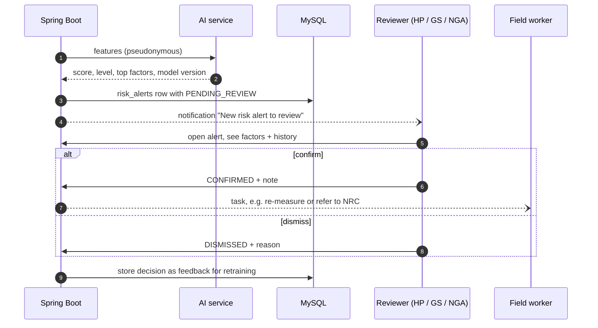

# ML Overview

JanSetu uses machine learning to **help humans prioritise**, never to decide. This document covers each use case: model choice,
features, data needs, evaluation and how predictions reach a human reviewer. Module-level detail is in
[Module 13 – AI-Based Intelligence & Analytics](modules/13-ai-analytics.md).

## Principles

1. **Human-in-the-loop, always.** Every prediction becomes a `risk_alerts` row with `review_status = PENDING_REVIEW`. A Healthcare
   Professional, Government Supervisor or NGO Administrator confirms or dismisses it. No model output changes a nutrition status,
   creates a referral, changes welfare eligibility or closes an SOS by itself.
2. **Rules before models.** Where clinical guidelines already give a clear answer (WHO z-score cut-offs, MUAC < 11.5 cm, oedema,
   BP ≥ 180/120), we use the rule, and it always applies regardless of the model. ML is for *ranking* and *early warning* where rules are weak.
3. **Interpretable first.** Logistic Regression and Random Forest with feature importances. Reviewers see the top factors in plain language
   ("weight-for-age dropped 0.8 SD in 2 months").
4. **No real data until approved.** Phase I uses synthetic data and public reference data. Training on field data requires consent and
   ethics approval ([privacy-and-security.md](privacy-and-security.md#research-ethics)).
5. **Pseudonymous inputs.** The AI service receives IDs and features. Names, phone numbers and addresses are never sent.
6. **Off the critical path.** If the AI service is down, records save normally and predictions are retried.

## Use cases at a glance

| # | Use case | Approach | Phase I deliverable | AI service endpoint |
|---|---|---|---|---|
| 1 | Malnutrition risk prediction | Logistic Regression (baseline) → Random Forest | Feature spec + synthetic-data notebook | `POST /v1/malnutrition/predict` |
| 2 | Growth trend analysis | WHO LMS z-scores + rules (not ML) | `lms_zscore()` implemented & tested | `POST /v1/growth/zscores` |
| 3 | Meal image quality analysis | OpenCV features + RF/SVM classifier | Pipeline design, labelling guide | `POST /v1/meal-image/analyze` |
| 4 | Nutritional adequacy | Rules vs. NFSA/Poshan 2.0 norms using food composition tables | Norms table + menu mapping design | (backend rule, no model) |
| 5 | Elderly health risk | Rules (Phase I) → Logistic Regression once data exists | Rule set | `POST /v1/elderly-risk/predict` |
| 6 | Risk-based prioritisation | Transparent weighted score over 1–5 | Formula | (backend) |
| 7 | Predictive analytics (dashboards) | Trends, moving averages, simple forecasts | Chart specs | (backend) |

## 1. Malnutrition risk prediction

**Question:** which children who are *not yet* moderately/severely malnourished are likely to become so (or to show growth faltering) in the next 90 days?

| Item | Detail |
|---|---|
| Candidate models | **Logistic Regression** (L2, class-weighted) as the baseline, **Random Forest** (≤ 200 trees, max_depth ≤ 8). Gradient boosting only if it clearly beats RF |
| Label | 1 if, within 90 days after the prediction date, WHZ < −2 **or** WAZ < −2 **or** WAZ drops ≥ 0.67 SD; else 0. TODO(team): confirm the label definition with a nutrition expert |
| Features | age (months), sex; latest WAZ, HAZ, WHZ; MUAC (6–59 m); change in WAZ over last 1 and 3 measurements; slope of WAZ (linear fit); months since last measurement; number of measurements; birth weight (low birth weight < 2.5 kg flag); attendance rate last 30 days; count of overdue vaccinations; recent illness/referral flag; calendar month (lean season); take-home ration received flag (if tracked) |
| Excluded features | Caste, religion, income, name, location below block level (fairness + DPDP s. 9: no profiling of children beyond care) |
| Output | `risk_score` 0–1, `risk_level` LOW / MEDIUM / HIGH, top 3 factors |
| Thresholds | Set together with supervisors based on **review capacity** (e.g. "top 10 % of each centre" or score ≥ 0.6). Stored in config, not code |

**Training data we still need: TODO(team)**
- Longitudinal growth records (≥ 3 measurements per child) with outcomes. Possible sources: partner Anganwadi registers (digitised with consent + ethics approval).
  Public **NFHS-5** microdata (DHS Program, registration required) is cross-sectional, so it is useful for pre-training/feature sanity checks only.
- Rough size: a few thousand children with follow-up. Until then, publish only the **rule-based** score and do not deploy a trained model.

**Evaluation metrics**
- **Recall (sensitivity) for the positive class** is the main metric, because missing a child who deteriorates is the costly error. Target agreed with experts (e.g. ≥ 0.80).
- Precision at the chosen threshold (review workload), **PR-AUC** (classes are imbalanced), ROC-AUC, **Brier score / calibration curve** (scores must mean what they say).
- Must beat the **rule-only baseline** (current WAZ < −1.5) on the same split, or we ship the rule.
- **Subgroup checks:** recall by sex, age band (0–2 / 2–6) and centre. A large gap blocks release.
- Validation: time-based split (train on earlier months, test on later), grouped by child so no child is in both sets.

## 2. Growth trend analysis (deterministic)

- Z-scores computed with the **WHO Child Growth Standards (2006) LMS method**: weight-for-age, length/height-for-age, weight-for-length/height,
  with the WHO restricted-tail adjustment for weight-based indicators beyond ±3 SD. Implemented in
  [`ai-service/app/models/zscore.py`](../ai-service/app/models/zscore.py) (formula done, tested). WHO tables to be added (TODO(team)).
- Same tables bundled in the app for offline calculation. The server value is authoritative.
- Classification: WHZ < −3 or oedema → **Severe**, −3 ≤ WHZ < −2 → **Moderate**, else Normal. MUAC < 11.5 cm → Severe, 11.5–12.5 → Moderate (6–59 months).
  Underweight (WAZ) and stunting (HAZ) are shown alongside.
- Trend rules: **growth faltering** = WAZ drop ≥ 0.67 SD between measurements ≤ 3 months apart, or no weight gain in 2 consecutive monthly measurements.
- Biologically implausible values flagged (WHO flags: WAZ < −6 or > 5, HAZ < −6 or > 6, WHZ < −5 or > 5). These ask the worker to re-measure; they are not stored as a diagnosis.

## 3. Meal image quality analysis

**Question:** does this photo of today's meal look acceptable, or should a supervisor check it?

| Stage | Method (OpenCV / scikit-learn) |
|---|---|
| Verification | Photo must come from the in-app camera (gallery disabled). Check EXIF/capture time = meal date. **Perceptual hash (pHash)** against the centre's last 60 photos, so a re-used photo is flagged |
| Image quality gate | Blur = variance of Laplacian. Brightness = mean V channel in HSV. Too blurry/dark → `UNCERTAIN` and the worker is asked to retake |
| Features | HSV colour histograms (food colour, burnt/discoloured), texture (Local Binary Patterns), edge density, fraction of plate covered (simple segmentation), dominant colours (k-means, k = 5) |
| Classifier | Random Forest or linear SVM on the features → P(POOR) |
| Output | `ACCEPTABLE` / `POOR` / `UNCERTAIN`, score, reasons |
| Not attempted | Judging hygiene, taste or nutrient content from a photo (not reliable). Those come from the worker's ratings + checklist |

**Data needed (TODO(team)):** ≥ 500 labelled photos, collected during the pilot, labelled by supervisors with a written labelling guide
(what counts as POOR: burnt, watery dal, visible insects/foreign matter, spoiled, much smaller quantity than menu). Two labellers on a subset, to measure agreement (Cohen's κ).

**Metrics:** F1 and recall for `POOR`, confusion matrix, share of photos marked `UNCERTAIN` (must stay low on real phones), inference time on the server (< 1 s).

## 4. Nutritional adequacy (rule-based)

- Compare what was served with **supplementary nutrition norms** under the National Food Security Act 2013, Schedule II / Poshan 2.0
  (e.g. children 3–6 years: ~500 kcal and 12–15 g protein per day from the Anganwadi; severely underweight children: ~800 kcal and 20–25 g protein).
  TODO(team): verify current norms and the state's menu with the ICDS partner.
- Menu items are picked from a list (not free text), each mapped to kcal/protein per standard serving using the
  **Indian Food Composition Tables (IFCT 2017, NIN)**. Adequacy = estimated per-child kcal/protein ÷ norm.
- Output: per-meal adequacy % and a weekly centre summary. Below 80 % for 3 days in a week → alert to GS.

## 5. Elderly health risk

- **Phase I: rules only.**
  - BP ≥ 180/120 → urgent (advise immediate medical help, notify NGW + HP).
  - BP ≥ 140/90 on 3 readings in 2 weeks → follow-up.
  - Glucose < 70 mg/dL → urgent hypoglycaemia advice.
  - Fasting ≥ 126 or random ≥ 200 repeatedly → follow-up.
  - Missed medicines ≥ 30 % in 2 weeks → follow-up.
  - TODO(team): validate thresholds with the partner doctor.
- **Later: Logistic Regression.** Features: age, lives alone, mean and variability of BP over 30 days, glucose readings, missed doses,
  missed appointments, SOS count in 90 days, days since last visit. Label: adverse health event (hospital visit, health SOS) within 90 days.
  Only once there is enough labelled data (TODO(team)).
- **Metrics:** same as use case 1 (recall first, PR-AUC, calibration, subgroup by age band and living arrangement).

## 6. Risk-based prioritisation

A **transparent score** orders each worker's daily list (children to re-measure, beneficiaries to visit):

```
priority = 40·[open HIGH alert] + 20·[open MEDIUM alert] + 15·[overdue vaccination or appointment]
         + 10·min(days since last visit / 30, 1) + 10·[lives alone] + 5·[pending welfare application]
```

Weights are config, reviewed with supervisors. The app shows *why* an item is at the top. No black box.

## 7. Predictive analytics for dashboards

Centre/NGO-level trends only (no individual predictions): monthly prevalence of Moderate/Severe with 3-month moving average, attendance
trends, meal-quality trend, SOS response times. Simple linear trend projection for planning (e.g. expected SAM cases next quarter), always shown with its uncertainty.

## How predictions are exposed and reviewed



- Alerts show: score as LOW/MEDIUM/HIGH (not a raw number), top factors, model name + version, and the banner
  **"Suggestion from AI – please check before acting"** (in Hindi and English).
- Reviewer decisions are stored and used as feedback labels, and dismissal rate is monitored. If > 70 % of HIGH alerts are dismissed, the threshold or model is revisited.
- **Model versioning:** each artefact has a version and a model card (data snapshot, features, metrics, limits), stored in `risk_alerts.model_version`.
- **Monitoring:** monthly drift check on input feature distributions per district. Re-evaluate before any retrained model is deployed.

## Repository layout

```
ai-service/
├── app/main.py            FastAPI app, API-key guard, /health
├── app/routers/           growth, malnutrition, meal_image, elderly_risk
├── app/models/            zscore.py (+ WHO tables, trained artefacts – not committed)
├── app/schemas/           Pydantic request/response models
├── notebooks/             exploration + training (outputs cleared)
├── data/                  README only – no real data in git
└── tests/                 pytest
```
