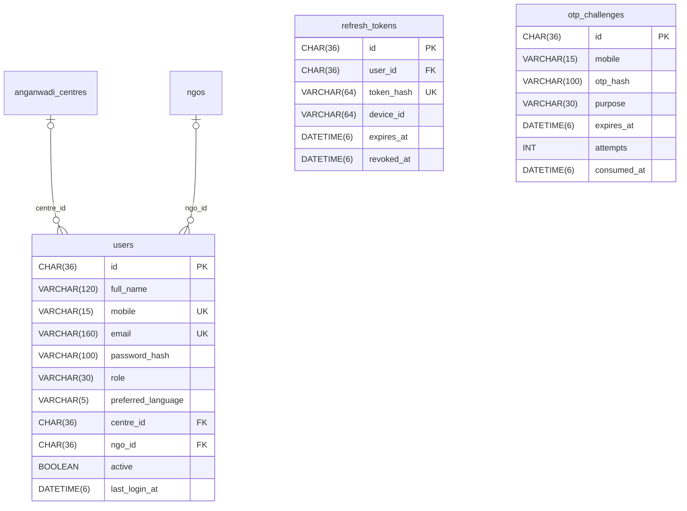
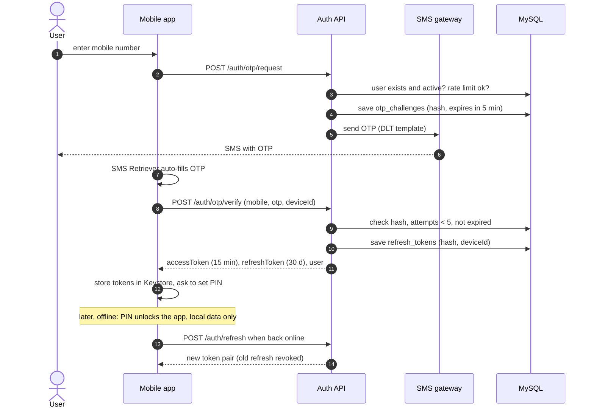

# Module 01: Authentication & User Management

- **Pillar:** 3 – Common AI, notifications, admin & offline sync
- **Priority:** High
- **Status:** Planned

## Overview

Every other module depends on knowing **who** the user is and **what they may see**. Users are Anganwadi workers, NGO field
workers, doctors/ANMs, parents, NGO coordinators and ICDS supervisors. Many of them use a shared, low-end Android phone, may not
have an email address, and are often offline for days.

So authentication is **mobile-number first with OTP**, with an optional password for staff. Sessions survive offline use
(local PIN unlock), and accounts are **created or approved by an administrator** rather than through open self-signup, so a
stranger cannot register as an Anganwadi worker and read children's records.

## User roles & permissions

| Role | View | Create | Edit | Delete | Approve |
|---|---|---|---|---|---|
| SA | All users | Any user, any role | Any user | Deactivate any | Activate accounts, reset roles |
| AWW | Own profile | — | Own profile, language, PIN | — | — |
| NGW | Own profile | — | Own profile | — | — |
| HP | Own profile | — | Own profile | — | — |
| PG | Own profile | Self-registration (needs AWW confirmation) | Own profile | Request account deletion | — |
| NGA | NGO staff | NGW accounts for own NGO | NGO staff | Deactivate NGO staff | Activate NGO staff |
| GS | Staff of centres in jurisdiction | AWW accounts for those centres | Those AWW accounts | Deactivate them | Activate AWW accounts, confirm PG links |

Role codes: see [rbac-matrix.md](../rbac-matrix.md#roles).

## Features

| Feature | Description |
|---|---|
| Mobile + OTP login | 6-digit OTP by SMS to a registered +91 number. Primary login for all roles |
| Password login | Optional for staff with email/password (SA, NGA, GS often use it on shared office PCs/phones) |
| Registration | Staff accounts are created by SA/NGA/GS. Parents can self-register with mobile + OTP, then the AWW confirms the link to their child |
| Forgot password | OTP to the registered mobile, then set a new password |
| Role-based login | After login the token carries the role, and the home screen shows only that role's modules ([`roles.ts`](../../mobile/src/constants/roles.ts)) |
| Profile | Name, mobile, email (optional), preferred language (Hindi/English), centre/NGO (read-only for the user) |
| Local app PIN | 4-digit PIN to unlock the app offline and after 5 min in the background (shared-phone protection) |
| Session management | 15-min access JWT + 30-day rotating refresh token per device. "Log out", "Log out all devices", admin "Revoke device" |
| Account lifecycle | Pending → Active → Deactivated. Deactivation revokes refresh tokens at once |

## User stories

1. As an **Anganwadi worker** with no email, I want to log in with my mobile number and an OTP so that I don't need to remember a password.
2. As an **Anganwadi worker**, I want the app to open with my PIN when there is no network so that I can keep working in the village.
3. As a **parent**, I want to register with my mobile number so that I can see my child's growth and vaccination record.
4. As a **Government Supervisor**, I want to create and deactivate Anganwadi worker accounts for my centres so that only current staff can access children's data.
5. As an **NGO Administrator**, I want to revoke a worker's lost phone so that nobody can use it to see beneficiaries' data.
6. As a **Super Admin**, I want to assign roles and centres/NGOs so that each user sees only what they are allowed to.
7. As any **user**, I want to choose Hindi or English so that I can understand every screen.

## Screens

| Screen | Key fields / actions |
|---|---|
| Language picker (first launch) | हिन्दी / English big buttons |
| Login | Mobile number (+91 prefix fixed, 10 digits), *Send OTP*, link *Use password instead* |
| OTP entry | 6 boxes, auto-read via Android SMS Retriever API (no SMS permission needed), *Resend in 30 s*, *Verify* |
| Password login | Mobile or email, password, *Forgot password?* |
| Forgot / reset password | Mobile → OTP → new password ×2 (min 8 chars) |
| Set app PIN | 4-digit PIN ×2 after the first successful login |
| PIN unlock | PIN pad, *Forgot PIN → login with OTP* (needs network) |
| Parent self-registration | Name, mobile, OTP, child's name + DOB + Anganwadi centre (to send a link request to the AWW) |
| Profile | Name, mobile, email, language, role & centre/NGO (read-only), *Change password*, *Log out*, *Log out all devices* |
| User management (SA/NGA/GS) | Search list (name/mobile/role), *Add user* (name, mobile, role, centre/NGO), activate/deactivate, revoke devices |

## Data model

<!-- DATA_MODEL: users, refresh_tokens, otp_challenges -->
<!-- generated:start -->

**`users`**: Every login account, any of the 7 roles. `centre_id` / `ngo_id` give the data scope. JPA entity: [`User`](../../backend/src/main/java/in/jansetu/auth/entity/User.java)

| Column | MySQL type | Null | Notes |
|---|---|---|---|
| `id` | `CHAR(36)` | no | PK, UUID (client-generated for offline-created rows) |
| `full_name` | `VARCHAR(120)` | no |  |
| `mobile` | `VARCHAR(15)` | no | unique; E.164, e.g. +919876543210 |
| `email` | `VARCHAR(160)` | yes | unique |
| `password_hash` | `VARCHAR(100)` | yes | BCrypt; null for OTP-only users |
| `role` | `VARCHAR(30)` | no |  |
| `preferred_language` | `VARCHAR(5)` | no | en | hi |
| `centre_id` | `CHAR(36)` | yes | FK → `anganwadi_centres.id`; Anganwadi workers/supervisors |
| `ngo_id` | `CHAR(36)` | yes | FK → `ngos.id`; NGO staff |
| `active` | `BOOLEAN` | no |  |
| `last_login_at` | `DATETIME(6)` | yes |  |

**`refresh_tokens`**: Hashed, rotating refresh tokens per device. JPA entity: [`RefreshToken`](../../backend/src/main/java/in/jansetu/auth/entity/RefreshToken.java)

| Column | MySQL type | Null | Notes |
|---|---|---|---|
| `id` | `CHAR(36)` | no | PK, UUID (client-generated for offline-created rows) |
| `user_id` | `CHAR(36)` | no | FK → `users.id` |
| `token_hash` | `VARCHAR(64)` | no | unique; SHA-256 of the opaque token |
| `device_id` | `VARCHAR(64)` | no |  |
| `expires_at` | `DATETIME(6)` | no |  |
| `revoked_at` | `DATETIME(6)` | yes |  |

**`otp_challenges`**: Hashed OTPs with expiry and attempt count. JPA entity: [`OtpChallenge`](../../backend/src/main/java/in/jansetu/auth/entity/OtpChallenge.java)

| Column | MySQL type | Null | Notes |
|---|---|---|---|
| `id` | `CHAR(36)` | no | PK, UUID (client-generated for offline-created rows) |
| `mobile` | `VARCHAR(15)` | no |  |
| `otp_hash` | `VARCHAR(100)` | no | never store the OTP itself |
| `purpose` | `VARCHAR(30)` | no | enum: `LOGIN`, `REGISTER`, `RESET_PASSWORD` |
| `expires_at` | `DATETIME(6)` | no |  |
| `attempts` | `INT` | no |  |
| `consumed_at` | `DATETIME(6)` | yes |  |

All tables also have the common columns `created_at`, `updated_at`, `created_by`, `updated_by`, `version`, `deleted`. See [data-model.md](../data-model.md#conventions). Schema: [`V1__init.sql`](../../backend/src/main/resources/db/migration/V1__init.sql).
<!-- generated:end -->

## API endpoints

`ROLE_SUPER_ADMIN` may call every endpoint and is omitted below (see [api-overview.md](../api-overview.md#authorization)).

| Method | Path | Description | Allowed roles |
|---|---|---|---|
| POST | `/api/v1/auth/otp/request` | Send OTP to `{mobile, purpose}` | public (rate-limited) |
| POST | `/api/v1/auth/otp/verify` | Verify OTP → access + refresh token + user | public (rate-limited) |
| POST | `/api/v1/auth/login` | Password login `{username, password, deviceId}` | public (rate-limited) |
| POST | `/api/v1/auth/refresh` | Rotate refresh token → new pair | public (valid refresh token) |
| POST | `/api/v1/auth/password/forgot` | Start reset (sends OTP) | public |
| POST | `/api/v1/auth/password/reset` | `{mobile, otp, newPassword}` | public |
| POST | `/api/v1/auth/logout` | Revoke this device's refresh token | any authenticated |
| POST | `/api/v1/auth/logout-all` | Revoke all own refresh tokens | any authenticated |
| POST | `/api/v1/auth/register/guardian` | Parent self-registration (after OTP) | public (OTP-verified) |
| GET | `/api/v1/users/me` | Own profile | any authenticated |
| PATCH | `/api/v1/users/me` | Update name, email, language | any authenticated |
| PUT | `/api/v1/users/me/password` | Change password | any authenticated |
| GET | `/api/v1/users` | List/search users in my scope | `ROLE_NGO_ADMIN`, `ROLE_GOVT_SUPERVISOR` |
| POST | `/api/v1/users` | Create staff user (role limited by caller) | `ROLE_NGO_ADMIN`, `ROLE_GOVT_SUPERVISOR` |
| PATCH | `/api/v1/users/{userId}` | Edit user / activate / deactivate | `ROLE_NGO_ADMIN`, `ROLE_GOVT_SUPERVISOR` |
| POST | `/api/v1/users/{userId}/revoke-sessions` | Revoke all devices of a user | `ROLE_NGO_ADMIN`, `ROLE_GOVT_SUPERVISOR` |
| PATCH | `/api/v1/users/{userId}/role` | Change role / centre / NGO | `ROLE_SUPER_ADMIN` only |

## Workflow

## Business rules & validation

- Mobile: Indian format `^[6-9]\d{9}$`, stored as E.164 `+91XXXXXXXXXX`, unique per user.
- OTP: 6 digits, valid 5 min, max 5 wrong attempts per challenge, max 3 requests per mobile per 15 min. Stored as a hash only.
- OTP login works **only for existing active users** (except `REGISTER` purpose for guardians). The response is the same whether or not the number exists (no account enumeration).
- Password: ≥ 8 characters, not equal to mobile number, BCrypt-hashed. 5 failed logins → 15 min lock.
- Refresh token: random 256-bit, stored as SHA-256 hash, **rotated** on every refresh. Reuse of an old token revokes all tokens of that device (theft detection).
- Who can create whom: SA → any role; GS → AWW for centres in jurisdiction; NGA → NGW for own NGO. Nobody can grant a role higher than their own.
- A user must have `centre_id` if AWW, and `ngo_id` if NGW or NGA. Enforced in the service.
- Guardian link: a PG account sees a child only after the AWW confirms that the mobile number matches `guardians.mobile` for that child.
- Deactivated users: refresh fails at once. Access tokens expire within 15 min (TODO(team): denylist cache for immediate cut-off).

## Offline behaviour

- **First login requires network.** After that the app works offline, unlocked by the local PIN, for up to **30 days** (refresh-token lifetime).
  After that the app becomes read-only until the user logs in online again.
- The cached profile (name, role, centre/NGO, language) is stored in the encrypted local DB. Tokens are stored in the Android Keystore.
- Role changes made by an admin take effect at the next refresh (≤ 15 min online).
- No auth data is queued in `sync_queue`. Profile edits made offline are queued as a normal `UPDATE users` op (only name/email/language).

## AI / ML

None.

## Notifications triggered

| Event | Channel | To |
|---|---|---|
| OTP | SMS | User |
| Account created / activated | SMS (+ push once the app is installed) | New user |
| Guardian link request | Push | AWW of the centre |
| Guardian link approved | Push / SMS | Parent |
| New login on another device | Push | User |
| Account deactivated | SMS | User |

## Privacy & security considerations

- No self-signup for staff roles. Accounts are created by accountable admins.
- Generic responses on OTP request and login prevent checking whether a number is registered.
- SMS Retriever API auto-reads the OTP **without** `READ_SMS` permission.
- Tokens never go into AsyncStorage or logs. Access JWT carries no personal data except IDs and role.
- Every login, failed login, role change, deactivation and session revocation is audited.
- Shared phones: PIN, auto-lock, `FLAG_SECURE`, and "Log out" offers to wipe local data. See [privacy-and-security.md](../privacy-and-security.md#access-control).
- SMS sending in India needs **DLT registration** of the sender ID and templates. TODO(team): choose a gateway and register.

## Dependencies on other modules

- Used by **all** modules (JWT principal, roles, scopes).
- [14 – Notifications](14-notifications.md): device tokens, SMS gateway.
- [02 – Child Management](02-child-management.md): guardian ↔ PG account link.
- [12 – NGO Worker & Caregiver Mgmt](12-ngo-worker-caregiver.md): NGW accounts are created here and allocated there.
- [15 – Admin Dashboard](15-admin-dashboard-reports.md): user management screens for SA/NGA/GS.

## Acceptance criteria

- [ ] A registered active user can log in with mobile + OTP. A wrong OTP 5 times locks that challenge.
- [ ] OTP request for an unknown number returns the same response as for a known one and sends nothing.
- [ ] More than 3 OTP requests in 15 min for the same number return `429`.
- [ ] Access token expires after 15 min. `/auth/refresh` returns a new pair, and the old refresh token no longer works.
- [ ] Reusing a rotated refresh token revokes all tokens for that device.
- [ ] A GS cannot create an NGA or SA account (`403`). An NGA cannot create users for another NGO (`404`).
- [ ] After deactivation, `/auth/refresh` fails for that user.
- [ ] With network off, a previously logged-in user can unlock with PIN and reach their home screen.
- [ ] All login screens work in Hindi and English.
- [ ] Every endpoint in the table above has a test for at least one allowed and one forbidden role.

## Future enhancements

- WhatsApp OTP as a cheaper alternative channel (where allowed).
- Biometric unlock (fingerprint) on devices that support it.
- Single sign-on with state ICDS / Poshan Tracker accounts, if an API becomes available.
- Voice-guided login for users with low literacy.
