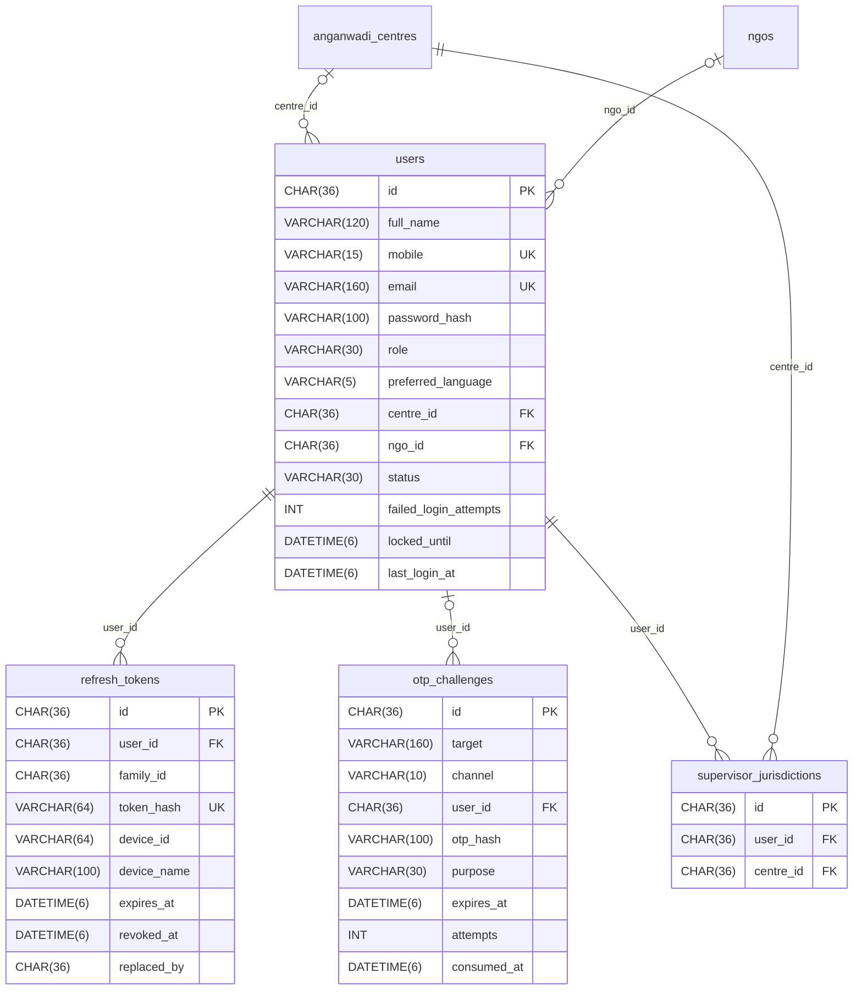
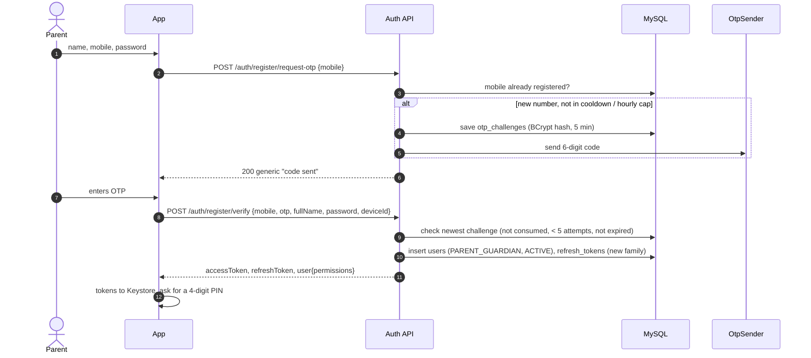
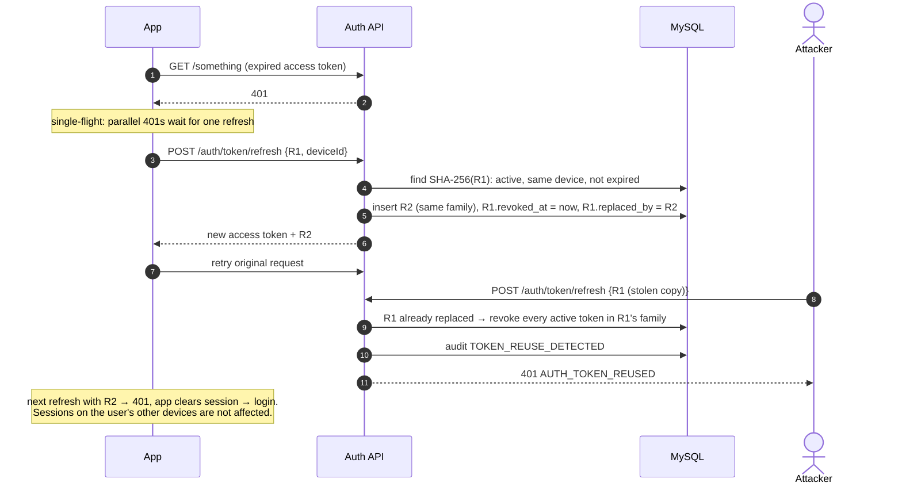
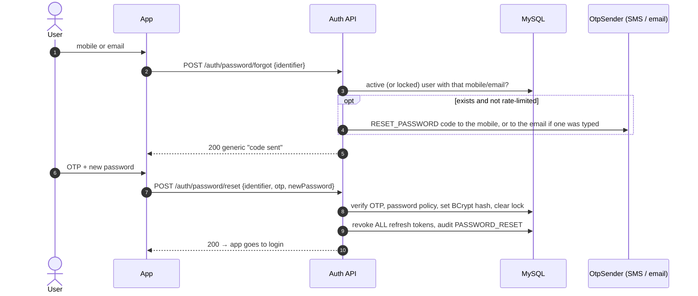

# Module 01: Authentication & User Management

- **Pillar:** 3 – Common AI, notifications, admin & offline sync
- **Priority:** High
- **Status:** Implemented (backend + mobile). SMS delivery is stubbed until a gateway is chosen (see [Open items](#open-items-todoteam)).

## Overview

Every other module depends on knowing **who** the user is and **what they may see**. Users are Anganwadi workers, NGO field
workers, doctors/ANMs, parents, NGO coordinators and ICDS supervisors. Many of them use a shared, low-end Android phone, may not
have an email address, and are often offline for days.

So authentication is **mobile-number first with OTP**, with an optional password for staff. Sessions survive offline use
(local PIN unlock), and accounts are **created or approved by an administrator** rather than through open self-signup, so a
stranger cannot register as an Anganwadi worker and read children's records.

## User roles & permissions

| Role | View | Create | Edit | Delete | Approve |
|---|---|---|---|---|---|
| SA | All users | Any user, any role | Any user | Deactivate any | Activate accounts, reset roles |
| AWW | Own profile | — | Own profile, language, PIN | — | — |
| NGW | Own profile | — | Own profile | — | — |
| HP | Own profile | — | Own profile | — | — |
| PG | Own profile | Self-registration (needs AWW confirmation) | Own profile | Request account deletion | — |
| NGA | NGO staff | NGW accounts for own NGO | NGO staff | Deactivate NGO staff | Activate NGO staff |
| GS | Staff of centres in jurisdiction | AWW accounts for those centres | Those AWW accounts | Deactivate them | Activate AWW accounts, confirm PG links |

Role codes: see [rbac-matrix.md](../rbac-matrix.md#roles).

## Features

| Feature | Description |
|---|---|
| Mobile + OTP login | 6-digit OTP to a registered +91 number. Default tab on the login screen |
| Password login | Mobile number **or** email + password. 5 failed attempts lock password login for 15 min (OTP login still works and clears the lock) |
| Parent self-registration | Mobile → OTP → name + password. The account is active at once; the link to a child is confirmed by the AWW in [Module 02](02-child-management.md) |
| Staff accounts | Created by SA / NGA / GS (scoped, see below) as `PENDING_ACTIVATION`. An activation OTP is sent; the user sets their own password on first login (`/auth/activate`) |
| Forgot password | OTP to the mobile (or to the email, if the user typed their email), then a new password. Ends every session |
| Role-based login | The login response carries `user.permissions` (module keys). The app builds its home menu from it; the server enforces access with `@PreAuthorize` + data scoping |
| Profile | Name, email, preferred language editable. Mobile, role, centre/NGO read-only |
| Local app PIN | 4-digit PIN set after the first login, salted hash in the Keystore. Asked on every app open and after 5 min in the background. 5 wrong PINs wipe the local session |
| Session management | 15-min access JWT + 30-day opaque refresh token, one session per device, rotated on every refresh. "Log out", "Log out all devices", "Active devices" (end any one). Admin DISABLE ends all sessions |
| Account lifecycle | `PENDING_ACTIVATION` → `ACTIVE` ⇄ `LOCKED` (auto, 15 min) / `DISABLED` (admin) |
| First SUPER_ADMIN | Seeded on startup from `SUPERADMIN_*` env vars if no SUPER_ADMIN exists. Outside the `dev` profile, startup fails if they are missing or the password is weak |

## User stories

1. As an **Anganwadi worker** with no email, I want to log in with my mobile number and an OTP so that I don't need to remember a password.
2. As an **Anganwadi worker**, I want the app to open with my PIN when there is no network so that I can keep working in the village.
3. As a **parent**, I want to register with my mobile number so that I can see my child's growth and vaccination record.
4. As a **Government Supervisor**, I want to create and deactivate Anganwadi worker accounts for my centres so that only current staff can access children's data.
5. As an **NGO Administrator**, I want to revoke a worker's lost phone so that nobody can use it to see beneficiaries' data.
6. As a **Super Admin**, I want to assign roles and centres/NGOs so that each user sees only what they are allowed to.
7. As any **user**, I want to choose Hindi or English so that I can understand every screen.

## Screens

All in [`mobile/src/screens/auth`](../../mobile/src/screens/auth) and [`mobile/src/screens/profile`](../../mobile/src/screens/profile). Hindi and English.

| Screen | Key fields / actions |
|---|---|
| Welcome (first launch) | हिन्दी / English big buttons |
| Login | Tabs **OTP** (mobile → Send OTP) and **Password** (mobile or email + password, *Forgot password?*). Links: parent sign-up, staff activation. Offline banner |
| OTP verify | 6 boxes (SMS autofill), *Resend* after 60 s, *Verify* |
| Parent sign-up | Name, mobile, password ×2 → OTP verify |
| Account activation | Mobile → OTP + new password ×2 |
| Forgot / reset password | Mobile or email → OTP + new password ×2 |
| Set PIN / PIN unlock | 4 boxes; *Forgot PIN → sign in again* (needs network) |
| Profile | Mobile, role, centre/NGO (read-only); name, email, language; *Change password*, *Active devices*, *Log out*, *Log out of all devices* |
| Active devices | List of sessions, "this phone" marked, *Log out this device* on the others |
| User management (SA/NGA/GS) | API only for now (`/admin/users`); screens belong to [Module 15](15-admin-dashboard-reports.md) |

## Data model

<!-- DATA_MODEL: users, refresh_tokens, otp_challenges, supervisor_jurisdictions -->
<!-- generated:start -->


**`users`**: Every login account, any of the 7 roles. `centre_id` (AWW) / `ngo_id` (NGW, NGA) give the data scope; GS scope is `supervisor_jurisdictions`. JPA entity: [`User`](../../backend/src/main/java/in/jansetu/auth/entity/User.java)

| Column | MySQL type | Null | Notes |
|---|---|---|---|
| `id` | `CHAR(36)` | no | PK, UUID |
| `full_name` | `VARCHAR(120)` | no |  |
| `mobile` | `VARCHAR(15)` | no | unique; E.164, e.g. +919876543210 |
| `email` | `VARCHAR(160)` | yes | unique; stored lower-case |
| `password_hash` | `VARCHAR(100)` | yes | BCrypt (12); null until an admin-created user activates |
| `role` | `VARCHAR(30)` | no | enum `Role` |
| `preferred_language` | `VARCHAR(5)` | no | en \| hi |
| `centre_id` | `CHAR(36)` | yes | FK → `anganwadi_centres.id`; required for AWW, null otherwise |
| `ngo_id` | `CHAR(36)` | yes | FK → `ngos.id`; required for NGW / NGA, null otherwise |
| `status` | `VARCHAR(30)` | no | enum: `PENDING_ACTIVATION`, `ACTIVE`, `LOCKED`, `DISABLED` |
| `failed_login_attempts` | `INT` | no | reset on success; 5 → lock |
| `locked_until` | `DATETIME(6)` | yes | password login blocked until then |
| `last_login_at` | `DATETIME(6)` | yes |  |

**`refresh_tokens`**: Opaque refresh tokens, stored as SHA-256. One rotation chain (`family_id`) per login on a device. JPA entity: [`RefreshToken`](../../backend/src/main/java/in/jansetu/auth/entity/RefreshToken.java)

| Column | MySQL type | Null | Notes |
|---|---|---|---|
| `id` | `CHAR(36)` | no | PK, UUID; also the session id in `/auth/sessions` |
| `user_id` | `CHAR(36)` | no | FK → `users.id` |
| `family_id` | `CHAR(36)` | no | rotation chain; reuse of a rotated token revokes the family |
| `token_hash` | `VARCHAR(64)` | no | unique; SHA-256 hex of the token |
| `device_id` | `VARCHAR(64)` | no | stable id generated by the app on first launch |
| `device_name` | `VARCHAR(100)` | yes | e.g. "Android 14" |
| `expires_at` | `DATETIME(6)` | no | 30 days after issue |
| `revoked_at` | `DATETIME(6)` | yes | set on rotation, logout, reset, disable, reuse |
| `replaced_by` | `CHAR(36)` | yes | id of the token issued when this one was rotated |

**`otp_challenges`**: Hashed OTPs. Only the newest challenge per target + purpose is valid. Deleted after 24 h. JPA entity: [`OtpChallenge`](../../backend/src/main/java/in/jansetu/auth/entity/OtpChallenge.java)

| Column | MySQL type | Null | Notes |
|---|---|---|---|
| `id` | `CHAR(36)` | no | PK, UUID |
| `target` | `VARCHAR(160)` | no | E.164 mobile or lower-case email |
| `channel` | `VARCHAR(10)` | no | enum: `SMS`, `EMAIL` |
| `user_id` | `CHAR(36)` | yes | FK → `users.id`; null for `REGISTER` |
| `otp_hash` | `VARCHAR(100)` | no | BCrypt; never the OTP itself |
| `purpose` | `VARCHAR(30)` | no | enum: `LOGIN`, `REGISTER`, `RESET_PASSWORD`, `ACTIVATION` |
| `expires_at` | `DATETIME(6)` | no | 5 min after issue |
| `attempts` | `INT` | no | wrong codes; 5 burns the challenge |
| `consumed_at` | `DATETIME(6)` | yes |  |

**`supervisor_jurisdictions`**: Centres a GOVT_SUPERVISOR covers. Set by SUPER_ADMIN. JPA entity: [`SupervisorJurisdiction`](../../backend/src/main/java/in/jansetu/auth/entity/SupervisorJurisdiction.java)

| Column | MySQL type | Null | Notes |
|---|---|---|---|
| `id` | `CHAR(36)` | no | PK, UUID |
| `user_id` | `CHAR(36)` | no | FK → `users.id`; unique with `centre_id` |
| `centre_id` | `CHAR(36)` | no | FK → `anganwadi_centres.id` |

All tables also have the common columns `created_at`, `updated_at`, `created_by`, `updated_by`, `version`, `deleted`. See [data-model.md](../data-model.md#conventions). Schema: [`V1__init.sql`](../../backend/src/main/resources/db/migration/V1__init.sql) + [`V3__auth.sql`](../../backend/src/main/resources/db/migration/V3__auth.sql). Auth events go to `audit_logs` (`entity_type = USER`, with `ip` and `device_id`).
<!-- generated:end -->

## API endpoints

Base path `/api/v1`. Live contract: Swagger UI (`/swagger-ui.html`), tags *Authentication*, *My profile*, *User management*.
Endpoints marked **(generic)** return the same body whether or not the account exists.

| Method | Path | Body → response | Access |
|---|---|---|---|
| POST | `/auth/register/request-otp` | `{mobile}` → OTP sent **(generic)** | public |
| POST | `/auth/register/verify` | `{mobile, otp, fullName, password, preferredLanguage?, deviceId, deviceName?}` → `AuthResponse` | public |
| POST | `/auth/login` | `{identifier, password, deviceId, deviceName?}` (identifier = mobile or email) → `AuthResponse` | public |
| POST | `/auth/login/otp/request` | `{mobile}` → OTP sent **(generic)** | public |
| POST | `/auth/login/otp/verify` | `{mobile, otp, deviceId, deviceName?}` → `AuthResponse` | public |
| POST | `/auth/activate/request-otp` | `{mobile}` → new activation OTP **(generic)** | public |
| POST | `/auth/activate` | `{mobile, otp, newPassword, deviceId, deviceName?}` → `AuthResponse` | public |
| POST | `/auth/password/forgot` | `{identifier}` → OTP sent **(generic)** | public |
| POST | `/auth/password/reset` | `{identifier, otp, newPassword}` → ends all sessions | public |
| POST | `/auth/token/refresh` | `{refreshToken, deviceId}` → new `AuthResponse` (rotated) | public (valid refresh token) |
| POST | `/auth/logout` | – → ends this device's session | any authenticated |
| POST | `/auth/logout-all` | – → ends every session | any authenticated |
| GET | `/auth/sessions` | → `[{id, deviceId, deviceName, lastRefreshedAt, expiresAt, current}]` | any authenticated |
| DELETE | `/auth/sessions/{sessionId}` | ends one of my sessions | any authenticated |
| GET | `/users/me` | → `UserDto` | any authenticated |
| PATCH | `/users/me` | `{fullName?, email?, preferredLanguage?}` → `UserDto` | any authenticated |
| POST | `/users/me/password` | `{currentPassword, newPassword}`; other devices logged out | any authenticated |
| POST | `/users/me/device-token` | `{fcmToken, platform}` (FCM, Module 14) | any authenticated |
| POST | `/admin/users` | `{fullName, mobile, email?, role, centreId?, ngoId?, jurisdictionCentreIds?, preferredLanguage?}` → `AdminUserDto` | SA, NGA, GS (scoped) |
| GET | `/admin/users` | `?role&status&ngoId&centreId&q&page&size&sort` → `PageResponse<AdminUserDto>` | SA, NGA, GS (scoped) |
| GET | `/admin/users/{userId}` | → `AdminUserDto` | SA, NGA, GS (scoped) |
| PATCH | `/admin/users/{userId}` | `{fullName?, email?, preferredLanguage?, role?, centreId?, ngoId?, jurisdictionCentreIds?}` | SA, NGA, GS (scoped; role/NGO/jurisdiction SA only) |
| PATCH | `/admin/users/{userId}/status` | `{action: ACTIVATE \| DISABLE \| UNLOCK}`; DISABLE ends all sessions | SA, NGA, GS (scoped) |

`AuthResponse` = `{accessToken, refreshToken, expiresIn, user}` where `user` = `{id, fullName, mobile, email, role, status, permissions[], preferredLanguage, centreId, ngoId}`.
`permissions` are module keys (`child`, `growth`, …, `admin`) from [`Permissions`](../../backend/src/main/java/in/jansetu/auth/service/Permissions.java).

**Admin scoping** ([`UserAdminService`](../../backend/src/main/java/in/jansetu/auth/service/UserAdminService.java)):

| Caller | Can create | Can view | Can edit / change status |
|---|---|---|---|
| SA | any role (AWW needs `centreId`, NGW/NGA need `ngoId`, GS takes `jurisdictionCentreIds`) | everyone | everyone except themselves |
| NGA | `NGO_WORKER` for their own NGO only | users of their NGO | `NGO_WORKER`s of their NGO (not role / NGO) |
| GS | `ANGANWADI_WORKER` for a centre in their jurisdiction | users of those centres | those AWWs (centre only within jurisdiction) |

Outside the view scope → `404`; visible but not manageable, or a forbidden role → `403`.

### Error codes

| HTTP | `error.code` | When |
|---|---|---|
| 400 | `VALIDATION_FAILED` | Bean Validation / malformed JSON |
| 400 | `AUTH_OTP_INVALID` / `AUTH_OTP_EXPIRED` / `AUTH_OTP_ATTEMPTS_EXCEEDED` | wrong / expired (> 5 min) / 5 wrong codes |
| 400 | `AUTH_PASSWORD_POLICY` | < 8 chars, no letter or no digit, > 72 bytes |
| 400 | `AUTH_PASSWORD_INCORRECT` | change password: current password wrong |
| 401 | `UNAUTHORIZED` | missing / invalid / expired access token |
| 401 | `AUTH_INVALID_CREDENTIALS` | unknown user, wrong password, or no password yet (same answer for all) |
| 401 | `AUTH_REFRESH_INVALID` | refresh token unknown, expired, logged out, or for another device |
| 401 | `AUTH_TOKEN_REUSED` | an already-rotated refresh token was presented; that token family is revoked |
| 403 | `AUTH_ACCOUNT_DISABLED` / `AUTH_ACTIVATION_REQUIRED` | after a correct password |
| 403 | `FORBIDDEN` | role not allowed |
| 404 | `NOT_FOUND` | not found or outside your scope |
| 409 | `ALREADY_EXISTS` | mobile or email already used |
| 422 | `BUSINESS_RULE` | admin tries to change their own account through `/admin/users` |
| 423 | `AUTH_ACCOUNT_LOCKED` | 5 failed password logins, for 15 min |
| 429 | `RATE_LIMITED` | per-IP or per-mobile/email limit on `/auth/**` |

## Workflows

### Parent sign-up



### Login (password or OTP)

```mermaid
sequenceDiagram
    autonumber
    actor U as User
    participant App
    participant API as Auth API
    participant DB as MySQL

    alt password
        U->>App: mobile/email + password
        App->>API: POST /auth/login {identifier, password, deviceId}
        API->>DB: find user; locked_until in the future? → 423
        alt wrong password
            API->>DB: failed_login_attempts++ (5 → LOCKED for 15 min)
            API-->>App: 401 AUTH_INVALID_CREDENTIALS / 423
        end
    else OTP
        U->>App: mobile
        App->>API: POST /auth/login/otp/request (generic)
        U->>App: OTP
        App->>API: POST /auth/login/otp/verify {mobile, otp, deviceId}
    end
    API->>DB: status ACTIVE? revoke older tokens of this device, new refresh token family
    API->>DB: audit LOGIN_SUCCESS
    API-->>App: accessToken (15 min), refreshToken (30 d), user{role, permissions}
    App->>App: home menu from permissions
```

### Refresh with rotation and reuse detection



### Forgot / reset password



## Business rules & validation

- **Mobile:** `^[6-9]\d{9}$` (with or without `+91`), stored as E.164 `+91XXXXXXXXXX`, unique. Emails are stored lower-case and matched case-insensitively.
- **Password:** ≥ 8 characters with at least one letter and one digit, ≤ 72 bytes; BCrypt strength 12 ([`PasswordPolicy`](../../backend/src/main/java/in/jansetu/auth/service/PasswordPolicy.java), mirrored in `mobile/src/utils/validation.ts`).
- **Lockout:** 5 failed password logins → `LOCKED` for 15 min. A successful OTP login, password reset or admin UNLOCK clears it.
- **OTP:** 6 digits from `SecureRandom`, BCrypt-hashed, 5 min validity, 5 wrong attempts burn the challenge, only the newest challenge per target + purpose is valid.
  Resend cooldown **60 s per target + purpose**; at most **5 OTPs per target per hour** (all purposes). Inside the cooldown/cap nothing is sent but the response is still the generic one.
- **No enumeration:** OTP-request and forgot-password endpoints answer identically for unknown numbers; password login answers `AUTH_INVALID_CREDENTIALS` for unknown users and users without a password (with a dummy BCrypt check for equal timing).
- **Rate limits** ([`AuthRateLimits`](../../backend/src/main/java/in/jansetu/security/ratelimit/AuthRateLimits.java)): 30 requests/min per IP on `/auth/**`, 10 per 15 min per mobile/email on endpoints that take one. Both env-configurable. In-memory, per instance (see [architecture.md](../architecture.md#cross-cutting-concerns)).
- **Access token:** HS256 JWT, 15 min, claims `sub` (user id), `role`, `centreId`, `ngoId`, `did` (device id), `jti`. No personal data.
- **Refresh token:** 256-bit random, base64url, stored as SHA-256 only, 30 days, bound to `deviceId`. One active session per user + device (a new login on the same device ends the old one). Rotated on every refresh; reuse of a rotated token revokes **that token family only** (not the user's other devices) and is audited as `TOKEN_REUSE_DETECTED`. Shared low-end phones make "log out everywhere" on one replay too disruptive.
- **Who can create whom:** see the scoping table above. Admin-created users start `PENDING_ACTIVATION` with no password.
- **Role change:** SA only; takes effect at the user's next refresh (≤ 15 min). Audited as `ROLE_CHANGED`.
- **Disable:** ends every refresh token at once; access tokens stay valid until they expire (≤ 15 min, TODO(team): denylist).
- **Audit:** `LOGIN_SUCCESS`, `LOGIN_FAILED`, `ACCOUNT_LOCKED`, `PASSWORD_RESET`, `PASSWORD_CHANGED`, `ACCOUNT_ACTIVATED`, `LOGOUT`, `LOGOUT_ALL`, `SESSION_REVOKED`, `TOKEN_REUSE_DETECTED`, `USER_CREATED`, `USER_UPDATED`, `ROLE_CHANGED`, `USER_STATUS_CHANGED`, with IP and device id. OTPs, passwords and tokens are never logged; only the `dev` profile prints OTPs to the console.

## Offline behaviour

- **Login, sign-up, activation and reset need network.** The screens show an offline banner and a clear error.
- After login the session (tokens + profile) is kept in the Keystore. On every app start the app opens **behind the PIN**, also offline, for up to 30 days (the refresh-token lifetime); after that the user must log in online again.
- The PIN is asked on app open and after 5 min in the background. **5 wrong PINs wipe the local session** (tokens, profile, PIN); the count survives restarts.
- When online again, the API client refreshes the access token on the first `401` (single-flight). A rejected refresh logs the user out; a network failure keeps the session.
- "Log out" works offline (wipes the phone; the server session expires on its own). "Log out of all devices" needs network.
- No auth data is queued in `sync_queue`.

## AI / ML

None.

## Notifications triggered

| Event | Channel | To |
|---|---|---|
| OTP | SMS | User |
| Account created / activated | SMS (+ push once the app is installed) | New user |
| Guardian link request | Push | AWW of the centre |
| Guardian link approved | Push / SMS | Parent |
| New login on another device | Push | User |
| Account deactivated | SMS | User |

## Privacy & security considerations

- No self-signup for staff roles. Accounts are created by accountable admins and scoped to their NGO / centres.
- Generic responses and existence-independent rate limits on OTP and forgot-password endpoints prevent checking whether a number is registered.
- OTP and refresh tokens are stored only as hashes; passwords as BCrypt(12); the app PIN as a salted SHA-256 in the Keystore.
- Tokens never go into AsyncStorage or logs. The access JWT carries no personal data.
- Every login, failed login, lock, role change, deactivation and session revocation is audited.
- Shared phones: PIN, auto-lock after 5 min, wipe after 5 wrong PINs. See [privacy-and-security.md](../privacy-and-security.md#access-control).
- SMS sending in India needs **DLT registration** of the sender ID and templates.

## Dependencies on other modules

- Used by **all** modules (JWT principal, roles, scopes).
- [14 – Notifications](14-notifications.md): device tokens, SMS gateway.
- [02 – Child Management](02-child-management.md): guardian ↔ PG account link.
- [12 – NGO Worker & Caregiver Mgmt](12-ngo-worker-caregiver.md): NGW accounts are created here and allocated there.
- [15 – Admin Dashboard](15-admin-dashboard-reports.md): user management screens for SA/NGA/GS.

## Acceptance criteria

Covered by `backend/src/test/java/in/jansetu/it/*IT.java` (Testcontainers MySQL) and unit tests.

- [x] A registered active user can log in with mobile + OTP. A wrong OTP 5 times burns that challenge.
- [x] OTP request for an unknown number returns the same response as for a known one and sends nothing.
- [x] OTP requests are limited (60 s cooldown, 5 per hour per number; 10 auth calls per 15 min per number → `429`).
- [x] Access token expires after 15 min. `/auth/token/refresh` returns a new pair, and the old refresh token no longer works.
- [x] Reusing a rotated refresh token revokes that token family (other devices keep working).
- [x] A GS cannot create an NGA or SA account (`403`). An NGA cannot create users for another NGO (`404`).
- [x] After deactivation, `/auth/token/refresh` fails for that user.
- [x] 5 wrong passwords lock password login for 15 min.
- [x] With network off, a previously logged-in user can unlock with PIN and reach their home screen.
- [x] All auth screens work in Hindi and English.
- [ ] Manual test on a low-end Android phone (small screen, Hindi). TODO(team) before the pilot.

## Open items (TODO(team))

- **SMS gateway:** [`SmsOtpSender`](../../backend/src/main/java/in/jansetu/auth/otp/SmsOtpSender.java) is a stub (MSG91 / Twilio / Fast2SMS, DLT registration). Until then OTPs are only delivered in the `dev` profile (console) or by email.
- **Access-token denylist** for immediate cut-off after DISABLE (today ≤ 15 min).
- **Rate limiter** is in-memory per instance; move to Redis / Bucket4j-Redis before running more than one backend instance.
- **`FLAG_SECURE`** (hide content in the app switcher) needs a small native module.
- **Admin user-management screens** in the app ([Module 15](15-admin-dashboard-reports.md)); the API is ready.
- **Parent ↔ child link** confirmation by the AWW ([Module 02](02-child-management.md)).
- **Logout and local data:** decide whether logout also wipes the local SQLite DB on shared phones.
- **Android SMS Retriever** (auto-read OTP without `READ_SMS`) needs the app hash in the SMS template once the gateway is chosen; the OTP box already accepts SMS autofill.

## Future enhancements

- WhatsApp OTP as a cheaper alternative channel (where allowed).
- Biometric unlock (fingerprint) on devices that support it.
- Single sign-on with state ICDS / Poshan Tracker accounts, if an API becomes available.
- Voice-guided login for users with low literacy.
