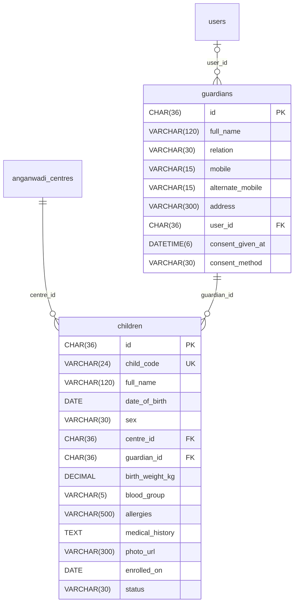
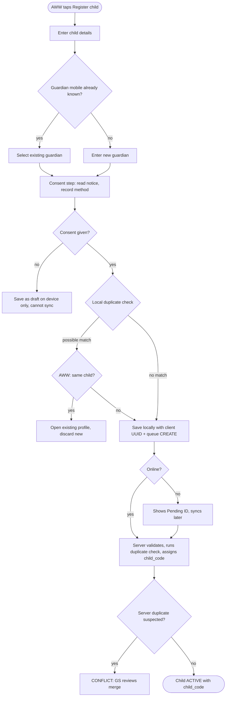

# Module 02: Anganwadi Child Management

- **Pillar:** 1 – Anganwadi child health & nutrition
- **Priority:** High
- **Status:** Planned

## Overview

Anganwadi centres (AWCs) under ICDS / Saksham Anganwadi & Poshan 2.0 serve children aged 0–6. Today, children's details sit in
paper registers that are hard to search, get damaged, and cannot be shared with the ANM or doctor at a referral. When a family
migrates seasonally, the child's history is lost.

This module is the **digital child register**: each child gets a unique ID, a profile with guardian details, allergies and medical
history, and becomes the anchor for growth ([03](03-growth-nutrition.md)), vaccination ([04](04-vaccination-healthcare.md)),
attendance ([05](05-attendance.md)) and the QR card ([06](06-qr-health-card.md)). It must work fully offline on the AWW's phone.

## User roles & permissions

| Role | View | Create | Edit | Delete | Approve |
|---|---|---|---|---|---|
| SA | All | Yes | Yes | Soft-delete | Merges |
| AWW | Children of own centre | Register child + guardian | Profile, guardian, status (exit/transfer) | — | — |
| HP | Referred children / via QR grant | — | — (health data goes in [04](04-vaccination-healthcare.md)) | — | — |
| PG | Own child(ren) | — | Request correction | — | — |
| GS | Children in jurisdiction | — | — | — | Duplicate merges, transfers between centres |
| NGW, NGA | — | — | — | — | — |

## Features

| Feature | Description |
|---|---|
| Register child | Name, DOB (or approximate age, flagged as estimated), sex, birth weight, centre (auto = AWW's centre), guardian, consent |
| Guardian info | Name, relation, mobile, alternate mobile, address. One guardian can have several children (siblings share the record) |
| Guardian consent | Mandatory consent step (DPDP s. 9) with method recorded: signed form photo, OTP to the guardian's phone, or thumb impression |
| Unique child ID | Server-assigned `child_code` = `<AWC code>-<4-digit serial>`, e.g. `AWC0412-0031`. Shown as "Pending ID" until first sync. The UUID is the real key |
| Child profile | Summary card: age (auto-calculated), latest nutrition status, next vaccine due, attendance this month, allergies banner |
| Medical history & allergies | Free text + common-allergy chips (milk, peanut, egg, medicine). Allergies are shown in red on every child screen |
| Digital health records | Timeline that combines growth, vaccinations, checkups and referrals from modules 03/04 |
| Search & filter | By name (Hindi/English, typo-tolerant), child code, guardian mobile, age band (0–6 m, 6 m–3 y, 3–6 y), nutrition status, status |
| Status lifecycle | `ACTIVE` → `TRANSFERRED` (to another AWC) / `EXITED` (turned 6, migrated, died: reason recorded) |
| Duplicate check | On save, warns if a similar child exists (same guardian mobile + DOB, or similar name + DOB) |

## User stories

1. As an **Anganwadi worker**, I want to register a newborn at a home visit without network so that the child is tracked from birth.
2. As an **Anganwadi worker**, I want to find a child by the mother's mobile number so that I don't scroll through 80 names.
3. As an **Anganwadi worker**, I want to see a child's allergies in red on every screen so that I never serve food that harms them.
4. As a **parent**, I want to see my child's record and ID so that I can show it at the PHC.
5. As a **Government Supervisor**, I want to approve the transfer of a child whose family migrated to another village so that the history follows the child.
6. As a **Government Supervisor**, I want to review suspected duplicate registrations so that our counts are correct.
7. As a **Healthcare Professional**, I want to see the medical history of a referred child so that I can treat them safely.

## Screens

| Screen | Key fields / actions |
|---|---|
| **Child List** | Search bar (name / code / mobile), filter chips (age band, status, nutrition status), each row: name, age, sex icon, status colour dot, "Pending ID"/"Not synced" badge. FAB *Register child* |
| **Child Registration** (3 steps) | 1. Child: name, DOB or "Don't know DOB → age in months", sex, birth weight (optional). 2. Guardian: search existing by mobile **or** add new (name, relation, mobile, address). 3. Consent: notice read aloud (audio clip in Hindi), method picker, capture (photo of signed form / OTP / thumb), *Save*. Duplicate warning dialog if a match is found |
| **Child Profile** | Header: name, `child_code`, age, sex, centre. Red allergy banner. Tiles: Growth, Vaccination, Attendance, Health Card (QR). *Edit*, *Mark exited / transferred* |
| **Health History** | Timeline (newest first) of measurements, vaccines, checkups, referrals. Filter by type. Tap to open the item in its module |
| Edit Child | Same fields as registration. DOB/sex changes require a reason (audited) |
| Guardian Detail | Guardian info + list of their children |

## Data model

<!-- DATA_MODEL: children, guardians -->
<!-- generated:start -->

**`children`**: A child (0–6) enrolled at a centre. Anchor for Pillar 1. JPA entity: [`Child`](../../backend/src/main/java/in/jansetu/child/entity/Child.java)

| Column | MySQL type | Null | Notes |
|---|---|---|---|
| `id` | `CHAR(36)` | no | PK, UUID (client-generated for offline-created rows) |
| `child_code` | `VARCHAR(24)` | no | unique; human-readable unique ID printed on the card |
| `full_name` | `VARCHAR(120)` | no |  |
| `date_of_birth` | `DATE` | no |  |
| `sex` | `VARCHAR(30)` | no | enum: `MALE`, `FEMALE`, `OTHER` |
| `centre_id` | `CHAR(36)` | no | FK → `anganwadi_centres.id` |
| `guardian_id` | `CHAR(36)` | no | FK → `guardians.id` |
| `birth_weight_kg` | `DECIMAL(4,2)` | yes |  |
| `blood_group` | `VARCHAR(5)` | yes |  |
| `allergies` | `VARCHAR(500)` | yes |  |
| `medical_history` | `TEXT` | yes |  |
| `photo_url` | `VARCHAR(300)` | yes |  |
| `enrolled_on` | `DATE` | no |  |
| `status` | `VARCHAR(30)` | no | enum: `ACTIVE`, `TRANSFERRED`, `EXITED` |

**`guardians`**: Parent/guardian of one or more children, with DPDP consent record. JPA entity: [`Guardian`](../../backend/src/main/java/in/jansetu/child/entity/Guardian.java)

| Column | MySQL type | Null | Notes |
|---|---|---|---|
| `id` | `CHAR(36)` | no | PK, UUID (client-generated for offline-created rows) |
| `full_name` | `VARCHAR(120)` | no |  |
| `relation` | `VARCHAR(30)` | no | enum: `MOTHER`, `FATHER`, `GRANDPARENT`, `OTHER` |
| `mobile` | `VARCHAR(15)` | yes |  |
| `alternate_mobile` | `VARCHAR(15)` | yes |  |
| `address` | `VARCHAR(300)` | yes |  |
| `user_id` | `CHAR(36)` | yes | FK → `users.id`; set when the guardian has an app login |
| `consent_given_at` | `DATETIME(6)` | yes | DPDP verifiable consent for the child's data |
| `consent_method` | `VARCHAR(30)` | yes | enum: `SIGNED_FORM`, `OTP`, `THUMB_IMPRESSION` |

All tables also have the common columns `created_at`, `updated_at`, `created_by`, `updated_by`, `version`, `deleted`. See [data-model.md](../data-model.md#conventions). Schema: [`V1__init.sql`](../../backend/src/main/resources/db/migration/V1__init.sql).
<!-- generated:end -->

Notes:
- `child_code` is `NULL` until the server assigns it on first sync. The column is unique.
- Age is **never stored**. It is calculated from `date_of_birth` at display/measurement time. Estimated DOBs are set to the 15th of the estimated month, with `medicalHistory` noting "DOB estimated" (TODO(team): consider a `dob_estimated` boolean in V3).

## API endpoints

`ROLE_SUPER_ADMIN` may call every endpoint and is omitted below.

| Method | Path | Description | Allowed roles |
|---|---|---|---|
| GET | `/api/v1/children` | List/search in scope (`q`, `status`, `ageBand`, `nutritionStatus`, pagination) | `ROLE_ANGANWADI_WORKER`, `ROLE_GOVT_SUPERVISOR`, `ROLE_HEALTH_PROFESSIONAL`, `ROLE_PARENT_GUARDIAN` |
| POST | `/api/v1/children` | Register child (+ new guardian inline, + consent). Client may send `id` | `ROLE_ANGANWADI_WORKER` |
| GET | `/api/v1/children/{childId}` | Child profile | `ROLE_ANGANWADI_WORKER`, `ROLE_GOVT_SUPERVISOR`, `ROLE_HEALTH_PROFESSIONAL`, `ROLE_PARENT_GUARDIAN` |
| PUT | `/api/v1/children/{childId}` | Update profile (with `version`) | `ROLE_ANGANWADI_WORKER` |
| POST | `/api/v1/children/{childId}/status` | Exit / request transfer `{status, reason, toCentreId?}` | `ROLE_ANGANWADI_WORKER` |
| POST | `/api/v1/children/{childId}/transfer/approve` | Approve transfer to another centre | `ROLE_GOVT_SUPERVISOR` |
| GET | `/api/v1/children/{childId}/timeline` | Combined health history (paged) | `ROLE_ANGANWADI_WORKER`, `ROLE_GOVT_SUPERVISOR`, `ROLE_HEALTH_PROFESSIONAL`, `ROLE_PARENT_GUARDIAN` |
| GET | `/api/v1/children/duplicates` | Suspected duplicates in scope | `ROLE_GOVT_SUPERVISOR`, `ROLE_ANGANWADI_WORKER` |
| POST | `/api/v1/children/{childId}/merge` | Merge `{duplicateId}` into this child | `ROLE_GOVT_SUPERVISOR` |
| GET | `/api/v1/guardians?mobile=` | Find guardian by mobile in scope | `ROLE_ANGANWADI_WORKER` |
| PUT | `/api/v1/guardians/{guardianId}` | Update guardian | `ROLE_ANGANWADI_WORKER` |
| POST | `/api/v1/guardians/{guardianId}/link-account` | Confirm PG account link | `ROLE_ANGANWADI_WORKER` |
| POST | `/api/v1/children/{childId}/correction-requests` | Parent asks for a correction | `ROLE_PARENT_GUARDIAN` |

## Workflow

## Business rules & validation

- `fullName`: 2–120 chars, letters (Devanagari or Latin), spaces, `.` and `'`.
- `dateOfBirth`: not in the future, child must be **< 6 years** at registration (older → error `BUSINESS_RULE`). Unborn children are not registered here (pregnancy tracking is out of scope for Phase I).
- `sex`: required. `birthWeightKg`: 0.5–6.0 if given.
- `centreId` = the AWW's centre. An AWW cannot register into another centre.
- **Consent is mandatory to sync.** A record without `consentGivenAt` stays on the device as a draft (shown with a warning) and is never pushed.
- Guardian `mobile`: same format as Module 01. It may be shared by siblings' records, but not between unrelated guardians (warning, not error, since families share phones).
- **Duplicate rule** (same as [architecture.md](../architecture.md#duplicate-detection)): same centre + normalised name + DOB ± 30 days + guardian mobile → strong match → `409 DUPLICATE_SUSPECTED`.
  Same guardian mobile + same DOB → weak match → warning only.
- Merge: keeps the older record's id. Measurements, vaccinations, attendance and cards are re-pointed. The duplicate is soft-deleted. GS only. Audited.
- DOB or sex change after registration needs a reason. It also triggers recomputation of z-scores ([03](03-growth-nutrition.md)) and the vaccine schedule ([04](04-vaccination-healthcare.md)).
- At age 6 the child is auto-flagged *Due for exit* (the AWW confirms).

## Offline behaviour

| Works offline | Details |
|---|---|
| Register child + guardian | Fully. Client UUID, `child_code` pending |
| Search / list / profile | From local SQLite (all active children of the centre are pulled, typically 40–120) |
| Edit profile | Yes. Identity fields (DOB, sex, guardian) conflict → manual review |
| Transfer approve, merges | **No.** Online only (GS) |

- SQLite tables: `children`, `guardians` ([`schema.ts`](../../mobile/src/db/schema.ts)). Ops queued with `PRIORITY.DEFAULT`.
- The guardian row is pushed **before** the child row (the queue preserves creation order within a transaction).
- Conflicts: name/address/phone → last-write-wins. DOB/sex/guardian → manual review ([Module 16](16-offline-sync.md)).

## AI / ML

None directly. The profile shows the latest **risk alert** from [Module 13](13-ai-analytics.md) (if confirmed by a reviewer).

## Notifications triggered

| Event | To |
|---|---|
| Duplicate suspected on sync | AWW (who registered), GS |
| Transfer requested | GS |
| Transfer approved | Old and new AWW, guardian (SMS) |
| Child approaching 6 years (30 days before) | AWW |
| Correction requested by parent | AWW |

## Privacy & security considerations

- Children's data = DPDP s. 9: **verifiable guardian consent before sync**. The consent method and the notice version are stored.
- Data classification: name/DOB/guardian = S2, medical history/allergies = S3 ([privacy-and-security.md](../privacy-and-security.md#data-minimisation-what-we-do-not-collect)).
- No Aadhaar, caste or religion fields. Child photo is optional and off by default.
- Every profile view by HP/GS/SA is audited. List endpoints are scoped in the query (no cross-centre leakage).
- Parent sees only their own children, linked through a confirmed guardian account.

## Dependencies on other modules

- [01 – Authentication](01-authentication.md): AWW centre scope, PG account link.
- [03 – Growth](03-growth-nutrition.md), [04 – Vaccination](04-vaccination-healthcare.md), [05 – Attendance](05-attendance.md): hang off `children.id`.
- [06 – QR Health Card](06-qr-health-card.md): card issued after the first sync.
- [15 – Admin Dashboard](15-admin-dashboard-reports.md): `anganwadi_centres` master data.
- [16 – Offline Sync](16-offline-sync.md): duplicate detection, conflicts.

## Acceptance criteria

- [ ] With network off, an AWW can register a child + new guardian with consent, and the child appears in the list with "Pending ID".
- [ ] After reconnecting, the child gets a `child_code` in format `<AWC code>-NNNN` within one sync cycle.
- [ ] A child without consent cannot be synced, and the app explains why.
- [ ] Registering the same child (same guardian mobile, name, DOB) on two phones offline gives one `DUPLICATE_SUSPECTED` conflict, visible to the GS.
- [ ] DOB in the future or age ≥ 6 years is rejected on device and server.
- [ ] Search by guardian mobile and by partial Hindi name returns the child in < 1 s on a 2 GB RAM phone with 150 children.
- [ ] An AWW gets `404` for a child of another centre. A PG gets `404` for a child not linked to them.
- [ ] Allergies show as a red banner on the profile, growth entry and meal screens.

## Future enhancements

- Pregnancy and lactating-mother tracking (also served by Anganwadis).
- Import from Poshan Tracker exports, if partners allow.
- Family-level view (siblings, household).
- Voice input for names in Hindi.
