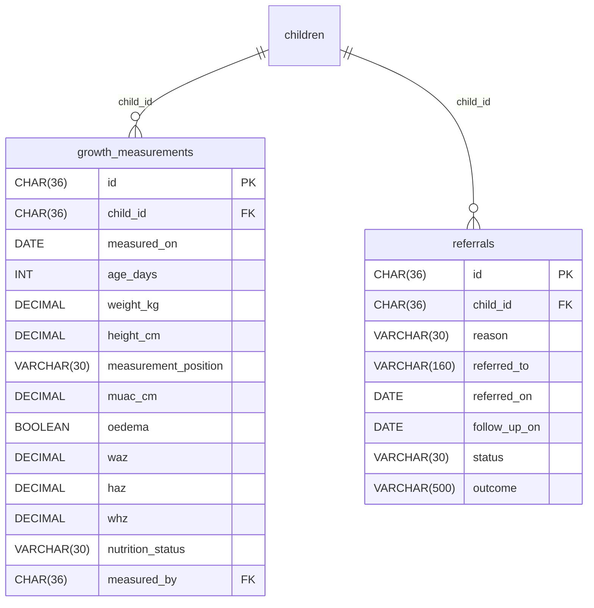
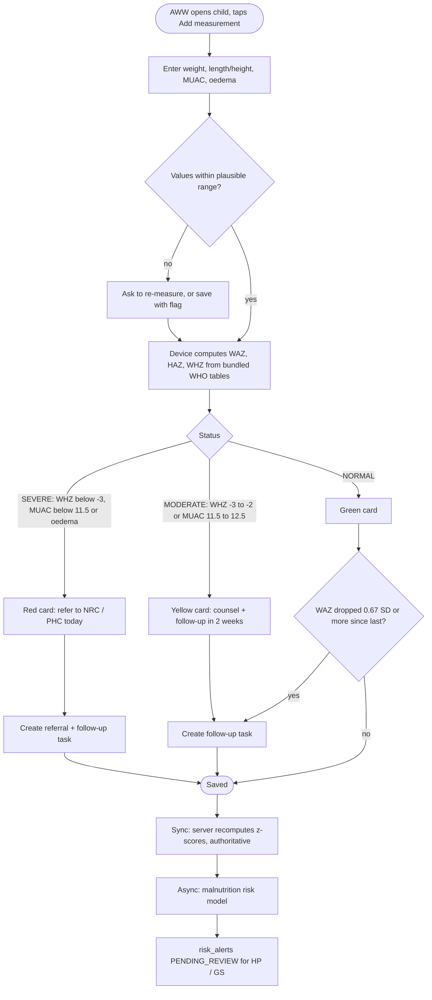

# Module 03: Child Growth & Nutrition Monitoring

- **Pillar:** 1 – Anganwadi child health & nutrition
- **Priority:** High
- **Status:** Planned

## Overview

Child undernutrition is still widespread in India: NFHS-5 (2019–21) reported about 35 % of under-5 children stunted, 19 % wasted
and 32 % underweight. Anganwadi workers weigh children every month, but the growth chart on paper is often plotted wrongly or not at all,
z-scores are not calculated, and a child who is *sliding* towards malnutrition is noticed only when already severe.

This module lets the AWW enter weight, height/length and MUAC on the phone. The app instantly calculates **WHO Child Growth Standards
z-scores** (weight-for-age, height-for-age, weight-for-height), shows a colour-coded growth chart, classifies nutrition status, compares with
previous measurements, and raises **referral and follow-up** tasks. An ML model ([13](13-ai-analytics.md)) adds early-warning risk alerts for human review.

## User roles & permissions

| Role | View | Create | Edit | Delete | Approve |
|---|---|---|---|---|---|
| SA | All | Yes | Yes | Soft-delete | Yes |
| AWW | Own centre's children | Measurements, referrals | Same-day measurements; referral follow-ups | — | — |
| HP | Referred / QR-granted children | Measurements (clinic), referral outcomes | Own entries | — | Confirm SAM/MAM classification on referral |
| PG | Own child's chart & status | — | — | — | — |
| GS | Jurisdiction | — | — | — | Review flagged measurements and risk alerts |
| NGW, NGA | — | — | — | — | — |

## Features

| Feature | Description |
|---|---|
| Measurement entry | Weight (kg, 0.1 precision for 0–2 y on infant scale, 0.1 for others), length (recumbent, < 2 y) or height (standing, ≥ 2 y), MUAC (6–59 months), bilateral oedema yes/no, measurement date |
| Age & date | Age in days calculated from DOB and the measurement date (not today), shown as "1 y 4 m" |
| Z-scores | WAZ, HAZ, WHZ via the WHO LMS method, computed on device (offline) and recomputed on the server (authoritative) |
| Nutrition status | `NORMAL` / `MODERATE` / `SEVERE` / `NOT_ASSESSED` (WHZ, MUAC and oedema rules), plus underweight and stunting labels for WAZ/HAZ |
| Growth chart | WHO reference curves (−3, −2, 0, +2, +3 SD bands, coloured) with the child's points. Separate charts per indicator. Boys/girls charts |
| Historical comparison | Last 6 measurements table, change since last (↑ ↓ →), "no weight gain for 2 months" flag |
| Malnutrition risk screening | Rule-based: SAM/MAM classification, growth faltering (WAZ drop ≥ 0.67 SD), implausible-value flag |
| ML risk alerts | Early-warning score from [Module 13](13-ai-analytics.md), shown only after review, or as "Under review" to the AWW |
| Referral | Create a referral (to NRC, PHC, CHC, ANM) with reason, date, follow-up date. Track `OPEN → VISITED → CLOSED / LOST_TO_FOLLOW_UP` |
| Follow-up | Tasks list: SAM children re-measured weekly, MAM every 2 weeks (TODO(team): confirm with state CMAM guidelines) |
| Monthly weighing list | Children not measured this month (growth monitoring day) |

## User stories

1. As an **Anganwadi worker**, I want to enter weight and height and immediately see if the child is normal, moderate or severe so that I don't have to read the paper chart.
2. As an **Anganwadi worker**, I want the app to tell me when a child hasn't gained weight for 2 months so that I can counsel the mother early.
3. As an **Anganwadi worker**, I want to refer a severely wasted child to the Nutrition Rehabilitation Centre and get reminded to follow up so that the child isn't lost.
4. As a **parent**, I want to see my child's growth chart in simple colours so that I understand whether my child is growing well.
5. As a **Healthcare Professional**, I want to record the outcome of a referral so that the Anganwadi knows what treatment was given.
6. As a **Government Supervisor**, I want to see values the app flagged as implausible so that I can check scale/measurement problems at that centre.
7. As a **Government Supervisor**, I want to review AI malnutrition-risk alerts so that the worker's effort goes to the children who need it most.

## Screens

| Screen | Key fields / actions |
|---|---|
| **Growth Entry** | Child header (name, age, sex, allergy banner), date (default today), weight, length/height + position toggle (auto by age), MUAC (shown 6–59 m), oedema yes/no with picture guide. *Save* → result card: status colour + word ("Severe – refer"), WAZ/HAZ/WHZ, change since last. Big buttons *Refer* / *Done* |
| **Growth Chart** | Tabs: Weight-for-age, Height-for-age, Weight-for-height. Coloured SD bands, child's points, tap a point for details. Boys/girls automatically |
| **Growth History** | Table of measurements (date, age, wt, ht, MUAC, status) with trend arrows. Flagged values marked ⚠ |
| **Referral Form** | Reason (SAM, MAM, growth faltering, illness, other), referred to (NRC / PHC / CHC / ANM + name), date, follow-up date, notes |
| **Follow-up List** | Today / overdue / upcoming. Each: child, reason, due date, *Mark visited*, *Record outcome* |
| **Monthly Weighing List** | Children not yet measured this month, sorted by last status (severe first) |

## Data model

<!-- DATA_MODEL: growth_measurements, referrals -->
<!-- generated:start -->

**`growth_measurements`**: One weight/height/MUAC measurement with derived WHO z-scores and status (append-only). JPA entity: [`GrowthMeasurement`](../../backend/src/main/java/in/jansetu/growth/entity/GrowthMeasurement.java)

| Column | MySQL type | Null | Notes |
|---|---|---|---|
| `id` | `CHAR(36)` | no | PK, UUID (client-generated for offline-created rows) |
| `child_id` | `CHAR(36)` | no | FK → `children.id` |
| `measured_on` | `DATE` | no |  |
| `age_days` | `INT` | no | computed from DOB at measuredOn |
| `weight_kg` | `DECIMAL(5,2)` | yes |  |
| `height_cm` | `DECIMAL(5,1)` | yes | length if < 2 years |
| `measurement_position` | `VARCHAR(30)` | yes | enum: `RECUMBENT`, `STANDING` |
| `muac_cm` | `DECIMAL(4,1)` | yes | mid-upper arm circumference, 6-59 months |
| `oedema` | `BOOLEAN` | no | bilateral pitting oedema => SAM regardless of z-score |
| `waz` | `DECIMAL(5,2)` | yes | weight-for-age z |
| `haz` | `DECIMAL(5,2)` | yes | height-for-age z |
| `whz` | `DECIMAL(5,2)` | yes | weight-for-height z |
| `nutrition_status` | `VARCHAR(30)` | no | enum: `NORMAL`, `MODERATE`, `SEVERE`, `NOT_ASSESSED` |
| `measured_by` | `CHAR(36)` | no | FK → `users.id` |

**`referrals`**: Referral of a child to NRC/PHC/CHC/ANM with follow-up tracking. JPA entity: [`Referral`](../../backend/src/main/java/in/jansetu/growth/entity/Referral.java)

| Column | MySQL type | Null | Notes |
|---|---|---|---|
| `id` | `CHAR(36)` | no | PK, UUID (client-generated for offline-created rows) |
| `child_id` | `CHAR(36)` | no | FK → `children.id` |
| `reason` | `VARCHAR(30)` | no | enum: `SAM`, `MAM`, `GROWTH_FALTERING`, `ILLNESS`, `MISSED_VACCINE`, `OTHER` |
| `referred_to` | `VARCHAR(160)` | no | e.g. NRC, PHC, CHC |
| `referred_on` | `DATE` | no |  |
| `follow_up_on` | `DATE` | yes |  |
| `status` | `VARCHAR(30)` | no | enum: `OPEN`, `VISITED`, `CLOSED`, `LOST_TO_FOLLOW_UP` |
| `outcome` | `VARCHAR(500)` | yes |  |

All tables also have the common columns `created_at`, `updated_at`, `created_by`, `updated_by`, `version`, `deleted`. See [data-model.md](../data-model.md#conventions). Schema: [`V1__init.sql`](../../backend/src/main/resources/db/migration/V1__init.sql).
<!-- generated:end -->

Notes:
- `waz`, `haz`, `whz` and `nutrition_status` are **derived** values stored for querying/reporting, and are recomputed if DOB, sex or values change.
- Each measurement is a new row (append-only), so no sync conflicts arise. Corrections are edits on the same day, or a new row plus soft-delete of the wrong one.

## API endpoints

`ROLE_SUPER_ADMIN` may call every endpoint and is omitted below.

| Method | Path | Description | Allowed roles |
|---|---|---|---|
| GET | `/api/v1/children/{childId}/growth-measurements` | Measurement history with z-scores | `ROLE_ANGANWADI_WORKER`, `ROLE_HEALTH_PROFESSIONAL`, `ROLE_GOVT_SUPERVISOR`, `ROLE_PARENT_GUARDIAN` |
| POST | `/api/v1/children/{childId}/growth-measurements` | Add measurement → server computes z-scores + status | `ROLE_ANGANWADI_WORKER`, `ROLE_HEALTH_PROFESSIONAL` |
| PUT | `/api/v1/growth-measurements/{measurementId}` | Correct a measurement (same day for AWW) | `ROLE_ANGANWADI_WORKER`, `ROLE_HEALTH_PROFESSIONAL` |
| DELETE | `/api/v1/growth-measurements/{measurementId}` | Soft-delete wrong entry (with reason) | `ROLE_ANGANWADI_WORKER` (same day), `ROLE_GOVT_SUPERVISOR` |
| GET | `/api/v1/children/{childId}/growth-chart?indicator=WFA` | Chart data: child's points + WHO SD curves for sex/age range | `ROLE_ANGANWADI_WORKER`, `ROLE_HEALTH_PROFESSIONAL`, `ROLE_GOVT_SUPERVISOR`, `ROLE_PARENT_GUARDIAN` |
| GET | `/api/v1/growth-measurements/flagged` | Implausible / flagged values in scope | `ROLE_GOVT_SUPERVISOR` |
| GET | `/api/v1/growth/weighing-due?centreId=&month=` | Children not measured this month | `ROLE_ANGANWADI_WORKER`, `ROLE_GOVT_SUPERVISOR` |
| GET | `/api/v1/referrals` | Referrals in scope (`status`, `reason`, `dueBefore`) | `ROLE_ANGANWADI_WORKER`, `ROLE_HEALTH_PROFESSIONAL`, `ROLE_GOVT_SUPERVISOR` |
| POST | `/api/v1/children/{childId}/referrals` | Create referral | `ROLE_ANGANWADI_WORKER`, `ROLE_HEALTH_PROFESSIONAL` |
| PATCH | `/api/v1/referrals/{referralId}` | Update status / outcome / follow-up date | `ROLE_ANGANWADI_WORKER`, `ROLE_HEALTH_PROFESSIONAL` |

AI service (internal, called by the backend): `POST /v1/growth/zscores`, `POST /v1/malnutrition/predict`. See [api-overview.md](../api-overview.md#service-to-service-backend--ai-service).

## Workflow

## Business rules & validation

- **Plausible input ranges** (device + server): weight 0.5–40 kg, length 40–110 cm (recumbent, 0–24 m), height 60–130 cm (standing, 24–72 m), MUAC 7–25 cm.
  Values outside → `VALIDATION_FAILED`.
- **WHO plausibility flags** (save allowed, value flagged for GS review): WAZ < −6 or > 5, HAZ < −6 or > 6, WHZ < −5 or > 5.
- **Measurement position:** under 24 months → recumbent length. 24 months and over → standing height. If the "wrong" position was used, adjust by WHO convention (standing height + 0.7 cm = length, length − 0.7 cm = height) before computing.
- **Indicators:** WFA 0–60 months. HFA 0–60 months (61–72 months: WHO 2007 reference, TODO(team) decide). WFH/WFL by length/height range.
  For children over 5 years, mark WHZ `NOT_ASSESSED` and use BMI-for-age (TODO(team)).
- **Classification** (WHO/IAP, also in [`zscore.py`](../../ai-service/app/models/zscore.py)):
  - `SEVERE` = WHZ < −3 **or** MUAC < 11.5 cm (6–59 m) **or** bilateral oedema.
  - `MODERATE` = −3 ≤ WHZ < −2 **or** 11.5 ≤ MUAC < 12.5.
  - `NORMAL` otherwise. `NOT_ASSESSED` if required values are missing.
  - Underweight: WAZ < −2 (severe < −3). Stunting: HAZ < −2 (severe < −3). These are shown, but they are not the `nutrition_status`.
- **Growth faltering:** WAZ drop ≥ 0.67 SD vs. a measurement ≤ 92 days earlier, or weight not increased in two consecutive monthly measurements.
- One measurement per child per day (a second one replaces it after confirmation).
- `SEVERE` automatically suggests a referral. The worker must choose *Refer* or record a reason for not referring (e.g. "already at NRC").
- The server z-score wins over the device value. If they differ by > 0.1, the device table version is logged (data bug detection).
- Referral follow-up date defaults: SAM 7 days, MAM 14 days, other 30 days.

## Offline behaviour

- **Fully offline**: entry, z-scores, status, chart, history, referral creation, follow-up list.
- The WHO LMS tables (~1 MB JSON) ship inside the app bundle, versioned.
- SQLite: `growth_measurements` (+ `referrals`, TODO(team): add to [`schema.ts`](../../mobile/src/db/schema.ts) in the next local migration).
  Ops queued with `PRIORITY.HEALTH`.
- Measurements are append-only, so there are no LWW conflicts. A same-day duplicate (same child + date from two devices) becomes `CONFLICT` and the AWW picks one.
- ML risk alerts need the server; offline the app shows only rule-based status.

## AI / ML

| Item | Detail |
|---|---|
| Model | Malnutrition risk: Logistic Regression baseline → Random Forest ([ml-overview.md](../ml-overview.md#1-malnutrition-risk-prediction)) |
| Input features | Age, sex, latest WAZ/HAZ/WHZ, MUAC, WAZ change/slope, months since last measurement, birth weight, attendance rate, overdue vaccinations, recent referral |
| Output | `risk_score` (0–1), `risk_level`, top factors |
| Endpoint | ai-service `POST /v1/malnutrition/predict`, triggered by the backend after each new measurement (async) |
| Human review | Alert → `risk_alerts` `PENDING_REVIEW` → HP or GS confirms/dismisses ([Module 13](13-ai-analytics.md)). The AWW sees "Under review" and then a task only if confirmed. **The model never changes `nutrition_status`.** |

## Notifications triggered

| Event | To | Channel |
|---|---|---|
| Child classified SEVERE | AWW (on screen), GS, linked HP | Push |
| Follow-up due today / overdue | AWW | Push (local notification if offline) |
| Monthly weighing day reminder | AWW | Local notification |
| Growth faltering detected | AWW | In-app task |
| Referral outcome recorded | AWW | Push |
| Child status changed (to parent) | PG | Push: "Your child's growth check is updated" (no status in the push text) |
| Implausible values > 10 % of a centre's month | GS | Push |

## Privacy & security considerations

- Nutrition status and z-scores are **S3** data. They never appear in push notification text, SMS, or logs.
- Parents see their own child's chart with supportive wording ("needs extra care"), not stigmatising labels. Colours come with words.
- AI inputs are pseudonymous (child UUID + features).
- Every view of the chart by HP/GS is audited.

## Dependencies on other modules

- [02 – Child Management](02-child-management.md): DOB, sex, centre.
- [05 – Attendance](05-attendance.md), [04 – Vaccination](04-vaccination-healthcare.md): features for risk model.
- [13 – AI Analytics](13-ai-analytics.md): risk model, review workflow.
- [14 – Notifications](14-notifications.md): follow-up reminders.
- [15 – Admin Dashboard](15-admin-dashboard-reports.md): prevalence reports.

## Acceptance criteria

- [ ] For 20 reference cases from WHO Anthro (TODO(team): prepare), device and server WAZ/HAZ/WHZ match WHO Anthro within ±0.01.
- [ ] WHZ −3.2 → `SEVERE`. MUAC 11.8 cm (no oedema, WHZ −1) → `MODERATE`. Oedema → `SEVERE` regardless of z-scores.
- [ ] Entering weight 2 kg for a 3-year-old shows a plausibility warning and stores a flag.
- [ ] Offline: measurement entry shows status within 1 s and the growth chart renders on a 2 GB RAM phone.
- [ ] A SEVERE result forces *Refer* or a reason for not referring.
- [ ] A referral creates a follow-up task due in 7 days (SAM) that appears in the Follow-up List.
- [ ] A WAZ drop of 0.7 SD within 2 months shows the growth-faltering flag.
- [ ] Push notification text never contains the nutrition status.
- [ ] The ML alert appears to the GS as `PENDING_REVIEW` and does not change the child's `nutrition_status`.

## Future enhancements

- Bluetooth digital scales / infantometers to remove manual entry errors.
- BMI-for-age for 5–6 years. WHO 2007 references.
- Counselling content (Hindi audio/video) shown with MODERATE/SEVERE results.
- Integration of CMAM treatment protocols (RUTF/energy-dense food tracking) where the state supports it.
