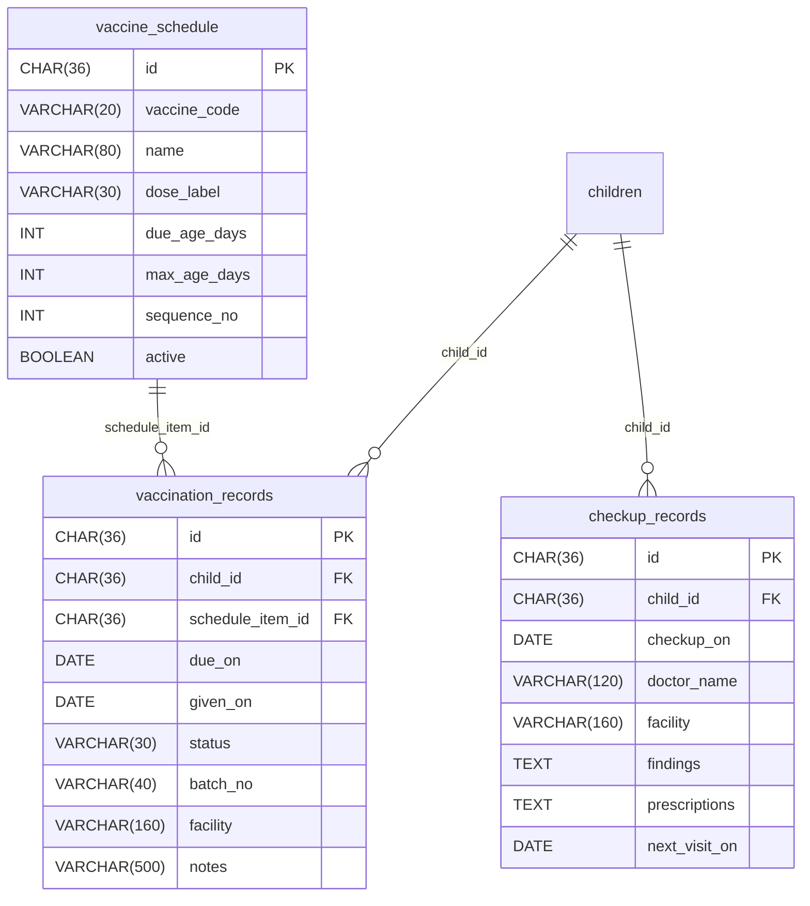
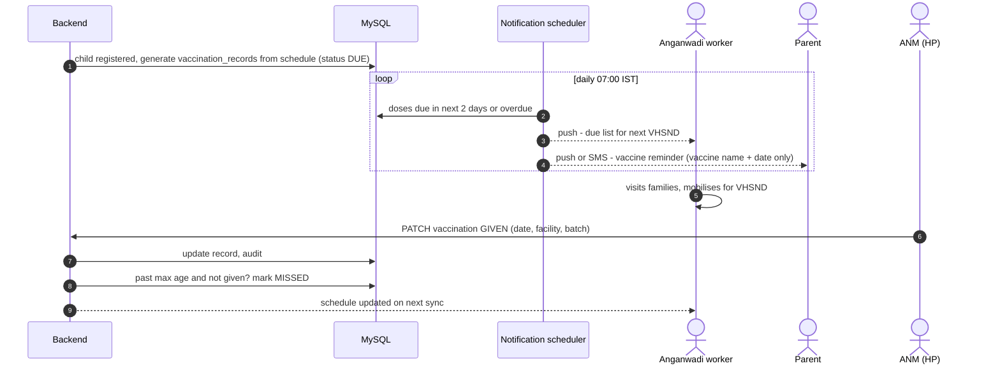

# Module 04: Vaccination & Healthcare Management

- **Pillar:** 1 – Anganwadi child health & nutrition
- **Priority:** High
- **Status:** Planned

## Overview

Under India's **Universal Immunization Programme (UIP)**, children receive a fixed schedule of free vaccines: BCG, OPV, Hepatitis B,
Pentavalent, Rotavirus, fIPV, PCV, Measles-Rubella, JE (in endemic districts), DPT boosters and Vitamin A. Vaccines are usually given
by the ANM at the Village Health, Sanitation & Nutrition Day (VHSND) held at the Anganwadi, and the AWW's job is to **track who is
due and mobilise families**. Today that relies on the paper Mother & Child Protection (MCP) card and memory, so doses are missed or delayed.

This module generates each child's **UIP schedule from date of birth**, shows due, upcoming and overdue doses, records doses given (with date and place),
and keeps **health checkup and doctor-visit history**. Reminders go to the AWW and the parent before each VHSND.

## User roles & permissions

| Role | View | Create | Edit | Delete | Approve |
|---|---|---|---|---|---|
| SA | All | Yes | Yes | Soft-delete | Schedule master data |
| AWW | Own centre | Record dose given (from MCP card / VHSND), checkups | Own entries (7 days) | — | — |
| HP | Referred / QR-granted / VHSND list | Doses, checkups, doctor visits | Own entries | — | **Verify** doses recorded by AWW |
| PG | Own child | — | — | — | — |
| GS | Jurisdiction | — | — | — | — |
| NGW, NGA | — | — | — | — | — |

## Features

| Feature | Description |
|---|---|
| UIP schedule | Seeded master table ([`V2__seed_uip_schedule.sql`](../../backend/src/main/resources/db/migration/V2__seed_uip_schedule.sql)): vaccine, dose, due age, max age. JE active only for endemic districts |
| Per-child plan | On registration (or DOB change) the server generates `vaccination_records` with `due_on` = DOB + due age |
| Vaccination history | Given doses with date, facility, batch no. (optional), who recorded, verified by HP |
| Upcoming reminders | Doses due in the next 14 days, grouped by the next VHSND date |
| Pending/overdue alerts | Past `due_on` and not given = overdue. Past `max_age_days` = `MISSED` (not given under UIP any more) |
| VHSND due list | For a chosen session date: all children due/overdue, printable/shareable to the ANM |
| Checkup records | Health checkups (date, doctor/ANM, facility, findings, prescriptions, next visit) |
| Doctor visit history | Same table, filtered: visits outside the Anganwadi (PHC/CHC/private) |
| Catch-up | For late-registered children, past doses are entered from the MCP card. Missing ones are shown as catch-up doses if still within max age |

## User stories

1. As an **Anganwadi worker**, I want a list of children due for vaccines before the VHSND so that I can visit those families the day before.
2. As an **Anganwadi worker**, I want to copy vaccines from the child's MCP card when I register an older child so that the schedule is correct.
3. As a **parent**, I want an SMS/push reminder two days before my child's vaccine so that I don't miss it.
4. As a **Healthcare Professional (ANM)**, I want to mark doses as given during the VHSND session so that records are updated at once.
5. As a **Healthcare Professional**, I want to verify doses the AWW entered from the MCP card so that the record is reliable.
6. As a **Government Supervisor**, I want to see full-immunisation coverage per centre so that I can target low-coverage villages.
7. As a **parent**, I want to see my child's vaccination history in the app so that I have a backup if the paper card is lost.

## Screens

| Screen | Key fields / actions |
|---|---|
| **Vaccination Schedule** (per child) | Timeline grouped by age (Birth, 6 wk, 10 wk, 14 wk, 9 m, 16–24 m, 5 y). Each dose: ✅ given (date) / 🟡 due / 🔴 overdue / ⚫ missed. Tap → record dose |
| **Record Dose** | Vaccine + dose (pre-filled), date given (≤ today, ≥ DOB + minimum age), facility (Anganwadi VHSND / PHC / CHC / Private), batch no. (optional), source (session / MCP card), *Save* |
| **Due List** | Date picker (next VHSND), list of children with due/overdue doses, call-guardian button, *Share list* (to ANM, no health details beyond vaccine names) |
| **Checkup Records** | List + *Add*: date, doctor/ANM name, facility, findings, prescriptions, next visit date |
| **Doctor Visit History** | Filtered list of external visits |
| **Verify Doses** (HP) | Doses recorded from MCP card waiting for verification → *Verify* / *Reject with note* |

## Data model

<!-- DATA_MODEL: vaccine_schedule, vaccination_records, checkup_records -->
<!-- generated:start -->

**`vaccine_schedule`**: UIP master schedule (seeded by V2). JPA entity: [`VaccineScheduleItem`](../../backend/src/main/java/in/jansetu/vaccination/entity/VaccineScheduleItem.java)

| Column | MySQL type | Null | Notes |
|---|---|---|---|
| `id` | `CHAR(36)` | no | PK, UUID (client-generated for offline-created rows) |
| `vaccine_code` | `VARCHAR(20)` | no |  |
| `name` | `VARCHAR(80)` | no |  |
| `dose_label` | `VARCHAR(30)` | no |  |
| `due_age_days` | `INT` | no |  |
| `max_age_days` | `INT` | yes | last age at which the dose may still be given |
| `sequence_no` | `INT` | no |  |
| `active` | `BOOLEAN` | no |  |

Unique: (`vaccine_code`, `dose_label`)

**`vaccination_records`**: One row per child per scheduled dose: due / given / missed / deferred. JPA entity: [`VaccinationRecord`](../../backend/src/main/java/in/jansetu/vaccination/entity/VaccinationRecord.java)

| Column | MySQL type | Null | Notes |
|---|---|---|---|
| `id` | `CHAR(36)` | no | PK, UUID (client-generated for offline-created rows) |
| `child_id` | `CHAR(36)` | no | FK → `children.id` |
| `schedule_item_id` | `CHAR(36)` | no | FK → `vaccine_schedule.id` |
| `due_on` | `DATE` | no |  |
| `given_on` | `DATE` | yes |  |
| `status` | `VARCHAR(30)` | no | enum: `DUE`, `GIVEN`, `MISSED`, `DEFERRED` |
| `batch_no` | `VARCHAR(40)` | yes |  |
| `facility` | `VARCHAR(160)` | yes |  |
| `notes` | `VARCHAR(500)` | yes |  |

Unique: (`child_id`, `schedule_item_id`)

**`checkup_records`**: Child health checkups and doctor visits. JPA entity: [`CheckupRecord`](../../backend/src/main/java/in/jansetu/vaccination/entity/CheckupRecord.java)

| Column | MySQL type | Null | Notes |
|---|---|---|---|
| `id` | `CHAR(36)` | no | PK, UUID (client-generated for offline-created rows) |
| `child_id` | `CHAR(36)` | no | FK → `children.id` |
| `checkup_on` | `DATE` | no |  |
| `doctor_name` | `VARCHAR(120)` | yes |  |
| `facility` | `VARCHAR(160)` | yes |  |
| `findings` | `TEXT` | yes |  |
| `prescriptions` | `TEXT` | yes |  |
| `next_visit_on` | `DATE` | yes |  |

All tables also have the common columns `created_at`, `updated_at`, `created_by`, `updated_by`, `version`, `deleted`. See [data-model.md](../data-model.md#conventions). Schema: [`V1__init.sql`](../../backend/src/main/resources/db/migration/V1__init.sql).
<!-- generated:end -->

Notes:
- One `vaccination_records` row per child per schedule item (unique `(child_id, schedule_item_id)`). Rows are created up-front with status `DUE`.
- Dose verification by HP: TODO(team): add `verified_by`, `verified_at` columns in V3 (not in V1).

## API endpoints

`ROLE_SUPER_ADMIN` may call every endpoint and is omitted below.

| Method | Path | Description | Allowed roles |
|---|---|---|---|
| GET | `/api/v1/vaccine-schedule` | UIP master list (cached on device) | any authenticated |
| PUT | `/api/v1/vaccine-schedule/{itemId}` | Edit master (activate JE etc.) | `ROLE_SUPER_ADMIN` only |
| GET | `/api/v1/children/{childId}/vaccinations` | Child's schedule with status | `ROLE_ANGANWADI_WORKER`, `ROLE_HEALTH_PROFESSIONAL`, `ROLE_GOVT_SUPERVISOR`, `ROLE_PARENT_GUARDIAN` |
| PATCH | `/api/v1/vaccinations/{recordId}` | Record dose given / deferred `{status, givenOn, facility, batchNo, source}` | `ROLE_ANGANWADI_WORKER`, `ROLE_HEALTH_PROFESSIONAL` |
| POST | `/api/v1/vaccinations/{recordId}/verify` | Verify a dose recorded from the MCP card | `ROLE_HEALTH_PROFESSIONAL` |
| GET | `/api/v1/vaccinations/due?centreId=&from=&to=` | Due/overdue list for a session | `ROLE_ANGANWADI_WORKER`, `ROLE_HEALTH_PROFESSIONAL`, `ROLE_GOVT_SUPERVISOR` |
| GET | `/api/v1/children/{childId}/checkups` | Checkup / doctor-visit history | `ROLE_ANGANWADI_WORKER`, `ROLE_HEALTH_PROFESSIONAL`, `ROLE_GOVT_SUPERVISOR`, `ROLE_PARENT_GUARDIAN` |
| POST | `/api/v1/children/{childId}/checkups` | Add checkup | `ROLE_ANGANWADI_WORKER`, `ROLE_HEALTH_PROFESSIONAL` |
| PUT | `/api/v1/checkups/{checkupId}` | Edit checkup | `ROLE_ANGANWADI_WORKER`, `ROLE_HEALTH_PROFESSIONAL` |

## Workflow

## Business rules & validation

- Schedule generation: `due_on = date_of_birth + due_age_days`. Regenerated if DOB changes, keeping `GIVEN` rows.
- `givenOn` must be ≥ DOB + minimum age for that dose, and ≤ today.
- **Minimum gap of 28 days** between doses of the same vaccine series (OPV 1–3, Penta 1–3, Rota 1–3, PCV 1–2).
- Dose must follow the order of the series (Penta-2 not before Penta-1) → `BUSINESS_RULE`.
- Past `max_age_days` and not given → `MISSED` (shown as "Not given – consult ANM"). Rotavirus and Pentavalent age limits come from the master table.
- `DEFERRED` needs a reason (illness, family refused, vaccine stock-out).
- Doses recorded with `source = MCP_CARD` by an AWW are shown as "unverified" until an HP verifies.
- **The schedule must be verified against the current MoHFW National Immunization Schedule before the pilot.** TODO(team) (see the seed file header).
- Overdue = `today > due_on` and status `DUE`. The dashboard counts a child as **fully immunised** (by 12 months) when BCG, OPV-3, Penta-3 and MR-1 are given (TODO(team): align with the official definition).

## Offline behaviour

- Schedule master + all children's `vaccination_records` for the centre are cached. Status calculation (due/overdue/missed) runs on the device.
- Recording a dose works offline (`PRIORITY.HEALTH`). Checkups can be added offline.
- Reminders: the app schedules **local notifications** for the AWW from cached data, so they work without the network.
  Parent reminders are sent by the server.
- Conflicts: `givenOn` / status edits on the same record from two devices → manual review (clinical field). Checkup notes → last-write-wins.

## AI / ML

None. Overdue vaccinations are an input feature to the malnutrition risk model ([Module 13](13-ai-analytics.md)).

## Notifications triggered

| Event | To | Channel |
|---|---|---|
| VHSND due list (2 days before) | AWW | Push / local |
| Vaccine reminder | PG | Push, SMS fallback (no health details beyond vaccine name & date) |
| Dose overdue > 14 days | AWW | Push |
| Dose became `MISSED` | AWW, HP | Push |
| Next checkup visit due | AWW, PG | Push |
| Unverified doses waiting > 30 days | HP | Push |

## Privacy & security considerations

- Vaccination data is S3. The VHSND list shared with the ANM contains name, age and due vaccines only.
- SMS reminders contain the vaccine name and date only, no child name (shared phones). TODO(team): confirm wording with partners.
- Batch numbers are stored for adverse-event (AEFI) tracing, viewable by HP/GS only.

## Dependencies on other modules

- [02 – Child Management](02-child-management.md): DOB, registration triggers schedule generation.
- [14 – Notifications](14-notifications.md): reminders.
- [06 – QR Health Card](06-qr-health-card.md): vaccination summary on scan.
- [15 – Admin Dashboard](15-admin-dashboard-reports.md): coverage reports.

## Acceptance criteria

- [ ] Registering a child with DOB 2026-01-01 creates rows for all active UIP doses with correct `due_on` (e.g. Penta-1 on 2026-02-12).
- [ ] Recording Penta-2 before Penta-1, or less than 28 days after it, is rejected with `BUSINESS_RULE`.
- [ ] A dose past `max_age_days` shows as `MISSED` the next day.
- [ ] The due list for a date returns all children with doses due ±7 days or overdue, in < 2 s for a centre with 150 children.
- [ ] Offline: the AWW records a dose, sees the status change immediately, and it syncs later.
- [ ] Parent reminder SMS contains no child name or other health information.
- [ ] Changing DOB regenerates `DUE` rows and keeps `GIVEN` rows.

## Future enhancements

- Integration with **U-WIN** (MoHFW's digital immunisation platform), if API access is granted.
- AEFI (adverse event) reporting form.
- Vaccine stock tracking at the VHSND session.
- Deworming (Albendazole) and IFA syrup tracking under Anemia Mukt Bharat.
