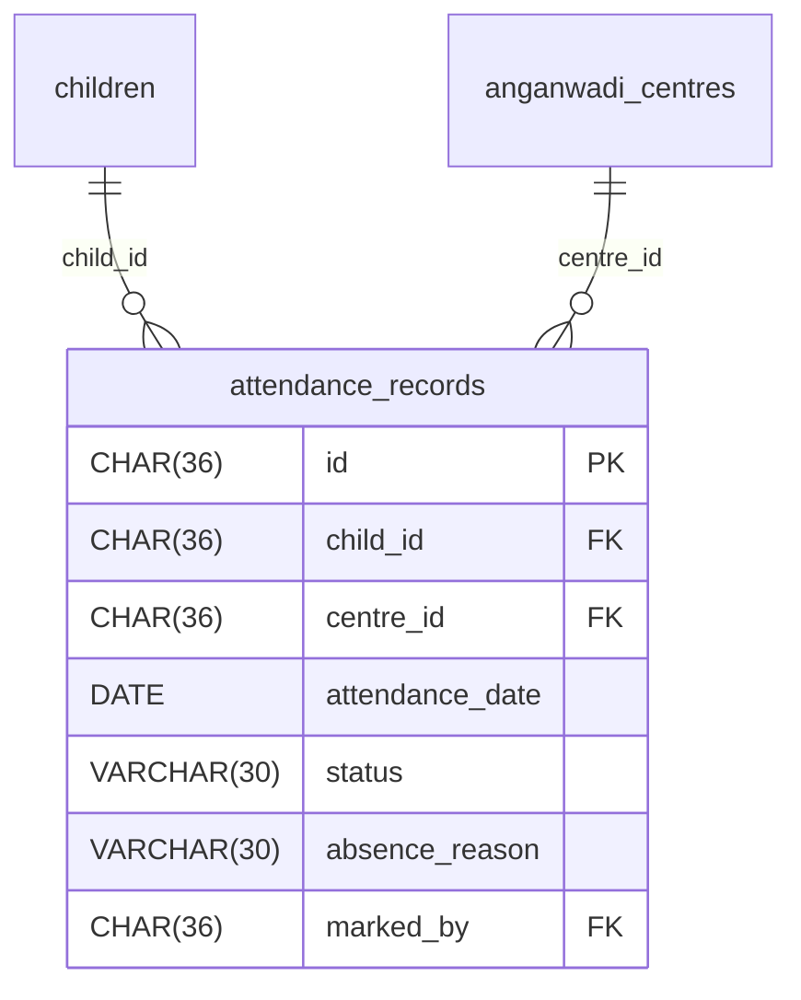
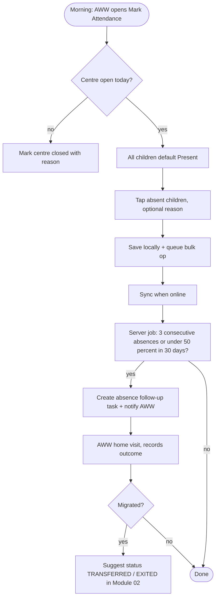

# Module 05: Attendance Management

- **Pillar:** 1 – Anganwadi child health & nutrition
- **Priority:** Medium
- **Status:** Planned

## Overview

Daily attendance at the Anganwadi (pre-school education for 3–6 year olds, hot cooked meals) is recorded in a paper register. It is
used to plan food quantities and to report to ICDS, but **repeated absence is rarely followed up**. A child who stops coming may be ill,
may have migrated with the family for seasonal work, or may be dropping out. These are exactly the children at risk of malnutrition.

This module provides one-tap daily attendance on the phone, monthly reports, and **automatic alerts for repeated absence**, so the AWW
can make a home visit. Attendance also feeds the meal planning ([07](07-midday-meal-quality.md)) and the risk model ([13](13-ai-analytics.md)).

## User roles & permissions

| Role | View | Create | Edit | Delete | Approve |
|---|---|---|---|---|---|
| SA | All | Yes | Yes | Soft-delete | Yes |
| AWW | Own centre | Mark daily attendance | Same day only | — | — |
| GS | Jurisdiction | — | — | — | Approve late corrections (older than today) |
| PG | Own child's monthly summary | — | — | — | — |
| HP, NGW, NGA | — | — | — | — | — |

## Features

| Feature | Description |
|---|---|
| Daily present/absent | Roster of active children (3–6 y by default, toggle "All ages"). Everyone starts *Present*, tap to mark *Absent* (fast for 30–40 children) |
| Absence reason | Optional: illness, migration, family event, unknown |
| Holiday / centre closed | Mark the whole day closed (holiday, worker on leave). This is not counted as absence |
| Attendance history | Per child: calendar view with ✅ / ❌ / closed |
| Monthly report | Per centre: working days, attendance % per child, average daily attendance, children below 50 % |
| Repeated-absence alert | Absent **3 consecutive working days** or **< 50 % in the last 30 days** → home-visit task |
| Filters | Centre (GS/SA), age group / "class" (0–3 / 3–6), month, status |
| Late correction | Edits to earlier days create a correction request that the GS approves |

## User stories

1. As an **Anganwadi worker**, I want to mark attendance for 35 children in under a minute so that it doesn't take time from teaching.
2. As an **Anganwadi worker**, I want to be told which children have been absent for 3 days so that I can visit their homes.
3. As an **Anganwadi worker**, I want to mark the centre closed on a holiday so that children's attendance % is not reduced.
4. As a **Government Supervisor**, I want monthly attendance per centre so that I can spot centres with falling attendance.
5. As a **Government Supervisor**, I want to approve corrections to past attendance so that records cannot be quietly changed.
6. As a **parent**, I want to see how many days my child attended this month so that I can follow up.

## Screens

| Screen | Key fields / actions |
|---|---|
| **Mark Attendance** | Date (today, locked), *Centre closed today* switch, list with large toggle per child (photo-less, name + age), counter "32 present / 4 absent", *Save*. Optional reason picker on absent |
| **Attendance History** (child) | Month calendar, attendance %, streak of absences |
| **Monthly Report** | Month picker, table: child, days present / working days, %. Highlight < 50 %. *Export* (GS/SA, through [Module 15](15-admin-dashboard-reports.md)) |
| **Absence Follow-ups** | Children with repeated absence, *Mark home visit done* + outcome (ill / migrated / will return / other) |
| **Correction Requests** (GS) | Requested change, reason, *Approve* / *Reject* |

## Data model

<!-- DATA_MODEL: attendance_records -->
<!-- generated:start -->

**`attendance_records`**: Daily present/absent per child (unique per child per day). JPA entity: [`AttendanceRecord`](../../backend/src/main/java/in/jansetu/attendance/entity/AttendanceRecord.java)

| Column | MySQL type | Null | Notes |
|---|---|---|---|
| `id` | `CHAR(36)` | no | PK, UUID (client-generated for offline-created rows) |
| `child_id` | `CHAR(36)` | no | FK → `children.id` |
| `centre_id` | `CHAR(36)` | no | FK → `anganwadi_centres.id` |
| `attendance_date` | `DATE` | no |  |
| `status` | `VARCHAR(30)` | no | enum: `PRESENT`, `ABSENT` |
| `absence_reason` | `VARCHAR(30)` | yes | enum: `ILLNESS`, `MIGRATION`, `FAMILY_EVENT`, `UNKNOWN` |
| `marked_by` | `CHAR(36)` | no | FK → `users.id` |

Unique: (`child_id`, `attendance_date`)

All tables also have the common columns `created_at`, `updated_at`, `created_by`, `updated_by`, `version`, `deleted`. See [data-model.md](../data-model.md#conventions). Schema: [`V1__init.sql`](../../backend/src/main/resources/db/migration/V1__init.sql).
<!-- generated:end -->

Notes:
- Unique `(child_id, attendance_date)`: one record per child per day.
- `centre_id` is copied onto the row (denormalised) so centre-day reports don't need joins and stay correct after a transfer.
- Centre closed days: TODO(team): add `centre_closures (centre_id, date, reason)` in V3.

## API endpoints

`ROLE_SUPER_ADMIN` may call every endpoint and is omitted below.

| Method | Path | Description | Allowed roles |
|---|---|---|---|
| GET | `/api/v1/attendance?centreId=&date=` | Roster with status for a day | `ROLE_ANGANWADI_WORKER`, `ROLE_GOVT_SUPERVISOR` |
| PUT | `/api/v1/attendance/{centreId}/{date}` | Bulk upsert a day's attendance `[{childId, status, absenceReason}]` (today only for AWW) | `ROLE_ANGANWADI_WORKER` |
| POST | `/api/v1/attendance/{centreId}/{date}/closure` | Mark centre closed | `ROLE_ANGANWADI_WORKER` |
| GET | `/api/v1/children/{childId}/attendance?month=` | Child's month | `ROLE_ANGANWADI_WORKER`, `ROLE_GOVT_SUPERVISOR`, `ROLE_PARENT_GUARDIAN` |
| GET | `/api/v1/attendance/reports/monthly?centreId=&month=` | Monthly centre report | `ROLE_ANGANWADI_WORKER`, `ROLE_GOVT_SUPERVISOR` |
| GET | `/api/v1/attendance/absence-alerts?centreId=` | Open repeated-absence tasks | `ROLE_ANGANWADI_WORKER`, `ROLE_GOVT_SUPERVISOR` |
| POST | `/api/v1/attendance/absence-alerts/{alertId}/follow-up` | Record home-visit outcome | `ROLE_ANGANWADI_WORKER` |
| POST | `/api/v1/attendance/corrections` | Request correction of a past day | `ROLE_ANGANWADI_WORKER` |
| POST | `/api/v1/attendance/corrections/{requestId}/decision` | Approve / reject | `ROLE_GOVT_SUPERVISOR` |

## Workflow

## Business rules & validation

- Only `ACTIVE` children appear on the roster. Children registered after the date are excluded.
- `attendance_date` = IST calendar date. AWW can create/edit **today only**. Past days need a correction request (GS approval). Future dates are rejected.
- A day marked *closed* cannot have attendance rows, and it is excluded from working days.
- Bulk save is **idempotent** (same day saved twice = upsert).
- Repeated absence: 3 consecutive *working* days absent, or attendance < 50 % over the last 30 calendar days (min 10 working days). One open alert per child at a time.
- Attendance % = present days / working days (closed days excluded).
- An AWW cannot mark attendance for another centre's children (`404`).

## Offline behaviour

- **Fully offline.** The roster comes from local `children`, rows are saved to `attendance_records` ([`schema.ts`](../../mobile/src/db/schema.ts)).
- One `sync_queue` op per child-day (small payloads, `PRIORITY.DEFAULT`).
- Conflicts: attendance status is low-risk → **last-write-wins** by `updated_at`. Two devices marking the same child on the same day merge naturally via the unique key.
- Repeated-absence detection runs on the server. The device also shows a local "absent 3 days" badge so offline workers see it.
- If the phone's date is wrong (common), the app warns when the device date differs from the last known server date by more than 1 day.

## AI / ML

None directly. Attendance rate (last 30 days) is an input feature to the malnutrition risk model ([Module 13](13-ai-analytics.md)).

## Notifications triggered

| Event | To |
|---|---|
| Attendance not marked by 11:00 IST on a working day | AWW (local notification) |
| Repeated absence detected | AWW |
| Centre attendance < 60 % for a week | GS |
| Correction requested | GS |
| Correction approved/rejected | AWW |
| Monthly summary (child) | PG (optional, push) |

## Privacy & security considerations

- Attendance is S1/S2 (not clinical), but absence reasons such as "illness" are S3 → hidden from PG of other children, excluded from exports below centre level.
- Late corrections are approval-gated and audited, which discourages inflated attendance (attendance drives food supply).

## Dependencies on other modules

- [02 – Child Management](02-child-management.md): roster, status changes after follow-up.
- [07 – Midday Meal](07-midday-meal-quality.md): children present ≈ children served.
- [13 – AI Analytics](13-ai-analytics.md): feature for risk model.
- [14 – Notifications](14-notifications.md), [15 – Admin Dashboard](15-admin-dashboard-reports.md).

## Acceptance criteria

- [ ] Marking 40 children with 5 absent takes ≤ 6 taps after opening the screen.
- [ ] Attendance saved offline syncs later, and the server has exactly one row per child per day.
- [ ] An AWW cannot edit yesterday's attendance directly. A correction request appears for the GS.
- [ ] A child absent for 3 consecutive working days (closed days skipped) gets one follow-up task.
- [ ] Monthly report % excludes closed days and matches a hand calculation on test data.
- [ ] Future dates are rejected by device and server.

## Future enhancements

- Face-free QR card scan at the door for faster marking.
- Pre-school education (ECCE) activity tracking.
- Seasonal migration analysis per village (when families leave and return).
