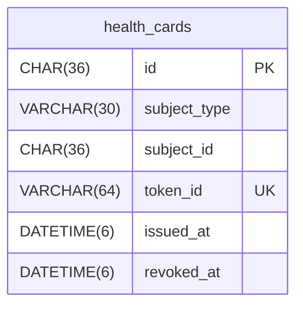
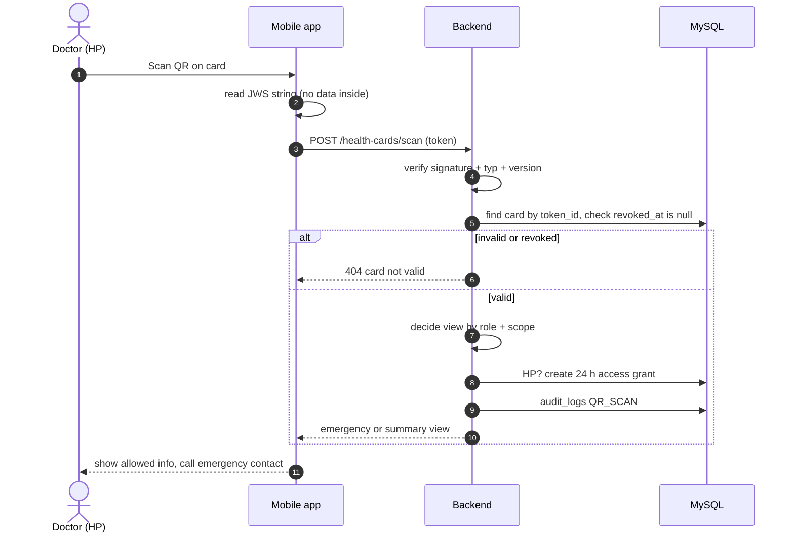

# Module 06: QR-Based Digital Health Card

- **Pillar:** 1 and 2 (shared): children and elderly beneficiaries
- **Priority:** Medium
- **Status:** Planned

## Overview

When a child is taken to a PHC, or an elderly woman is taken to hospital in an emergency, the doctor usually knows nothing about
her: no allergies, no current medicines, no emergency contact. Paper cards get lost, and many beneficiaries cannot explain their history.

Every child and elderly beneficiary gets a printed **health card with a QR code**. A JanSetu user scans it and sees **only what their role
allows**: emergency information for anyone logged in, a health summary for the treating HP or the responsible worker. The QR itself holds
**a signed token only, never health data**, so a lost card or a photo of it reveals nothing.

## User roles & permissions

| Role | View | Create | Edit | Delete | Approve |
|---|---|---|---|---|---|
| SA | All cards | Issue | — | Revoke | — |
| AWW | Scan; own centre's cards | Issue/print for own centre's children | — | Revoke (lost) for own centre | — |
| NGW | Scan; assigned beneficiaries' cards | Issue for assigned beneficiaries | — | — | — |
| HP | Scan → summary (creates a 24 h audited access grant) | — | — | — | — |
| PG | Own child's card (digital copy) | — | — | — | — |
| NGA | Scan; NGO beneficiaries' cards | Issue | — | Revoke | — |
| GS | Scan → emergency view + summary for jurisdiction | — | — | — | — |

## Features

| Feature | Description |
|---|---|
| Unique QR per person | One active card per child / elderly beneficiary. QR = signed token (JWS) with a random card id |
| Card generation | Backend renders the QR with **ZXing** and a printable PDF card (A6 / ID-1 size): first name, code, centre/NGO, helpline. **No health data printed** except blood group (TODO(team): decide) |
| Scan QR | In-app scanner (react-native-vision-camera code scanner). Works on low-end cameras, with torch toggle |
| Role-based view | Server returns the *emergency* or *summary* view based on the scanner's role and scope ([privacy-and-security.md](../privacy-and-security.md#qr-health-card-minimal-disclosure)) |
| Vaccination / health summary | Child: last measurement status, due/overdue vaccines, allergies, last checkup. Elderly: conditions, current medicines, last BP/glucose, allergies |
| Emergency contacts | Guardian / emergency contacts with one-tap call |
| Permission-based access | HP scanning creates an **access grant** valid 24 h for that subject (audited). This lets the HP open the full profile |
| Revoke & reissue | Lost/damaged card → revoke (old token stops working at once) → new card |
| Digital card | PG sees the child's card in the app (can show it on screen instead of paper) |

## User stories

1. As a **Healthcare Professional** at a PHC, I want to scan a child's card and see allergies and due vaccines so that I treat the child safely.
2. As an **NGO worker**, I want to print a card for each elderly woman I care for so that hospital staff can contact me in an emergency.
3. As an **elderly beneficiary's family member**, I want the card to show only an emergency contact so that her private health details stay private if the card is lost.
4. As an **Anganwadi worker**, I want to revoke a lost card and print a new one so that the old one cannot be misused.
5. As a **parent**, I want a digital copy of my child's card on my phone so that I don't depend on the paper card.
6. As a **Government Supervisor**, I want to see who scanned a card and when so that misuse can be detected.

## Screens

| Screen | Key fields / actions |
|---|---|
| **Scan QR** | Camera view, frame guide, torch, *Enter code manually* fallback (child/beneficiary code) |
| **Scan Result – Emergency view** | First name, age, blood group, allergies (red), emergency contact with *Call*. Banner: "Limited view – your role" |
| **Scan Result – Summary view** | Emergency view + (child) nutrition status, due/overdue vaccines, last checkup / (elderly) conditions, current medicines, last vitals. *Open full profile* if permitted |
| **Health Card** (per person) | Card preview, *Print / Share PDF*, *Revoke & reissue*, issue date, scan history (AWW/NGA/GS/SA) |
| **My Child's Card** (PG) | Full-screen QR + name + code |

## Data model

<!-- DATA_MODEL: health_cards -->
<!-- generated:start -->


**`health_cards`**: QR health card: random token id inside a signed QR, revocable. JPA entity: [`HealthCard`](../../backend/src/main/java/in/jansetu/healthcard/entity/HealthCard.java)

| Column | MySQL type | Null | Notes |
|---|---|---|---|
| `id` | `CHAR(36)` | no | PK, UUID (client-generated for offline-created rows) |
| `subject_type` | `VARCHAR(30)` | no | enum: `CHILD`, `ELDERLY` |
| `subject_id` | `CHAR(36)` | no | children.id or elderly_beneficiaries.id |
| `token_id` | `VARCHAR(64)` | no | unique; random id inside the signed QR token |
| `issued_at` | `DATETIME(6)` | no |  |
| `revoked_at` | `DATETIME(6)` | yes | set on reissue / loss |

All tables also have the common columns `created_at`, `updated_at`, `created_by`, `updated_by`, `version`, `deleted`. See [data-model.md](../data-model.md#conventions). Schema: [`V1__init.sql`](../../backend/src/main/resources/db/migration/V1__init.sql).
<!-- generated:end -->

**QR payload** (compact JWS, HS256 signed with a key **separate** from the login JWT key):

```json
{ "cid": "k3J9xQ2…(random 22 chars)", "typ": "CHILD", "v": 1 }
```

- `cid` = `health_cards.token_id`. The subject id is **not** in the QR, so the card cannot be linked to a person without the server.
- `subject_id` is polymorphic (child or elderly). Integrity is enforced in the service (TODO(team): or split into two nullable FK columns in V3).
- Access grants: TODO(team): `qr_access_grants (id, card_id, user_id, granted_at, expires_at)` in V3.

## API endpoints

`ROLE_SUPER_ADMIN` may call every endpoint and is omitted below.

| Method | Path | Description | Allowed roles |
|---|---|---|---|
| POST | `/api/v1/health-cards` | Issue card `{subjectType, subjectId}` (revokes the previous one) | `ROLE_ANGANWADI_WORKER`, `ROLE_NGO_WORKER`, `ROLE_NGO_ADMIN` |
| GET | `/api/v1/health-cards/{cardId}/qr.png` | QR image (ZXing) | same as issue + `ROLE_PARENT_GUARDIAN` (own child) |
| GET | `/api/v1/health-cards/{cardId}/card.pdf` | Printable card (OpenPDF) | `ROLE_ANGANWADI_WORKER`, `ROLE_NGO_WORKER`, `ROLE_NGO_ADMIN` |
| POST | `/api/v1/health-cards/scan` | `{token}` → verify signature, check revocation, return role-based view, audit | any authenticated |
| POST | `/api/v1/health-cards/{cardId}/revoke` | Revoke `{reason}` | `ROLE_ANGANWADI_WORKER`, `ROLE_NGO_ADMIN` |
| GET | `/api/v1/health-cards/{cardId}/scans` | Scan audit history | `ROLE_ANGANWADI_WORKER`, `ROLE_NGO_ADMIN`, `ROLE_GOVT_SUPERVISOR` |
| GET | `/api/v1/children/{childId}/health-card` | Current card of a child | `ROLE_ANGANWADI_WORKER`, `ROLE_PARENT_GUARDIAN` |
| GET | `/api/v1/elderly/{beneficiaryId}/health-card` | Current card of a beneficiary | `ROLE_NGO_WORKER`, `ROLE_NGO_ADMIN` |

## Workflow



## Business rules & validation

- One active card per subject. Issuing a new card sets `revoked_at` on the old one.
- A card is issued only after the subject is synced (it needs a server id and code).
- Token: 128-bit random `token_id`, signed with a dedicated card-signing key (rotatable). Unsigned/tampered/old-version tokens → `404`.
- View selection:
  - Emergency view: any authenticated user.
  - Summary view: AWW (own centre child), NGW (assigned beneficiary), NGA (own NGO), GS (jurisdiction child), HP (always, plus a 24 h grant).
  - PG: only their own child's card. Scanning another child → emergency view only.
- Every scan is written to `audit_logs` (`QR_SCAN`, card id, scanner, device). More than 20 scans by one user in an hour → alert SA (possible misuse).
- Manual code entry gives the same view rules as a scan.

## Offline behaviour

- **Scanning needs the network** to decide what the scanner may see. Offline fallback: if the scanned card belongs to a child/beneficiary
  **already in the scanner's local DB** (i.e. in their scope), the app shows the local profile. Otherwise it shows "Connect to view".
  Because the QR carries no data, nothing can be shown offline for out-of-scope cards (by design).
- To resolve offline scans, the device caches `token_id → subject id` for its own centre/assigned beneficiaries.
- Card issue/print is online only (a PDF is generated server-side). Offline the worker can queue an *Issue card* request.

## AI / ML

None.

## Notifications triggered

| Event | To |
|---|---|
| Card issued / reissued | PG (child) or NGW (elderly) |
| Card scanned by an HP | AWW / NGW responsible (in-app, daily digest; no health data) |
| Unusual scan volume | SA |

## Privacy & security considerations

- **The QR never contains raw health data**, only a signed random id. Holding the card is not enough to read data: the scanner must be logged in, and what they see depends on role and scope.
- No subject id in the token, which prevents linking cards to people offline.
- The printed card shows first name and code only. Health data is never printed. Blood group printing: TODO(team) (useful in emergencies, low sensitivity).
- HP access is time-limited (24 h) and audited, so "scan once, browse forever" is not possible.
- Separate signing key from login JWTs. Key rotation reissues nothing, because old cards stay valid via a key id (`kid`) header. TODO(team): implement `kid`.

## Dependencies on other modules

- [02 – Child Management](02-child-management.md), [08 – Elderly Registration](08-elderly-registration.md): subjects.
- [04 – Vaccination](04-vaccination-healthcare.md), [03 – Growth](03-growth-nutrition.md), [09 – Elderly Healthcare](09-elderly-healthcare.md): summary content.
- [10 – Emergency SOS](10-emergency-sos.md): emergency contacts.
- [01 – Authentication](01-authentication.md): scanner identity.

## Acceptance criteria

- [ ] Decoding the QR with any generic scanner app shows only an opaque string with no name or health data.
- [ ] A logged-in PG scanning another child's card sees only the emergency view.
- [ ] An HP scan returns the summary view and creates an audit entry and a 24 h grant. After 24 h, full-profile access is denied.
- [ ] A revoked card returns "card not valid" within one request after revocation.
- [ ] A tampered token (one changed character) is rejected.
- [ ] A printed card (PDF) scans successfully on a 5 MP phone camera from 20 cm in indoor light.
- [ ] Offline: scanning a card of a child in the AWW's own centre opens the local profile.

## Future enhancements

- NFC cards for beneficiaries who find QR difficult.
- Link with ABHA (Ayushman Bharat Health Account) **only** if the family opts in and ABDM integration is approved.
- Card in regional languages beyond Hindi/English.
