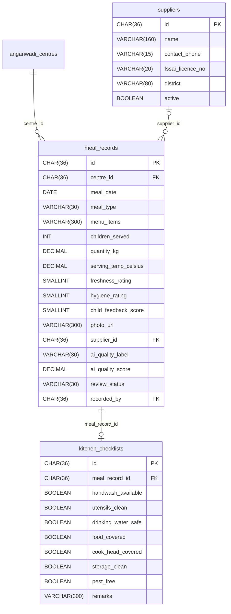
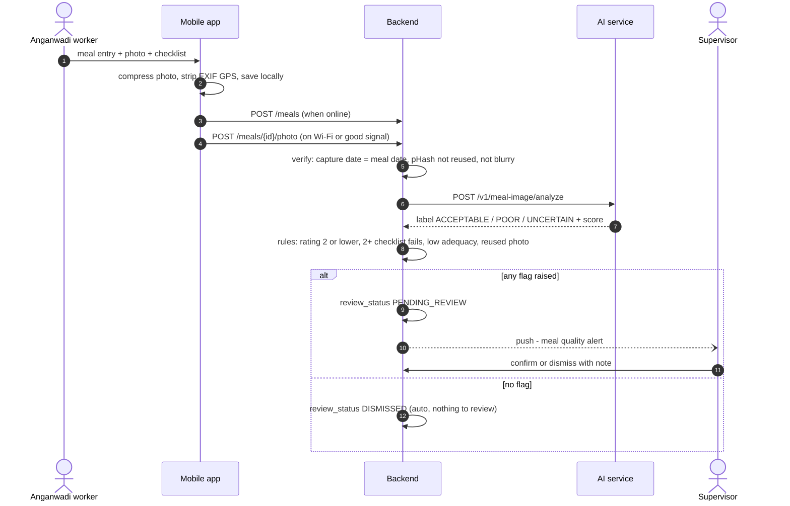

# Module 07: Midday Meal Quality Monitoring

- **Pillar:** 1 – Anganwadi child health & nutrition
- **Priority:** Medium
- **Status:** Planned

## Overview

Anganwadis serve **supplementary nutrition**: a morning snack and a hot cooked meal for children aged 3–6, and take-home ration (THR) for
younger children. For many children this is the most reliable meal of the day. Quality problems such as watery dal, undercooked or spoiled food,
unhygienic kitchens, short quantities and poor suppliers are common, and supervisors visit rarely, so problems are found late.

This module gives a **daily meal log** with a photo, quantity, serving temperature, freshness/hygiene ratings, child feedback and a kitchen
hygiene checklist. The backend checks the photo (fresh? reused? blurry?) and runs an **OpenCV + scikit-learn quality classifier**. It estimates
**nutritional adequacy** against norms and raises **poor-quality alerts** to the supervisor. The supervisor decides; the AI only flags.

## User roles & permissions

| Role | View | Create | Edit | Delete | Approve |
|---|---|---|---|---|---|
| SA | All | Yes | Yes | Soft-delete | Yes |
| AWW | Own centre | Daily meal record, photo, checklist | Same day | — | — |
| GS | Jurisdiction | Suppliers | Suppliers | Deactivate supplier | **Confirm/dismiss** poor-quality alerts |
| HP, PG, NGW, NGA | — | — | — | — | — |

TODO(team): should PG see a weekly menu summary? (Transparency, but not in Phase I.)

## Features

| Feature | Description |
|---|---|
| Daily meal entry | Meal type (morning snack / hot cooked meal / THR), menu items (pick list per state menu), children served (pre-filled from attendance) |
| Photo upload | **In-app camera only** (no gallery), plate photographed on a plain surface, compressed to ~300 KB on device, EXIF GPS stripped |
| Freshness & hygiene ratings | 1–5 stars with picture guides (e.g. 1 = spoiled smell/colour) |
| Quantity | Total cooked quantity (kg) → per-child grams calculated |
| Temperature | Serving temperature °C (if the centre has a food thermometer, otherwise "not measured") |
| Nutrition adequacy | Estimated kcal + protein per child vs. norms, from the menu items ([ml-overview.md](../ml-overview.md#4-nutritional-adequacy-rule-based)) |
| Child feedback | 3 smiley faces (😞 😐 😀) tapped by children or the AWW on their behalf, as a count per face |
| Kitchen hygiene checklist | 7 yes/no items: handwash with soap, utensils clean, safe drinking water, food covered, cook's head covered, storage clean, no pests |
| Supplier management | Supplier (THR / raw materials), FSSAI licence no., district, active flag. Link meals to suppliers |
| Image verification | Server checks: capture time vs. meal date, duplicate/reused photo (perceptual hash), blur/darkness |
| AI quality analysis | Classifier → `ACCEPTABLE` / `POOR` / `UNCERTAIN` + score |
| Poor-quality alerts | Rule or AI flag → alert to GS → confirm/dismiss with note → trend per centre and supplier |

## User stories

1. As an **Anganwadi worker**, I want to log today's meal with a photo in under 2 minutes so that it doesn't eat into cooking/teaching time.
2. As an **Anganwadi worker**, I want to tick a short hygiene checklist so that I remember the basics every day.
3. As a **Government Supervisor**, I want to be alerted when a centre's meal looks poor or hygiene items fail repeatedly so that I can visit that centre first.
4. As a **Government Supervisor**, I want to see which supplier is linked to repeated poor-quality THR so that I can act on the supplier.
5. As a **Government Supervisor**, I want to know if the same photo is being uploaded on different days so that I can trust the records.
6. As an **Anganwadi worker**, I want to see whether today's menu met the calorie/protein norm so that I can adjust portions.
7. As a **Super Admin**, I want to configure each state's menu items with nutrition values so that adequacy estimates are realistic.

## Screens

| Screen | Key fields / actions |
|---|---|
| **Meal Entry** | Meal type, menu items (multi-select chips), children served (pre-filled), quantity kg, temperature, freshness ★, hygiene ★, *Take photo* (with "Food only – no children" overlay), child feedback counters, *Next: checklist* |
| **Kitchen Checklist** | 7 big yes/no toggles with icons, remarks, *Save* |
| **Meal Result** | Adequacy bars (kcal, protein vs norm), photo check status ("Uploaded ✓ / Waiting for network"), AI result appears later ("Under review" if flagged) |
| **Meal History** | Calendar with coloured days (OK / flagged / missing), tap → details |
| **Quality Alerts** (GS) | List: centre, date, reason (AI POOR, low rating, checklist failures, reused photo), photo, *Confirm issue* / *Dismiss* + note |
| **Suppliers** (GS/SA) | List, add/edit: name, phone, FSSAI no., district, active |

## Data model

<!-- DATA_MODEL: meal_records, kitchen_checklists, suppliers -->
<!-- generated:start -->

**`meal_records`**: Daily meal log per centre with ratings, photo and AI suggestion. JPA entity: [`MealRecord`](../../backend/src/main/java/in/jansetu/meal/entity/MealRecord.java)

| Column | MySQL type | Null | Notes |
|---|---|---|---|
| `id` | `CHAR(36)` | no | PK, UUID (client-generated for offline-created rows) |
| `centre_id` | `CHAR(36)` | no | FK → `anganwadi_centres.id` |
| `meal_date` | `DATE` | no |  |
| `meal_type` | `VARCHAR(30)` | no | enum: `MORNING_SNACK`, `HOT_COOKED_MEAL`, `TAKE_HOME_RATION` |
| `menu_items` | `VARCHAR(300)` | no |  |
| `children_served` | `INT` | no |  |
| `quantity_kg` | `DECIMAL(6,2)` | yes |  |
| `serving_temp_celsius` | `DECIMAL(4,1)` | yes |  |
| `freshness_rating` | `SMALLINT` | no | 1-5 |
| `hygiene_rating` | `SMALLINT` | no | 1-5 |
| `child_feedback_score` | `SMALLINT` | yes | 1-3 smiley scale |
| `photo_url` | `VARCHAR(300)` | yes |  |
| `supplier_id` | `CHAR(36)` | yes | FK → `suppliers.id` |
| `ai_quality_label` | `VARCHAR(30)` | yes | enum: `ACCEPTABLE`, `POOR`, `UNCERTAIN`; AI suggestion only |
| `ai_quality_score` | `DECIMAL(4,3)` | yes |  |
| `review_status` | `VARCHAR(30)` | no | enum: `PENDING_REVIEW`, `CONFIRMED`, `DISMISSED` |
| `recorded_by` | `CHAR(36)` | no | FK → `users.id` |

Unique: (`centre_id`, `meal_date`, `meal_type`)

**`kitchen_checklists`**: Daily kitchen hygiene checklist (1:1 with a meal record). JPA entity: [`KitchenChecklist`](../../backend/src/main/java/in/jansetu/meal/entity/KitchenChecklist.java)

| Column | MySQL type | Null | Notes |
|---|---|---|---|
| `id` | `CHAR(36)` | no | PK, UUID (client-generated for offline-created rows) |
| `meal_record_id` | `CHAR(36)` | no | FK → `meal_records.id`; unique |
| `handwash_available` | `BOOLEAN` | no |  |
| `utensils_clean` | `BOOLEAN` | no |  |
| `drinking_water_safe` | `BOOLEAN` | no |  |
| `food_covered` | `BOOLEAN` | no |  |
| `cook_head_covered` | `BOOLEAN` | no |  |
| `storage_clean` | `BOOLEAN` | no |  |
| `pest_free` | `BOOLEAN` | no |  |
| `remarks` | `VARCHAR(300)` | yes |  |

**`suppliers`**: Food / THR suppliers. JPA entity: [`Supplier`](../../backend/src/main/java/in/jansetu/meal/entity/Supplier.java)

| Column | MySQL type | Null | Notes |
|---|---|---|---|
| `id` | `CHAR(36)` | no | PK, UUID (client-generated for offline-created rows) |
| `name` | `VARCHAR(160)` | no |  |
| `contact_phone` | `VARCHAR(15)` | yes |  |
| `fssai_licence_no` | `VARCHAR(20)` | yes |  |
| `district` | `VARCHAR(80)` | no |  |
| `active` | `BOOLEAN` | no |  |

All tables also have the common columns `created_at`, `updated_at`, `created_by`, `updated_by`, `version`, `deleted`. See [data-model.md](../data-model.md#conventions). Schema: [`V1__init.sql`](../../backend/src/main/resources/db/migration/V1__init.sql).
<!-- generated:end -->

Notes:
- Unique `(centre_id, meal_date, meal_type)`: one record per meal per day.
- `ai_quality_label` / `ai_quality_score` are set by the backend after the AI call. `review_status` follows the human review.
- Menu item master with nutrition values: TODO(team): `menu_items (id, state, name_en, name_hi, kcal_per_serving, protein_g_per_serving)` in V3. Until then `menu_items` is a comma-separated list.
- Photo perceptual hash: TODO(team): `photo_phash CHAR(16)` in V3.

## API endpoints

`ROLE_SUPER_ADMIN` may call every endpoint and is omitted below.

| Method | Path | Description | Allowed roles |
|---|---|---|---|
| GET | `/api/v1/meals?centreId=&from=&to=` | Meal records | `ROLE_ANGANWADI_WORKER`, `ROLE_GOVT_SUPERVISOR` |
| POST | `/api/v1/meals` | Create meal record (+ checklist) | `ROLE_ANGANWADI_WORKER` |
| PUT | `/api/v1/meals/{mealId}` | Edit (same day) | `ROLE_ANGANWADI_WORKER` |
| POST | `/api/v1/meals/{mealId}/photo` | Upload photo (multipart) → triggers verification + AI | `ROLE_ANGANWADI_WORKER` |
| GET | `/api/v1/meals/{mealId}/photo` | Download photo (access-checked) | `ROLE_ANGANWADI_WORKER`, `ROLE_GOVT_SUPERVISOR` |
| GET | `/api/v1/meals/{mealId}/adequacy` | kcal/protein estimate vs. norm | `ROLE_ANGANWADI_WORKER`, `ROLE_GOVT_SUPERVISOR` |
| GET | `/api/v1/meals/alerts?status=PENDING_REVIEW` | Poor-quality alerts in scope | `ROLE_GOVT_SUPERVISOR` |
| POST | `/api/v1/meals/{mealId}/review` | `{decision: CONFIRMED / DISMISSED, note}` | `ROLE_GOVT_SUPERVISOR` |
| GET | `/api/v1/suppliers` | List suppliers | `ROLE_GOVT_SUPERVISOR`, `ROLE_ANGANWADI_WORKER` |
| POST | `/api/v1/suppliers` | Add supplier | `ROLE_GOVT_SUPERVISOR` |
| PUT | `/api/v1/suppliers/{supplierId}` | Edit / deactivate | `ROLE_GOVT_SUPERVISOR` |

AI service (internal): `POST /v1/meal-image/analyze` (multipart image → label, score, image-quality flag, reasons).

## Workflow

## Business rules & validation

- One record per centre per meal type per day. Only on working days (not on closed days from [Module 05](05-attendance.md)).
- `childrenServed` ≤ active enrolled children. If it differs from attendance "present" by > 20 %, ask for a reason.
- Ratings 1–5 (required). Child feedback 1–3 scale stored as an average (counts in UI).
- Temperature 0–100 °C. Hot cooked meal served below 60 °C → hygiene note (TODO(team): confirm threshold with FSSAI guidance for the pilot).
- Photo: JPEG/PNG, ≤ 5 MB, from the in-app camera. The capture timestamp must be on the meal date (IST), otherwise flag `PHOTO_DATE_MISMATCH`.
- Reused photo: perceptual-hash Hamming distance ≤ 6 vs. the same centre's last 60 photos → flag `PHOTO_REUSED`.
- **Alert rules** (any one): AI label `POOR` with score ≥ 0.7. Freshness or hygiene rating ≤ 2. ≥ 2 checklist items failed. Adequacy < 80 % of kcal or protein norm 3 times in 7 days. Photo reused/date mismatch. Meal not logged on a working day.
- AI `UNCERTAIN` alone does **not** alert, but it asks the AWW to retake the photo once.
- A supplier with ≥ 3 confirmed THR quality issues in 30 days → flagged on the supplier list.

## Offline behaviour

- Meal entry, checklist and photo capture work **offline**. The photo is kept in app-private storage (`local_photo_path`), not the gallery.
- SQLite: `meal_records` ([`schema.ts`](../../mobile/src/db/schema.ts)) + checklist (TODO(team): add table). The meal op uses `PRIORITY.DEFAULT`, the photo upload `PRIORITY.MEDIA`.
  It is uploaded last, preferably on Wi-Fi/4G, resumable, retried with backoff. After a successful upload the local photo is deleted after 7 days.
- Adequacy is calculated on the device from the cached menu master, so the result shows offline.
- AI analysis and alerts happen only on the server after upload.
- Conflicts: same centre/date/meal type from two devices → manual pick. Ratings/notes → last-write-wins.

## AI / ML

| Item | Detail |
|---|---|
| Model | OpenCV feature extraction (HSV histograms, LBP texture, edge density, plate coverage, dominant colours) + Random Forest / linear SVM ([ml-overview.md](../ml-overview.md#3-meal-image-quality-analysis)) |
| Input | Meal photo (JPEG), meal type |
| Output | `label` (ACCEPTABLE / POOR / UNCERTAIN), `score` (P(POOR)), `image_quality_ok`, reasons |
| Endpoint | ai-service `POST /v1/meal-image/analyze` (stub returns 501 until trained) |
| Training data | ≥ 500 pilot photos labelled by supervisors with a labelling guide. TODO(team) |
| Human review | Every AI `POOR` becomes `PENDING_REVIEW` for the GS. The AWW is never penalised automatically. Dismissals are fed back as labels |

## Notifications triggered

| Event | To |
|---|---|
| Meal not logged by 14:00 IST on a working day | AWW (local) |
| Photo still not uploaded after 2 days | AWW |
| Poor-quality alert | GS |
| Alert confirmed (with note) | AWW |
| Supplier flagged | GS, SA |
| Weekly centre meal summary | GS |

## Privacy & security considerations

- Photos are of food only. The camera overlay says "Do not photograph children", and photos with faces are deleted on review (TODO(team): optional face detection to auto-warn).
- EXIF metadata (including GPS) is stripped before upload. Photos live in a private bucket, served only through the API.
- Supplier phone numbers are personal data (S2) and visible only to GS/SA.
- Ratings are about the meal, not the worker. Dashboards show centre trends, not individual blame, which reduces the incentive to fake entries.

## Dependencies on other modules

- [05 – Attendance](05-attendance.md): children present, closed days.
- [13 – AI Analytics](13-ai-analytics.md): image model, adequacy rules, alert review.
- [14 – Notifications](14-notifications.md), [15 – Admin Dashboard](15-admin-dashboard-reports.md): meal quality reports.
- [16 – Offline Sync](16-offline-sync.md): media upload queue.

## Acceptance criteria

- [ ] An AWW can log a meal with photo and checklist offline in ≤ 2 minutes, and it syncs later including the photo.
- [ ] The uploaded photo has no EXIF GPS data (verified on the stored file).
- [ ] Uploading the same photo on two different days raises `PHOTO_REUSED` for the GS.
- [ ] A freshness rating of 1 creates a `PENDING_REVIEW` alert visible to the GS of that centre only.
- [ ] Adequacy shows kcal and protein per child vs. the configured norm for a sample menu, matching a hand calculation.
- [ ] If the AI service is down, the meal record still saves, and the analysis runs when the service is back.
- [ ] A GS dismissal with note is stored and shown in the meal history.

## Future enhancements

- Portion estimation from the photo (reference object on the plate).
- THR packet batch/expiry scanning (barcode).
- Community (mothers' committee) feedback via SMS/IVR.
- Cook training content linked to failed checklist items.
