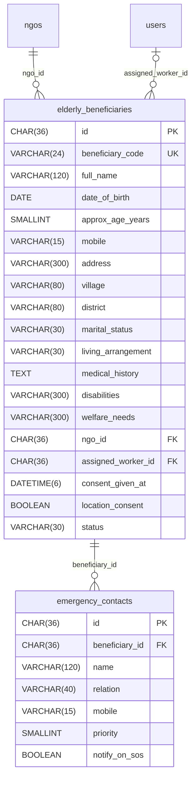
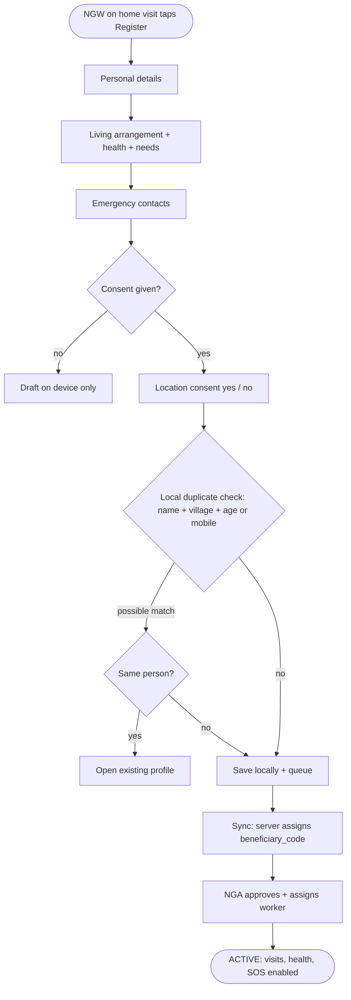

# Module 08: Elderly Women Registration & Management

- **Pillar:** 2 – Elderly women care & safety
- **Priority:** High
- **Status:** Planned

## Overview

Many elderly women in rural India, especially **widows and women living alone** after children migrate to cities, have no regular contact
with health or welfare services. NGOs support them through home visits, but records sit in notebooks spread across field workers. When a
worker leaves, the knowledge of who needs what leaves with them.

This module is the **beneficiary register** for Pillar 2: each woman gets a beneficiary ID, a profile with family and emergency contacts,
living arrangement, medical history, welfare needs and an **assigned NGO worker**. It is the anchor for healthcare ([09](09-elderly-healthcare.md)),
SOS ([10](10-emergency-sos.md)), welfare ([11](11-welfare-ngo-assistance.md)) and visits ([12](12-ngo-worker-caregiver.md)).

## User roles & permissions

| Role | View | Create | Edit | Delete | Approve |
|---|---|---|---|---|---|
| SA | All | Yes | Yes | Soft-delete | Yes |
| NGW | Assigned beneficiaries (+ ones they registered, until assigned) | Register | Assigned beneficiaries' profiles & contacts | — | — |
| NGA | All of own NGO | Register | Yes | Deactivate / mark deceased | **Approve registration**, assign worker |
| HP | Referred / QR-granted | — | — | — | — |
| AWW, PG, GS | — | — | — | — | — |

## Features

| Feature | Description |
|---|---|
| Registration | Name, DOB or approximate age (often unknown), mobile (optional, many have none or use a family phone), address, village, district |
| Beneficiary ID | Server-assigned `beneficiary_code` = `<NGO short code>-<5-digit serial>`, e.g. `NGO07-00142`. "Pending ID" until synced |
| Personal info | Marital status (many are widowed, which is relevant to pension schemes), disabilities, language spoken |
| Family & emergency contacts | Up to 5 contacts with relation, mobile, priority order, "notify on SOS" toggle |
| Living arrangement | Alone / with spouse / with family / care home. *Alone* raises visit priority |
| Medical history | Known conditions (hypertension, diabetes, arthritis, vision, hearing, memory) as chips + free text, allergies |
| Welfare needs | Needs checklist: food, pension, shelter repair, clothing, legal aid, counselling, assistive devices, with free text |
| Assigned NGO worker | Set by NGA, history kept in `caregiver_assignments` ([Module 12](12-ngo-worker-caregiver.md)) |
| Consent | Consent recorded (self, or family/lawful guardian if she cannot consent). Separate **location-sharing consent** for SOS |
| Profile & history | Summary + timeline of visits, health records, welfare, SOS incidents |
| Search & filter | Name, code, village, worker, living alone, condition, status |

## User stories

1. As an **NGO worker**, I want to register an elderly woman during a home visit, even without network, so that she starts getting support immediately.
2. As an **NGO worker**, I want to record her son's number as an emergency contact so that he is informed if she presses SOS.
3. As an **NGO Administrator**, I want to approve new registrations and assign a worker so that every woman has a responsible person.
4. As an **NGO Administrator**, I want to filter women who live alone and have hypertension so that I can plan health camps.
5. As an **NGO worker**, I want to see her welfare needs on her profile so that I bring the right forms on my next visit.
6. As an **elderly woman** (through the worker), I want to choose whether my location is shared during an emergency so that my privacy is respected.
7. As an **NGO Administrator**, I want to mark a beneficiary as deceased or inactive so that she no longer appears in visit plans and SOS lists.

## Screens

| Screen | Key fields / actions |
|---|---|
| **Beneficiary List** | Search, filters (village, worker, living alone, condition, status), row: name, age, village, "Alone" badge, last visit date |
| **Elderly Registration** (4 steps) | 1. Personal: name, DOB or approx age, marital status, mobile, address, village, district. 2. Living & health: living arrangement, conditions chips, disabilities, allergies. 3. Contacts: add 1–5 contacts (name, relation, mobile, notify on SOS). 4. Consent: notice read aloud (Hindi audio), self / family consent, location consent yes/no, *Save* |
| **Beneficiary Profile** | Header (name, code, age, village, assigned worker). Tiles: Health, SOS, Welfare, Visits, Health Card. Welfare needs list. *Edit* |
| **Emergency Contacts** | List ordered by priority, drag to reorder, *Call*, toggle notify on SOS |
| **Assign Worker** (NGA) | Worker picker with current caseload count |
| **Approve Registrations** (NGA) | Pending registrations, *Approve* / *Reject (duplicate / outside area)* |

## Data model

<!-- DATA_MODEL: elderly_beneficiaries, emergency_contacts -->
<!-- generated:start -->

**`elderly_beneficiaries`**: An elderly woman supported by an NGO. Anchor for Pillar 2. JPA entity: [`ElderlyBeneficiary`](../../backend/src/main/java/in/jansetu/elderly/entity/ElderlyBeneficiary.java)

| Column | MySQL type | Null | Notes |
|---|---|---|---|
| `id` | `CHAR(36)` | no | PK, UUID (client-generated for offline-created rows) |
| `beneficiary_code` | `VARCHAR(24)` | no | unique |
| `full_name` | `VARCHAR(120)` | no |  |
| `date_of_birth` | `DATE` | yes | often unknown |
| `approx_age_years` | `SMALLINT` | yes | used when DOB unknown |
| `mobile` | `VARCHAR(15)` | yes | many beneficiaries have no phone |
| `address` | `VARCHAR(300)` | no |  |
| `village` | `VARCHAR(80)` | yes |  |
| `district` | `VARCHAR(80)` | no |  |
| `marital_status` | `VARCHAR(30)` | yes | enum: `MARRIED`, `WIDOWED`, `SEPARATED`, `NEVER_MARRIED` |
| `living_arrangement` | `VARCHAR(30)` | no | enum: `ALONE`, `WITH_SPOUSE`, `WITH_FAMILY`, `CARE_HOME` |
| `medical_history` | `TEXT` | yes |  |
| `disabilities` | `VARCHAR(300)` | yes |  |
| `welfare_needs` | `VARCHAR(300)` | yes |  |
| `ngo_id` | `CHAR(36)` | no | FK → `ngos.id` |
| `assigned_worker_id` | `CHAR(36)` | yes | FK → `users.id` |
| `consent_given_at` | `DATETIME(6)` | no |  |
| `location_consent` | `BOOLEAN` | no | required before SOS shares GPS |
| `status` | `VARCHAR(30)` | no | enum: `ACTIVE`, `INACTIVE`, `DECEASED` |

**`emergency_contacts`**: Family/neighbour contacts notified on SOS, in priority order. JPA entity: [`EmergencyContact`](../../backend/src/main/java/in/jansetu/elderly/entity/EmergencyContact.java)

| Column | MySQL type | Null | Notes |
|---|---|---|---|
| `id` | `CHAR(36)` | no | PK, UUID (client-generated for offline-created rows) |
| `beneficiary_id` | `CHAR(36)` | no | FK → `elderly_beneficiaries.id` |
| `name` | `VARCHAR(120)` | no |  |
| `relation` | `VARCHAR(40)` | no |  |
| `mobile` | `VARCHAR(15)` | no |  |
| `priority` | `SMALLINT` | no | 1 = call first |
| `notify_on_sos` | `BOOLEAN` | no |  |

All tables also have the common columns `created_at`, `updated_at`, `created_by`, `updated_by`, `version`, `deleted`. See [data-model.md](../data-model.md#conventions). Schema: [`V1__init.sql`](../../backend/src/main/resources/db/migration/V1__init.sql).
<!-- generated:end -->

Notes:
- `date_of_birth` **or** `approx_age_years` is required (service-level check).
- `consent_given_at` is required. `location_consent` defaults to `false`.
- Registration approval status: TODO(team): add `PENDING_APPROVAL` to `BeneficiaryStatus` in V3 (V1 has ACTIVE / INACTIVE / DECEASED).

## API endpoints

`ROLE_SUPER_ADMIN` may call every endpoint and is omitted below.

| Method | Path | Description | Allowed roles |
|---|---|---|---|
| GET | `/api/v1/elderly` | List/search in scope | `ROLE_NGO_WORKER`, `ROLE_NGO_ADMIN`, `ROLE_HEALTH_PROFESSIONAL` |
| POST | `/api/v1/elderly` | Register (client `id` allowed) | `ROLE_NGO_WORKER`, `ROLE_NGO_ADMIN` |
| GET | `/api/v1/elderly/{beneficiaryId}` | Profile | `ROLE_NGO_WORKER`, `ROLE_NGO_ADMIN`, `ROLE_HEALTH_PROFESSIONAL` |
| PUT | `/api/v1/elderly/{beneficiaryId}` | Update profile | `ROLE_NGO_WORKER`, `ROLE_NGO_ADMIN` |
| POST | `/api/v1/elderly/{beneficiaryId}/approve` | Approve registration | `ROLE_NGO_ADMIN` |
| POST | `/api/v1/elderly/{beneficiaryId}/status` | Set INACTIVE / DECEASED `{status, reason, date}` | `ROLE_NGO_ADMIN` |
| PUT | `/api/v1/elderly/{beneficiaryId}/assigned-worker` | Assign / change worker | `ROLE_NGO_ADMIN` |
| GET | `/api/v1/elderly/{beneficiaryId}/contacts` | Emergency contacts | `ROLE_NGO_WORKER`, `ROLE_NGO_ADMIN` |
| POST | `/api/v1/elderly/{beneficiaryId}/contacts` | Add contact | `ROLE_NGO_WORKER`, `ROLE_NGO_ADMIN` |
| PUT | `/api/v1/emergency-contacts/{contactId}` | Edit contact / priority | `ROLE_NGO_WORKER`, `ROLE_NGO_ADMIN` |
| DELETE | `/api/v1/emergency-contacts/{contactId}` | Remove contact | `ROLE_NGO_WORKER`, `ROLE_NGO_ADMIN` |
| GET | `/api/v1/elderly/{beneficiaryId}/timeline` | Combined history | `ROLE_NGO_WORKER`, `ROLE_NGO_ADMIN` |

## Workflow

## Business rules & validation

- Age: DOB or `approxAgeYears` required. Beneficiary should be **≥ 60 years** (TODO(team): partner NGO may use 55+ for widows, so make it configurable).
- Mobile optional. If present, it must be a valid Indian mobile. At least **one emergency contact with a mobile** is required before SOS can be enabled.
- Emergency contact `priority` unique per beneficiary (1 = first). Max 5 contacts.
- Duplicate check: normalised name + village + (mobile match **or** approx age ± 2) → `DUPLICATE_SUSPECTED`, resolved by the NGA.
- `assignedWorkerId` must be an active `NGO_WORKER` of the same NGO.
- Status `DECEASED` stops all reminders, visits and SOS for her and closes open tasks. Data is retained per [privacy-and-security.md](../privacy-and-security.md#retention).
- `locationConsent = false` → SOS sends alerts without GPS coordinates (village/address only).
- Edits to identity fields (name, DOB) and consent changes are audited with a reason.

## Offline behaviour

- Registration, profile edits, contacts and search work **offline** for the worker's assigned beneficiaries (+ their own unsynced registrations).
- SQLite: `elderly_beneficiaries` ([`schema.ts`](../../mobile/src/db/schema.ts)) + emergency contacts (TODO(team): add local table). Emergency contacts are cached on the device because SOS needs them offline ([Module 10](10-emergency-sos.md)).
- Approval and worker assignment are online only (NGA).
- Conflicts: contact phone / address → last-write-wins. Name, DOB, consent fields → manual review.

## AI / ML

None directly. Profile fields (age, living alone) are features for the elderly risk score ([Module 13](13-ai-analytics.md)) and for visit prioritisation.

## Notifications triggered

| Event | To |
|---|---|
| New registration waiting for approval | NGA |
| Registration approved + worker assigned | Assigned NGW |
| Worker reassigned | Old and new NGW |
| Emergency contact added (with "notify on SOS") | That contact by SMS: "You have been added as emergency contact for … by <NGO>". TODO(team): confirm wording |
| Beneficiary marked deceased | Assigned NGW, NGA |

## Privacy & security considerations

- Living alone + address + age is a **safety risk** (targets for theft/fraud). The "lives alone" field is S3: never exported below aggregate level and never shown in notifications.
- No Aadhaar, bank account or caste stored ([privacy-and-security.md](../privacy-and-security.md#data-minimisation-what-we-do-not-collect)).
- Consent can come from a family member/lawful guardian if she cannot consent (cognitive impairment), recorded as such.
- Emergency contacts are third-party personal data: informed by SMS when added, removable on request.
- NGW sees only assigned beneficiaries. Reassignment removes access on the old worker's device at the next sync.

## Dependencies on other modules

- [01 – Authentication](01-authentication.md): NGO scope.
- [12 – NGO Worker & Caregiver Mgmt](12-ngo-worker-caregiver.md): assignments.
- [09](09-elderly-healthcare.md), [10](10-emergency-sos.md), [11](11-welfare-ngo-assistance.md), [06](06-qr-health-card.md): use the beneficiary record.
- [15 – Admin Dashboard](15-admin-dashboard-reports.md): `ngos` master data.

## Acceptance criteria

- [ ] An NGW can register a beneficiary with 2 contacts offline, and she syncs with a `beneficiary_code` later.
- [ ] A beneficiary without DOB and without approx age is rejected.
- [ ] SOS cannot be enabled until at least one emergency contact with a mobile exists.
- [ ] An NGW gets `404` for a beneficiary assigned to another worker.
- [ ] After reassignment, the old worker's device no longer shows the beneficiary after sync.
- [ ] Marking deceased cancels her scheduled visits and medicine reminders.
- [ ] All registration screens work in Hindi, with audio for the consent notice.

## Future enhancements

- Eligibility pre-check for pension schemes from profile data ([Module 11](11-welfare-ngo-assistance.md)).
- Elderly women's self-help group linkage.
- Voice notes (Hindi) for workers who type slowly.
