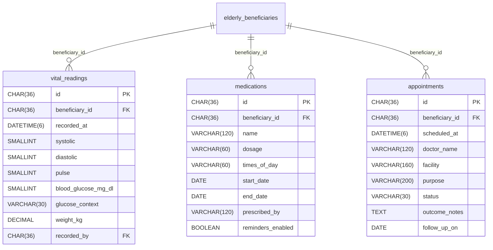
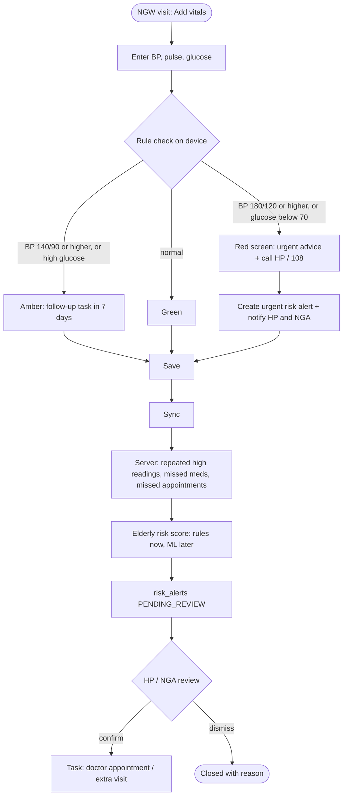

# Module 09: Elderly Healthcare Management

- **Pillar:** 2 – Elderly women care & safety
- **Priority:** High
- **Status:** Planned

## Overview

Hypertension and diabetes are common and often **undiagnosed or poorly controlled** among rural elderly women. Medicines are skipped
because of poor eyesight, memory, cost or no one reminding. Doctor appointments at the CHC/district hospital are missed because of distance
and no escort. The NGO worker visits every week or two with a BP monitor and glucometer, but readings are written on paper and trends are invisible.

This module records **BP and blood glucose readings**, medicines with **reminders**, doctor **appointments** and **checkup history**, tracks
follow-ups, and runs **rule-based (later ML) health risk alerts** that a human reviews.

## User roles & permissions

| Role | View | Create | Edit | Delete | Approve |
|---|---|---|---|---|---|
| SA | All | Yes | Yes | Soft-delete | Yes |
| NGW | Assigned beneficiaries | Vitals, medicines (from prescription), appointments, follow-ups | Own entries (same day for vitals) | — | — |
| HP | Referred / QR-granted | Vitals, medicines, appointment outcomes | Own entries | — | **Review elderly risk alerts** |
| NGA | All of own NGO | — | — | — | Review risk alerts (non-clinical triage) |
| AWW, PG, GS | — | — | — | — | — |

## Features

| Feature | Description |
|---|---|
| Health records | Conditions, allergies (from [Module 08](08-elderly-registration.md)), and the health timeline |
| BP logging | Systolic / diastolic / pulse with time. Device type (digital/manual). Colour band (normal / elevated / high / crisis) |
| Blood glucose logging | mg/dL with context (fasting / post-meal / random) |
| Medicine info | Name, dosage, times of day, start/end date, prescribed by. Pick list of common medicines + free text |
| Medicine reminders | Local notifications at set times on the **beneficiary's phone (if she has a smartphone)** or the family/worker phone. Taken / missed marked by worker on visit |
| Doctor appointments | Date/time, facility, doctor, purpose. Reminders the day before + escort/transport note |
| Checkup history | Appointment outcomes, notes, prescriptions changed |
| Follow-ups | Follow-up date per appointment/abnormal reading → task for NGW |
| Health trends | Charts of BP and glucose over time (last 30/90 days) |
| Health risk alerts | Rules (crisis BP, hypoglycaemia, repeated high readings, missed meds) and later ML ([Module 13](13-ai-analytics.md)) → human review |

## User stories

1. As an **NGO worker**, I want to log BP and glucose during my visit, even with no network, so that the readings aren't lost.
2. As an **NGO worker**, I want the app to warn me immediately if a reading is dangerously high so that I can arrange urgent care.
3. As an **elderly woman** (with a basic smartphone), I want a loud reminder in Hindi to take my BP tablet so that I don't forget.
4. As an **NGO worker**, I want to see her BP trend over 3 months so that I can show the doctor whether the medicine works.
5. As a **Healthcare Professional**, I want to update her medicines after an appointment so that the reminders are correct.
6. As an **NGO Administrator**, I want a list of women with missed appointments so that we can arrange transport.
7. As a **Healthcare Professional**, I want to review flagged high-risk women so that the most urgent get attention first.

## Screens

| Screen | Key fields / actions |
|---|---|
| **Health Overview** | Latest BP + glucose with colour + date, current medicines, next appointment, open follow-ups, *Add reading* |
| **Add Vitals** | Systolic, diastolic, pulse (large numeric keypad), glucose + context, time (default now), *Save* → immediate rule check (red full-screen advice if crisis) |
| **Vitals Trend** | BP chart (two lines + bands), glucose chart, 30/90-day toggle, table view |
| **Medicines** | List with times, *Add/Edit* (name, dosage, times of day, start/end, reminders on/off), adherence (taken/missed on visits) |
| **Appointments** | Upcoming/past, *Add* (date/time, facility, doctor, purpose), *Record outcome* (notes, follow-up date, medicines changed?) |
| **Follow-ups** | Due/overdue tasks for the worker's beneficiaries |

## Data model

<!-- DATA_MODEL: vital_readings, medications, appointments -->
<!-- generated:start -->

**`vital_readings`**: BP / pulse / glucose readings (append-only). JPA entity: [`VitalReading`](../../backend/src/main/java/in/jansetu/elderlyhealth/entity/VitalReading.java)

| Column | MySQL type | Null | Notes |
|---|---|---|---|
| `id` | `CHAR(36)` | no | PK, UUID (client-generated for offline-created rows) |
| `beneficiary_id` | `CHAR(36)` | no | FK → `elderly_beneficiaries.id` |
| `recorded_at` | `DATETIME(6)` | no |  |
| `systolic` | `SMALLINT` | yes | mmHg |
| `diastolic` | `SMALLINT` | yes | mmHg |
| `pulse` | `SMALLINT` | yes | bpm |
| `blood_glucose_mg_dl` | `SMALLINT` | yes |  |
| `glucose_context` | `VARCHAR(30)` | yes | enum: `FASTING`, `POST_MEAL`, `RANDOM` |
| `weight_kg` | `DECIMAL(5,2)` | yes |  |
| `recorded_by` | `CHAR(36)` | no | FK → `users.id` |

**`medications`**: Current and past medicines, with reminder times. JPA entity: [`Medication`](../../backend/src/main/java/in/jansetu/elderlyhealth/entity/Medication.java)

| Column | MySQL type | Null | Notes |
|---|---|---|---|
| `id` | `CHAR(36)` | no | PK, UUID (client-generated for offline-created rows) |
| `beneficiary_id` | `CHAR(36)` | no | FK → `elderly_beneficiaries.id` |
| `name` | `VARCHAR(120)` | no |  |
| `dosage` | `VARCHAR(60)` | no | e.g. 1 tablet 5 mg |
| `times_of_day` | `VARCHAR(60)` | no | HH:mm list, e.g. 08:00,20:00 |
| `start_date` | `DATE` | no |  |
| `end_date` | `DATE` | yes | null = ongoing |
| `prescribed_by` | `VARCHAR(120)` | yes |  |
| `reminders_enabled` | `BOOLEAN` | no |  |

**`appointments`**: Doctor appointments and their outcomes. JPA entity: [`Appointment`](../../backend/src/main/java/in/jansetu/elderlyhealth/entity/Appointment.java)

| Column | MySQL type | Null | Notes |
|---|---|---|---|
| `id` | `CHAR(36)` | no | PK, UUID (client-generated for offline-created rows) |
| `beneficiary_id` | `CHAR(36)` | no | FK → `elderly_beneficiaries.id` |
| `scheduled_at` | `DATETIME(6)` | no |  |
| `doctor_name` | `VARCHAR(120)` | yes |  |
| `facility` | `VARCHAR(160)` | no |  |
| `purpose` | `VARCHAR(200)` | no |  |
| `status` | `VARCHAR(30)` | no | enum: `SCHEDULED`, `COMPLETED`, `MISSED`, `CANCELLED` |
| `outcome_notes` | `TEXT` | yes |  |
| `follow_up_on` | `DATE` | yes |  |

All tables also have the common columns `created_at`, `updated_at`, `created_by`, `updated_by`, `version`, `deleted`. See [data-model.md](../data-model.md#conventions). Schema: [`V1__init.sql`](../../backend/src/main/resources/db/migration/V1__init.sql).
<!-- generated:end -->

Notes:
- Vitals are append-only (no conflicts).
- Medicine adherence records: TODO(team): `medication_doses (medication_id, scheduled_at, status TAKEN/MISSED/UNKNOWN, recorded_by)` in V3.

## API endpoints

`ROLE_SUPER_ADMIN` may call every endpoint and is omitted below.

| Method | Path | Description | Allowed roles |
|---|---|---|---|
| GET | `/api/v1/elderly/{beneficiaryId}/vitals?from=&to=` | Readings | `ROLE_NGO_WORKER`, `ROLE_NGO_ADMIN`, `ROLE_HEALTH_PROFESSIONAL` |
| POST | `/api/v1/elderly/{beneficiaryId}/vitals` | Add reading → rule check result | `ROLE_NGO_WORKER`, `ROLE_HEALTH_PROFESSIONAL` |
| PUT | `/api/v1/vitals/{readingId}` | Correct (same day) | `ROLE_NGO_WORKER`, `ROLE_HEALTH_PROFESSIONAL` |
| GET | `/api/v1/elderly/{beneficiaryId}/medications` | Medicines | `ROLE_NGO_WORKER`, `ROLE_NGO_ADMIN`, `ROLE_HEALTH_PROFESSIONAL` |
| POST | `/api/v1/elderly/{beneficiaryId}/medications` | Add medicine | `ROLE_NGO_WORKER`, `ROLE_HEALTH_PROFESSIONAL` |
| PUT | `/api/v1/medications/{medicationId}` | Edit / stop | `ROLE_NGO_WORKER`, `ROLE_HEALTH_PROFESSIONAL` |
| GET | `/api/v1/elderly/{beneficiaryId}/appointments` | Appointments | `ROLE_NGO_WORKER`, `ROLE_NGO_ADMIN`, `ROLE_HEALTH_PROFESSIONAL` |
| POST | `/api/v1/elderly/{beneficiaryId}/appointments` | Book | `ROLE_NGO_WORKER`, `ROLE_NGO_ADMIN`, `ROLE_HEALTH_PROFESSIONAL` |
| PATCH | `/api/v1/appointments/{appointmentId}` | Status / outcome / follow-up | `ROLE_NGO_WORKER`, `ROLE_HEALTH_PROFESSIONAL` |
| GET | `/api/v1/elderly/follow-ups?workerId=&dueBefore=` | Follow-up tasks | `ROLE_NGO_WORKER`, `ROLE_NGO_ADMIN` |
| GET | `/api/v1/elderly/{beneficiaryId}/health-trend?days=90` | Aggregated trend data | `ROLE_NGO_WORKER`, `ROLE_NGO_ADMIN`, `ROLE_HEALTH_PROFESSIONAL` |

AI service (internal): `POST /v1/elderly-risk/predict`.

## Workflow

## Business rules & validation

- Ranges (device + server): systolic 50–260, diastolic 30–160, systolic > diastolic, pulse 20–220, glucose 20–700 mg/dL. Glucose requires `glucoseContext`.
- BP bands (for display, TODO(team): confirm with partner doctor): normal < 120/80, elevated 120–139/80–89, high ≥ 140/90, **crisis ≥ 180/120**.
- **Urgent rules** (alert immediately, also offline on device): BP ≥ 180/120. Glucose < 70 mg/dL. Glucose > 300 mg/dL with symptoms (TODO(team)).
- **Follow-up rules:** ≥ 3 readings ≥ 140/90 in 14 days. Fasting glucose ≥ 126 or random ≥ 200 twice in 30 days. Missed doses ≥ 30 % in 14 days.
- The app **never** advises changing medicine doses. It advises contacting the HP/doctor. Urgent screen shows **108** (ambulance) and the HP's number.
- Medicine `timesOfDay`: 1–4 times, `HH:mm`. `endDate` ≥ `startDate`. Reminders stop at `endDate` or when the beneficiary is inactive/deceased.
- Appointment in the past cannot be `SCHEDULED`. Missed appointments (no outcome 1 day after) → `MISSED` + follow-up task.

## Offline behaviour

- Vitals entry, rule check, medicine list, local reminders, appointment list and follow-ups all work **offline**.
- SQLite: `vital_readings` ([`schema.ts`](../../mobile/src/db/schema.ts)), medicines and appointments (TODO(team): add local tables). Vitals use `PRIORITY.HEALTH`.
- **Medicine reminders are scheduled as local notifications** on the device from cached data, so they need no network.
- Urgent rule alerts: on-device screen immediately. Notification to HP/NGA is queued with `PRIORITY.SOS` and sent at the first network. If there is no data for 10 minutes, the app offers **"Send SMS to HP"** (uses the phone's SMS).
- Conflicts: vitals append-only. Medicine edits (clinical) → manual review. Appointment notes → last-write-wins.

## AI / ML

| Item | Detail |
|---|---|
| Model | Phase I: **rule-based score**. Later: Logistic Regression ([ml-overview.md](../ml-overview.md#5-elderly-health-risk)) |
| Input features | Age, lives alone, BP mean & variability (30 d), glucose readings, missed doses, missed appointments, SOS count (90 d), days since last visit |
| Output | `risk_score`, `risk_level`, top factors |
| Endpoint | ai-service `POST /v1/elderly-risk/predict` (after each sync with new vitals, and nightly) |
| Human review | `risk_alerts` `PENDING_REVIEW` → HP (clinical) or NGA (visit planning) confirms/dismisses. **No automatic medical action** |

## Notifications triggered

| Event | To | Channel |
|---|---|---|
| Medicine time | Beneficiary / family phone (local) | Local notification with Hindi voice (TODO(team)) |
| Urgent reading | HP, NGA, assigned NGW | Push, SMS fallback |
| Follow-up due | NGW | Push / local |
| Appointment tomorrow | NGW, beneficiary contact | Push / SMS |
| Appointment missed | NGW, NGA | Push |
| Risk alert to review | HP / NGA | Push |

## Privacy & security considerations

- Vitals, conditions and medicines are **S3**. Push/SMS texts say "Health follow-up needed for a beneficiary", never values or conditions.
- Medicine reminder text on a shared phone shows "Medicine time" (no medicine name) by default. The beneficiary can opt in to names.
- HP access is via referral or QR grant only, and audited.
- Readings entered by the worker are attributed (`recorded_by`) for accountability.

## Dependencies on other modules

- [08 – Elderly Registration](08-elderly-registration.md): beneficiary, conditions, contacts.
- [12 – NGO Worker & Caregiver Mgmt](12-ngo-worker-caregiver.md): visits produce readings and follow-ups.
- [13 – AI Analytics](13-ai-analytics.md), [14 – Notifications](14-notifications.md), [10 – SOS](10-emergency-sos.md) (SOS count as risk factor).

## Acceptance criteria

- [ ] Entering BP 185/125 offline shows the urgent screen within 1 s, and the alert reaches the HP within 1 min of connectivity.
- [ ] Systolic ≤ diastolic is rejected.
- [ ] A medicine with times 08:00 and 20:00 triggers local notifications at those times with the phone in airplane mode.
- [ ] 3 readings ≥ 140/90 within 14 days create one follow-up task.
- [ ] No push or SMS text contains a BP/glucose value or a condition name.
- [ ] A risk alert stays `PENDING_REVIEW` until an HP/NGA decides. Nothing about the medicines changes automatically.
- [ ] The trend chart for 90 days of readings renders in < 2 s on a 2 GB RAM phone.

## Future enhancements

- Bluetooth BP monitors / glucometers.
- Teleconsultation via eSanjeevani links.
- Medicine stock reminders (refill from Jan Aushadhi Kendra).
- Fall-risk and memory screening questionnaires.
