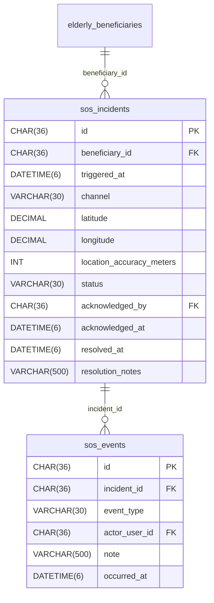
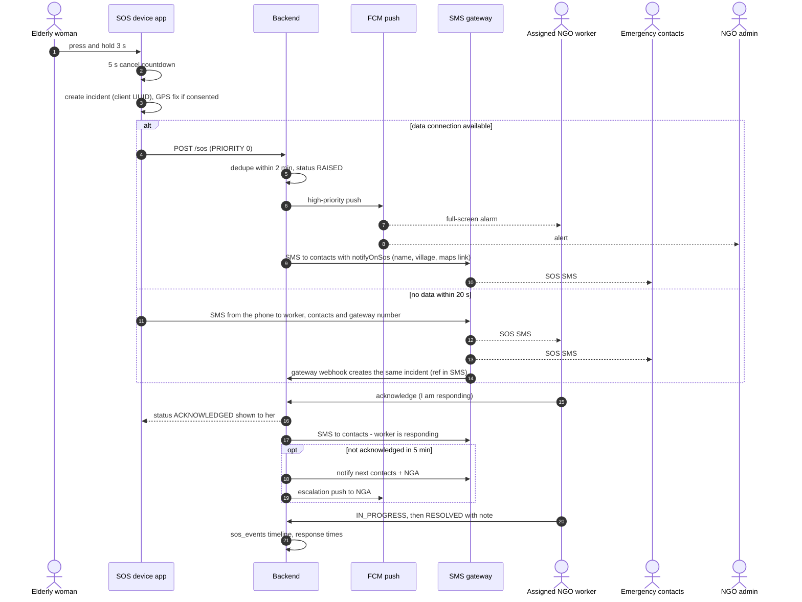
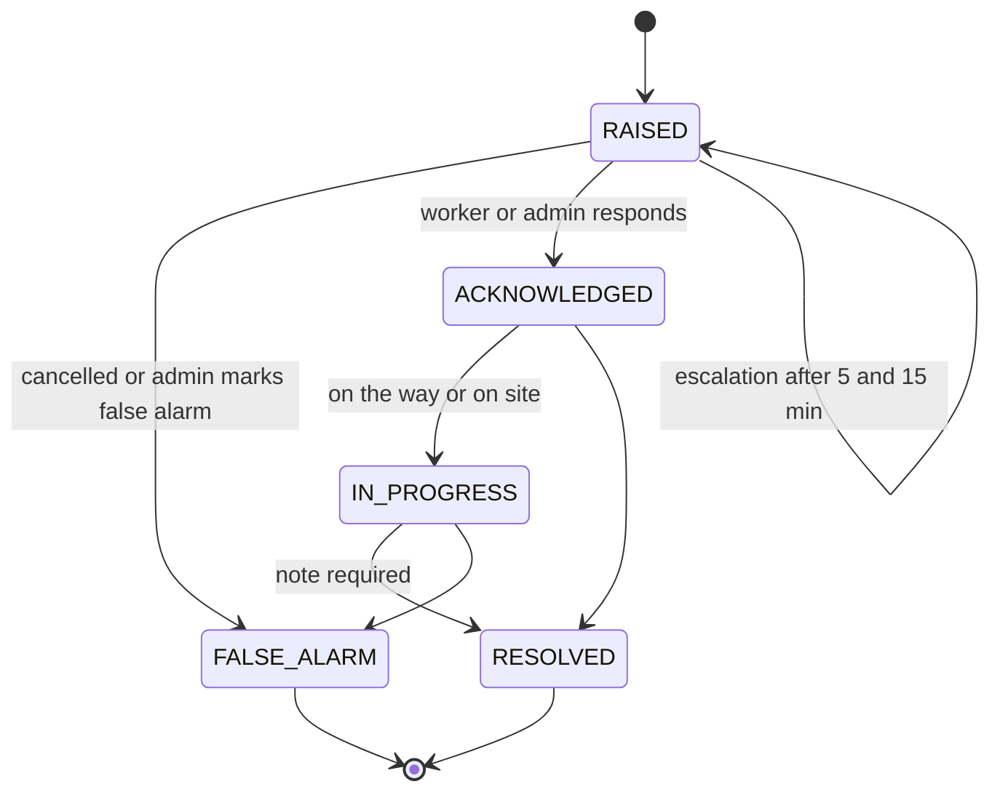

# Module 10: Emergency SOS & Safety

- **Pillar:** 2 – Elderly women care & safety
- **Priority:** **High** (safety-critical)
- **Status:** Planned

## Overview

An elderly woman living alone who falls, has chest pain, faces violence or is in danger may have **no way to call for help quickly**. She may not remember
numbers, her family is far away, and mobile data in the village is unreliable. Elder abuse, including abuse by family members, is often unreported.

This module provides an **SOS button**. One long press raises an alert, notifies the **assigned NGO worker and emergency contacts** (with location
if she consented), and **tracks the response until someone marks it resolved**. Because a missed SOS can cost a life, the design rule is:
**an SOS must reach a human even when the internet does not work.** The app falls back to SMS, and escalates if nobody acknowledges.

## User roles & permissions

| Role | View | Create | Edit | Delete | Approve |
|---|---|---|---|---|---|
| SA | All incidents | — | — | — | Override/close stuck incidents |
| NGW | Incidents of assigned beneficiaries | Raise SOS **on behalf** of a beneficiary | Acknowledge, update status, add notes, resolve | — | — |
| NGA | All incidents of own NGO | Raise on behalf | Acknowledge, reassign, escalate | — | Close as false alarm, review response times |
| HP | Incidents where they were notified (health SOS) | — | Add note | — | — |
| Beneficiary SOS device (`SOS_TRIGGER`) | Own active incident status | **Raise SOS** for herself | Cancel within 5 s | — | — |
| AWW, PG, GS | — | — | — | — | — |

The elderly beneficiary is not one of the seven user roles. See [rbac-matrix.md](../rbac-matrix.md#roles) for the recommended **beneficiary SOS device** token (TODO(team): confirm).

## Features

| Feature | Description |
|---|---|
| SOS button | Huge red button on the beneficiary device home screen, **press and hold 3 s** (prevents accidental presses), then a 5 s cancel countdown with vibration + voice ("मदद भेजी जा रही है" / "Sending help") |
| Alert generation | Creates an `sos_incidents` row locally (client UUID) with time, channel, location (if consented) |
| Notify NGO worker & contacts | Push to assigned NGW + NGA. **SMS** to emergency contacts marked "notify on SOS" (in priority order) and to the NGW |
| Location sharing with consent | Only if `location_consent = true`: one GPS fix (high accuracy, 30 s timeout, falls back to last known). Shared as a maps link in SMS/push. No continuous tracking |
| SMS fallback (offline) | No data → the app sends SMS directly to the NGW + contacts + the JanSetu SMS gateway number (which creates the server incident) |
| Feature-phone trigger | Beneficiaries without a smartphone send an SMS keyword (e.g. `SOS`) or give a missed call to a JanSetu number. TODO(team): provider |
| Raise on behalf | NGW/NGA can raise an SOS for a beneficiary (e.g. a neighbour called them) |
| Response status tracking | `RAISED → ACKNOWLEDGED → IN_PROGRESS → RESOLVED` (or `FALSE_ALARM`). Each change is an `sos_events` entry with actor + note |
| Escalation | Not acknowledged in **5 min** → notify next-priority contacts + NGA. **15 min** → NGA prompted to call emergency services (**112**) and a call-centre escalation (TODO(team)) |
| Incident history | Per beneficiary and per NGO: list with timings (time-to-acknowledge, time-to-resolve) |
| Helpline shortcuts | 112 (emergency), 108 (ambulance), 181 (women helpline), 14567 (Elder Line) one-tap call on the incident screen |

## User stories

1. As an **elderly woman living alone**, I want to press and hold one big button so that my NGO worker and my son know I need help.
2. As an **elderly woman**, I want my SOS to work even when there is no internet so that I can get help anywhere in the village.
3. As an **NGO worker**, I want a loud, persistent alert with her name, address and location so that I can reach her or send someone quickly.
4. As an **NGO worker**, I want to tap *I'm responding* so that her family and my admin know someone is on the way.
5. As an **NGO Administrator**, I want to be alerted if no one acknowledges an SOS within 5 minutes so that no alert is ignored.
6. As an **NGO Administrator**, I want to see response times for all incidents each month so that we can improve our coverage.
7. As an **elderly woman**, I want to cancel an accidental press within a few seconds so that nobody is alarmed for nothing.
8. As an **NGO worker**, I want to raise an SOS for a woman whose neighbour called me so that the incident is tracked the same way.

## Screens

| Screen | Key fields / actions |
|---|---|
| **SOS Home** (beneficiary device) | Only: big SOS button, her name, "Press and hold for 3 seconds" in Hindi with icon. Optional *Call my worker* button. Works locked-screen via a persistent notification shortcut (TODO(team): feasibility on Android 10+) |
| **SOS Countdown** | 5…4…3…2…1 with *Cancel* (huge), vibration, voice |
| **SOS Sent** | "Help is on the way" status: Sent ✓ / SMS sent ✓ / Acknowledged by <worker first name> ✓. Updates when online |
| **Incoming SOS Alert** (NGW/NGA) | Full-screen, alarm sound even in silent mode (notification channel with `IMPORTANCE_HIGH`, alarm usage), beneficiary name, photo-less, address, village, distance/map link, contacts with *Call*, *I'm responding* |
| **Incident Detail** | Timeline of events, status buttons (*In progress*, *Resolved*, *False alarm*), notes, helpline buttons, *Escalate* |
| **Incident History** | Filters (status, date, worker), columns: beneficiary, time, channel, time-to-ack, time-to-resolve, outcome |
| **Raise SOS on behalf** (NGW/NGA) | Pick beneficiary, reason (health / fall / violence / missing / other), *Raise* |

## Data model

<!-- DATA_MODEL: sos_incidents, sos_events -->
<!-- generated:start -->

**`sos_incidents`**: An SOS alert and its response status. JPA entity: [`SosIncident`](../../backend/src/main/java/in/jansetu/sos/entity/SosIncident.java)

| Column | MySQL type | Null | Notes |
|---|---|---|---|
| `id` | `CHAR(36)` | no | PK, UUID (client-generated for offline-created rows) |
| `beneficiary_id` | `CHAR(36)` | no | FK → `elderly_beneficiaries.id` |
| `triggered_at` | `DATETIME(6)` | no | device time |
| `channel` | `VARCHAR(30)` | no | enum: `APP`, `SMS`, `WORKER_ON_BEHALF` |
| `latitude` | `DECIMAL(9,6)` | yes | only if locationConsent |
| `longitude` | `DECIMAL(9,6)` | yes |  |
| `location_accuracy_meters` | `INT` | yes |  |
| `status` | `VARCHAR(30)` | no | enum: `RAISED`, `ACKNOWLEDGED`, `IN_PROGRESS`, `RESOLVED`, `FALSE_ALARM` |
| `acknowledged_by` | `CHAR(36)` | yes | FK → `users.id` |
| `acknowledged_at` | `DATETIME(6)` | yes |  |
| `resolved_at` | `DATETIME(6)` | yes |  |
| `resolution_notes` | `VARCHAR(500)` | yes |  |

**`sos_events`**: Timeline of an SOS incident (raised, notified, acknowledged, …). JPA entity: [`SosEvent`](../../backend/src/main/java/in/jansetu/sos/entity/SosEvent.java)

| Column | MySQL type | Null | Notes |
|---|---|---|---|
| `id` | `CHAR(36)` | no | PK, UUID (client-generated for offline-created rows) |
| `incident_id` | `CHAR(36)` | no | FK → `sos_incidents.id` |
| `event_type` | `VARCHAR(30)` | no | enum: `RAISED`, `NOTIFIED`, `ESCALATED`, `ACKNOWLEDGED`, `STATUS_CHANGED`, `NOTE_ADDED`, `RESOLVED` |
| `actor_user_id` | `CHAR(36)` | yes | FK → `users.id` |
| `note` | `VARCHAR(500)` | yes |  |
| `occurred_at` | `DATETIME(6)` | no |  |

All tables also have the common columns `created_at`, `updated_at`, `created_by`, `updated_by`, `version`, `deleted`. See [data-model.md](../data-model.md#conventions). Schema: [`V1__init.sql`](../../backend/src/main/resources/db/migration/V1__init.sql).
<!-- generated:end -->

Notes:
- `sos_incidents.id` is generated **on the device**, so the app, the SMS fallback and later sync all refer to the same incident.
- SMS from the app carries the short incident reference (first 8 chars of the UUID) and the beneficiary code, so the gateway webhook can attach to the same incident.
- `latitude` / `longitude` are only stored if `location_consent` was true. Precise location is reduced to village after 90 days ([retention](../privacy-and-security.md#retention)).
- Reason/category of SOS: TODO(team): add `reason` column (HEALTH / FALL / VIOLENCE / MISSING / OTHER) in V3.

## API endpoints

`ROLE_SUPER_ADMIN` may call every endpoint and is omitted below.

| Method | Path | Description | Allowed roles / authorities |
|---|---|---|---|
| POST | `/api/v1/sos` | Raise SOS `{id, beneficiaryId, triggeredAt, lat?, lng?, accuracy?, channel}`. Idempotent on `id`. Deduplicated within 2 min | `SOS_TRIGGER` (own beneficiary only), `ROLE_NGO_WORKER`, `ROLE_NGO_ADMIN` |
| POST | `/api/v1/sos/{incidentId}/cancel` | Cancel within 60 s of raising → `FALSE_ALARM` | `SOS_TRIGGER`, `ROLE_NGO_WORKER` |
| GET | `/api/v1/sos/{incidentId}` | Incident + events | `SOS_TRIGGER` (own, status only), `ROLE_NGO_WORKER`, `ROLE_NGO_ADMIN`, `ROLE_HEALTH_PROFESSIONAL` (if notified) |
| POST | `/api/v1/sos/{incidentId}/acknowledge` | "I'm responding" | `ROLE_NGO_WORKER`, `ROLE_NGO_ADMIN` |
| PATCH | `/api/v1/sos/{incidentId}/status` | `{status: IN_PROGRESS / RESOLVED / FALSE_ALARM, note}` | `ROLE_NGO_WORKER`, `ROLE_NGO_ADMIN` |
| POST | `/api/v1/sos/{incidentId}/notes` | Add note | `ROLE_NGO_WORKER`, `ROLE_NGO_ADMIN`, `ROLE_HEALTH_PROFESSIONAL` |
| POST | `/api/v1/sos/{incidentId}/escalate` | Manual escalation | `ROLE_NGO_WORKER`, `ROLE_NGO_ADMIN` |
| GET | `/api/v1/sos?status=&from=&to=` | Incident list in scope | `ROLE_NGO_WORKER`, `ROLE_NGO_ADMIN` |
| GET | `/api/v1/sos/stats?month=` | Response-time statistics | `ROLE_NGO_ADMIN` |
| POST | `/api/v1/sos/sms-webhook` | Inbound SMS / missed call from gateway → incident (`channel = SMS`) | public, **verified by gateway signature + IP allow-list** |
| POST | `/api/v1/sos/devices` | Register a beneficiary SOS device → device token with `SOS_TRIGGER` | `ROLE_NGO_WORKER`, `ROLE_NGO_ADMIN` |
| DELETE | `/api/v1/sos/devices/{deviceId}` | Revoke SOS device | `ROLE_NGO_WORKER`, `ROLE_NGO_ADMIN` |

## Workflow

**Main flow:** SOS pressed → alert generated → NGO worker & contacts notified → response tracked until resolved.

## Business rules & validation

- **Never block an SOS on validation.** The server accepts the incident even if optional fields are invalid (it drops them and logs). Only `beneficiaryId` (or a resolvable code in SMS) is required.
- `SOS_TRIGGER` tokens can only raise/cancel/view incidents for **their own** beneficiary.
- **Deduplication:** repeated presses or the same incident arriving via app + SMS within 2 min → one incident (matched by client id or by beneficiary + time window). Extra triggers are added as `sos_events`.
- **Cancel:** allowed within 60 s of `triggeredAt` by the device. After that only the NGW/NGA can mark `FALSE_ALARM` (note required).
- **Escalation:** at 5 min without `ACKNOWLEDGED` → notify all remaining contacts + NGA (+ HP if the reason is health). At 15 min → NGA must act. The system shows 112 / Elder Line prompts. Escalations are recorded as `ESCALATED` events.
- `RESOLVED` and `FALSE_ALARM` require a note. Resolution can't be before acknowledgement (acknowledgement is implied if a worker resolves directly).
- SOS works only if the beneficiary has ≥ 1 emergency contact with a mobile **and** an assigned worker (checked at device registration).
- Location: only if `location_consent`. Accuracy > 500 m → sent with "approximate" label. No continuous tracking. One fix per incident (+ one optional refresh on worker request, TODO(team)).
- An SOS from a `DECEASED`/`INACTIVE` beneficiary's device is still accepted and routed to the NGA (the device may be used by someone else in danger).
- Every action on an incident is audited.

## Offline behaviour

SOS is the module where offline handling matters most.

| Situation | Behaviour |
|---|---|
| Data available | Push immediately (`PRIORITY.SOS = 0`, bypasses the normal sync batch) |
| No data / request fails within 20 s | **SMS fallback** from the phone: to the assigned NGW, the top contacts and the JanSetu gateway number. The message has the beneficiary code, incident ref, village and location link (if consented) |
| No SMS either (no signal) | Keep retrying SMS + data every 30 s for 30 min, with a visible "Trying to send…" state and the instruction "Call 112 if you can" |
| Back online | The queued incident syncs. The server matches it to the SMS-created incident by ref, so there is no duplicate |
| Worker offline | Worker also receives the SMS. Acknowledging offline is queued and synced. The worker can call the contacts directly from the cached profile |

- **Android SMS permission constraint:** Google Play restricts `SEND_SMS` to default SMS apps and approved exceptions. Options:
  (a) distribute the SOS device app for the pilot outside Play (MDM/sideload) with `SEND_SMS`, (b) use an SMS **intent** pre-filled to all recipients (one extra tap on *Send*),
  (c) apply for the Play policy exception. **TODO(team): decide.** The recommendation for the pilot is (a), with (b) as the automatic fallback.
- Local tables: incidents + events are stored in SQLite (TODO(team): add `sos_incidents` local table) and the beneficiary's contacts are cached ([Module 08](08-elderly-registration.md#offline-behaviour)).
- Conflicts: incident status changes are ordered by `sos_events.occurred_at`. A later `RESOLVED` beats an earlier `ACKNOWLEDGED` from another device. Events are append-only, so no data is lost.

## AI / ML

None in the alert path (deterministic and fast by design). SOS count over 90 days is a feature of the elderly risk score ([Module 13](13-ai-analytics.md)).
Monthly SOS patterns (time of day, villages) appear in dashboards for planning.

## Notifications triggered

| Event | To | Channel |
|---|---|---|
| SOS raised | Assigned NGW, NGA | High-priority push (full-screen alarm) + SMS |
| SOS raised | Emergency contacts with `notifyOnSos` | SMS (most contacts have no app) |
| SOS raised, reason health | HP linked to the beneficiary | Push |
| Acknowledged | Beneficiary device, contacts | Push / SMS: "<Worker first name> from <NGO> is responding" |
| Not acknowledged 5 min | Remaining contacts, NGA | SMS + push (escalation) |
| Not acknowledged 15 min | NGA (+ SA) | Push + SMS, call prompt |
| Resolved / false alarm | Contacts, NGA | SMS / push |
| Monthly response-time summary | NGA | In-app |

## Privacy & security considerations

- **Location is shared only with consent** and only during an incident. DPDP s. 7 (medical emergency) may allow processing in a life-threatening emergency, but we ask for consent upfront anyway ([privacy-and-security.md](../privacy-and-security.md#legal-and-ethical-basis)).
- SMS content is minimal: "SOS: <first name>, <village>. <maps link>. Ref ABCD1234. Call her worker <number>". No health info.
- **Abuse cases:** if the reason is violence and the abuser may be an emergency contact, the NGA can mark contacts as **"do not notify"**.
  TODO(team): design this sensitively with the NGO (e.g. a "safe contacts only" setting).
- The SMS webhook is public but verified (gateway signature + IP allow-list + rate limit). It only accepts known beneficiary codes and never returns data.
- `SOS_TRIGGER` device tokens can't read any record and can be revoked if the phone is lost.
- Incident data (S3) is visible only to the NGO's staff involved, and all access is audited.

## Dependencies on other modules

- [08 – Elderly Registration](08-elderly-registration.md): beneficiary, emergency contacts, location consent, assigned worker.
- [12 – NGO Worker & Caregiver Mgmt](12-ngo-worker-caregiver.md): who is assigned / on duty.
- [14 – Notifications](14-notifications.md): FCM high-priority channel, SMS gateway.
- [16 – Offline Sync](16-offline-sync.md): priority 0 queue, idempotent push.
- [15 – Admin Dashboard](15-admin-dashboard-reports.md): incident reports.
- [01 – Authentication](01-authentication.md): device token issuance.

## Acceptance criteria

- [ ] Holding the SOS button for 3 s starts the countdown. Releasing earlier does nothing. *Cancel* during the countdown sends nothing.
- [ ] With data on, the assigned NGW receives a full-screen alarm within **30 s** of the press (measured on a 4G test, P95).
- [ ] With mobile data off but SMS available, the NGW and contacts receive an SMS within **60 s**, and the gateway creates the incident on the server.
- [ ] The same incident sent by app and SMS creates exactly **one** server incident.
- [ ] Without consent, no coordinates are stored or sent. With consent, the SMS contains a maps link.
- [ ] No acknowledgement in 5 min → NGA and remaining contacts are notified, and an `ESCALATED` event is recorded.
- [ ] `RESOLVED` without a note is rejected. The timeline shows every status change with actor and time.
- [ ] An `SOS_TRIGGER` token cannot read any beneficiary profile (`403`/`404`) or raise SOS for another beneficiary.
- [ ] End-to-end drill with the partner NGO (TODO(team)): 10 test SOS events, all reached a human, and response times are recorded.

## Future enhancements

- Fall detection using the phone accelerometer (opt-in), with automatic SOS after no response.
- Integration with the state **ERSS 112** system, if an API is available.
- Wearable SOS button / pendant (Bluetooth) for women who don't carry a phone.
- IVR call-back to the beneficiary in Hindi to confirm she is safe.
