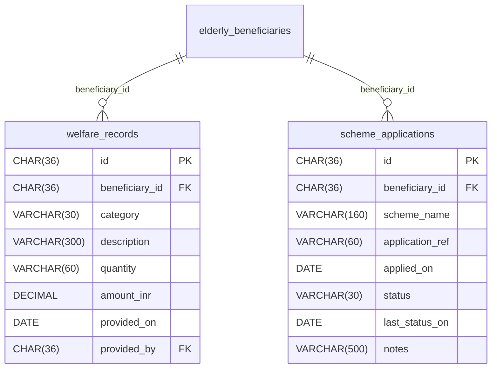
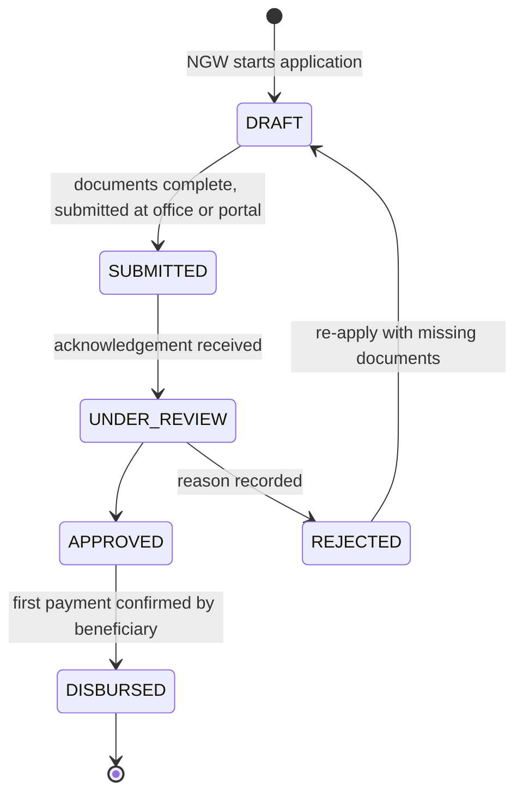
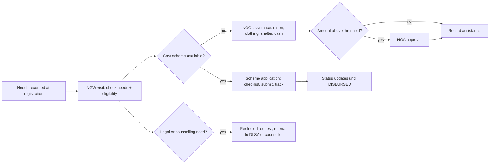

# Module 11: Elderly Social Welfare & NGO Assistance

- **Pillar:** 2 – Elderly women care & safety
- **Priority:** Medium
- **Status:** Planned

## Overview

Elderly women, especially widows, are often eligible for government support they never receive: old-age and widow pensions (e.g. under the
**National Social Assistance Programme**, such as IGNOAPS and IGNWPS), free ration under the **National Food Security Act / PM Garib Kalyan Anna Yojana**,
health cover under **Ayushman Bharat PM-JAY** (now including all citizens aged 70+), and assistive devices under schemes like **Rashtriya Vayoshri Yojana**.
Applications need documents, repeated office visits and follow-up, which an elderly woman alone cannot manage. NGOs also give direct help
(ration kits, clothing, shelter repair, counselling, legal aid), but they track it in spreadsheets, so they can't see who got what or who is left out.

This module records **all assistance given** (food, clothing, shelter, financial, legal aid, rehabilitation, counselling, donations) and tracks
**government scheme applications** through to disbursement.

## User roles & permissions

| Role | View | Create | Edit | Delete | Approve |
|---|---|---|---|---|---|
| SA | All | Yes | Yes | Soft-delete | Yes |
| NGW | Assigned beneficiaries | Assistance records, scheme applications, legal-aid/counselling requests | Own entries, application status updates | — | — |
| NGA | Own NGO | Yes | Yes | Soft-delete wrong entries | **Approve distributions** above a threshold, close applications, approve legal-aid referrals |
| GS | Aggregate counts only (scheme coverage), no individual records | — | — | — | — |
| AWW, HP, PG | — | — | — | — | — |

TODO(team): the brief lists GS for "welfare distribution" reports. Confirm whether supervisors from the Social Welfare department (not ICDS) will use the system.

## Features

| Feature | Description |
|---|---|
| Food / ration support | Ration kits given (items, quantity, date). Also tracks whether she has a ration card and receives NFSA ration (yes/no, not the card number) |
| Clothing | Items given (blanket, saree, sweater) with season |
| Shelter | Repair/assistance requests and completion |
| Financial assistance | NGO cash/kind support with amount (₹), purpose, date. No bank details |
| Government scheme tracking | Application per scheme: draft → submitted → under review → approved → disbursed / rejected, with application reference and dates |
| Legal aid requests | Property, maintenance (Maintenance and Welfare of Parents and Senior Citizens Act, 2007), abuse cases → referral to DLSA (District Legal Services Authority) / lawyer. **Sensitive** |
| Rehabilitation | Shelter home / old-age home placement, assistive devices (spectacles, hearing aid, walker) |
| Counselling records | Sessions (date, counsellor, topic category, follow-up). Notes are restricted |
| Donations | In-kind or cash donations received by the NGO and allocated to beneficiaries (allocation recorded as assistance) |
| Welfare application status | One status board per beneficiary and per NGO, with pending-since days |
| Document checklist | Per scheme: required documents (age proof, widow certificate, ration card, bank passbook) marked as available / missing. Not the documents themselves |

## User stories

1. As an **NGO worker**, I want to record the ration kit I gave today so that we don't give twice while others get nothing.
2. As an **NGO worker**, I want to track a widow pension application from submission to first payment so that it doesn't get stuck for months.
3. As an **NGO worker**, I want to see which documents are missing for a scheme so that I help her get them before applying.
4. As an **NGO Administrator**, I want a list of applications pending for more than 60 days so that I can follow up with the block office.
5. As an **NGO Administrator**, I want to see total assistance per category per month so that I can report to donors.
6. As an **NGO Administrator**, I want to restrict counselling and legal-aid notes to authorised staff so that sensitive matters stay confidential.
7. As an **NGO worker**, I want to raise a legal-aid request for a woman being denied maintenance by her sons so that she is connected to the DLSA.

## Screens

| Screen | Key fields / actions |
|---|---|
| **Welfare Summary** (beneficiary) | Assistance received (last 6 months by category), open applications with status chips, open legal/counselling requests (restricted), *Add assistance*, *New application* |
| **Add Assistance** | Category, description, quantity / amount (₹), date, donor/source (optional), *Save* |
| **Scheme Application** | Scheme (pick list, TODO(team): state-specific list), document checklist, applied on, application ref, status, notes. *Update status* with date |
| **Applications Board** (NGA) | Columns by status, filter by scheme / worker / pending > N days |
| **Legal Aid / Counselling Request** | Type, short description (restricted), referred to (DLSA / counsellor / police), date, follow-up date, status |
| **Distribution Report** (NGA) | Month, category totals, beneficiaries reached, *Export* ([Module 15](15-admin-dashboard-reports.md)) |
| **Donations** (NGA) | Donation received (donor type, item/amount, date), allocations |

## Data model

<!-- DATA_MODEL: welfare_records, scheme_applications -->
<!-- generated:start -->

**`welfare_records`**: Assistance given (food, clothing, shelter, financial, legal aid, counselling, donation). JPA entity: [`WelfareRecord`](../../backend/src/main/java/in/jansetu/welfare/entity/WelfareRecord.java)

| Column | MySQL type | Null | Notes |
|---|---|---|---|
| `id` | `CHAR(36)` | no | PK, UUID (client-generated for offline-created rows) |
| `beneficiary_id` | `CHAR(36)` | no | FK → `elderly_beneficiaries.id` |
| `category` | `VARCHAR(30)` | no | enum: `FOOD_RATION`, `CLOTHING`, `SHELTER`, `FINANCIAL`, `LEGAL_AID`, `REHABILITATION`, `COUNSELLING`, `DONATION` |
| `description` | `VARCHAR(300)` | no |  |
| `quantity` | `VARCHAR(60)` | yes | e.g. 5 kg rice |
| `amount_inr` | `DECIMAL(10,2)` | yes |  |
| `provided_on` | `DATE` | no |  |
| `provided_by` | `CHAR(36)` | no | FK → `users.id` |

**`scheme_applications`**: Government scheme applications and their status. JPA entity: [`SchemeApplication`](../../backend/src/main/java/in/jansetu/welfare/entity/SchemeApplication.java)

| Column | MySQL type | Null | Notes |
|---|---|---|---|
| `id` | `CHAR(36)` | no | PK, UUID (client-generated for offline-created rows) |
| `beneficiary_id` | `CHAR(36)` | no | FK → `elderly_beneficiaries.id` |
| `scheme_name` | `VARCHAR(160)` | no |  |
| `application_ref` | `VARCHAR(60)` | yes | reference from the govt portal |
| `applied_on` | `DATE` | yes |  |
| `status` | `VARCHAR(30)` | no | enum: `DRAFT`, `SUBMITTED`, `UNDER_REVIEW`, `APPROVED`, `REJECTED`, `DISBURSED` |
| `last_status_on` | `DATE` | yes |  |
| `notes` | `VARCHAR(500)` | yes |  |

All tables also have the common columns `created_at`, `updated_at`, `created_by`, `updated_by`, `version`, `deleted`. See [data-model.md](../data-model.md#conventions). Schema: [`V1__init.sql`](../../backend/src/main/resources/db/migration/V1__init.sql).
<!-- generated:end -->

Notes:
- `welfare_records.category` covers all assistance types, including `LEGAL_AID`, `COUNSELLING` and `DONATION` allocations. Their `description` is **restricted** (only the assigned NGW and NGA can read it; TODO(team): application-level encryption, see [privacy-and-security.md](../privacy-and-security.md#encryption)).
- Donations received (NGO-level, not per beneficiary): TODO(team): `donations (ngo_id, donor_type, item, amount_inr, received_on)` in V3.
- Scheme master + document checklist: TODO(team): `schemes` and `application_documents` tables in V3. V1 stores `scheme_name` as text.

## API endpoints

`ROLE_SUPER_ADMIN` may call every endpoint and is omitted below.

| Method | Path | Description | Allowed roles |
|---|---|---|---|
| GET | `/api/v1/elderly/{beneficiaryId}/welfare` | Assistance records (restricted categories filtered by role) | `ROLE_NGO_WORKER`, `ROLE_NGO_ADMIN` |
| POST | `/api/v1/elderly/{beneficiaryId}/welfare` | Add assistance | `ROLE_NGO_WORKER`, `ROLE_NGO_ADMIN` |
| PUT | `/api/v1/welfare/{recordId}` | Edit | `ROLE_NGO_WORKER`, `ROLE_NGO_ADMIN` |
| DELETE | `/api/v1/welfare/{recordId}` | Soft-delete wrong entry | `ROLE_NGO_ADMIN` |
| POST | `/api/v1/welfare/{recordId}/approve` | Approve high-value distribution | `ROLE_NGO_ADMIN` |
| GET | `/api/v1/elderly/{beneficiaryId}/scheme-applications` | Applications | `ROLE_NGO_WORKER`, `ROLE_NGO_ADMIN` |
| POST | `/api/v1/elderly/{beneficiaryId}/scheme-applications` | New application | `ROLE_NGO_WORKER`, `ROLE_NGO_ADMIN` |
| PATCH | `/api/v1/scheme-applications/{applicationId}` | Update status / ref / notes | `ROLE_NGO_WORKER`, `ROLE_NGO_ADMIN` |
| GET | `/api/v1/scheme-applications?status=&pendingDays=` | NGO board | `ROLE_NGO_ADMIN` |
| GET | `/api/v1/welfare/summary?month=` | Category totals for own NGO | `ROLE_NGO_ADMIN` |
| GET | `/api/v1/welfare/coverage?district=` | Aggregate scheme coverage (counts only) | `ROLE_GOVT_SUPERVISOR`, `ROLE_NGO_ADMIN` |

## Workflow

## Business rules & validation

- `amountInr` ≥ 0, max ₹1,00,000 per record. Financial assistance above **₹5,000** (TODO(team): NGO policy) needs NGA approval before it counts as given.
- `providedOn` ≤ today. The same category + same day + same beneficiary → duplicate warning.
- Scheme application status moves only along the state diagram. Each change records `lastStatusOn`. `REJECTED` requires a reason in `notes`.
- Applications in `SUBMITTED`/`UNDER_REVIEW` for > 60 days → flagged as delayed (configurable).
- `LEGAL_AID` and `COUNSELLING` descriptions: visible only to the creating NGW, the currently assigned NGW and NGA. Hidden from exports (counts only).
- No bank account, Aadhaar or ration card numbers are stored, only yes/no flags ([data minimisation](../privacy-and-security.md#data-minimisation-what-we-do-not-collect)).

## Offline behaviour

- Adding assistance, creating/updating applications and requests work **offline** for assigned beneficiaries.
- SQLite: TODO(team): add `welfare_records`, `scheme_applications` local tables. Ops use `PRIORITY.DEFAULT`.
- Approval of high-value distributions is online only (NGA).
- Conflicts: application status → the later state in the state machine wins if both moves are valid, otherwise manual review. Notes → last-write-wins.

## AI / ML

None in Phase I. "Pending welfare application" is a small factor in visit prioritisation ([ml-overview.md](../ml-overview.md#6-risk-based-prioritisation)).
Future: eligibility suggestions (rule-based) from profile data.

## Notifications triggered

| Event | To |
|---|---|
| Application status changed | Assigned NGW (+ SMS to beneficiary contact on APPROVED / DISBURSED, TODO(team) wording) |
| Application delayed > 60 days | NGW, NGA |
| Distribution needs approval | NGA |
| Legal-aid follow-up due | Assigned NGW |
| Monthly distribution summary | NGA |

## Privacy & security considerations

- Legal aid and counselling records may concern **abuse by family members**, so they are restricted at field level, never in notifications, never in exports.
- Financial amounts are visible to NGO staff only. GS sees aggregate counts, never per-person records.
- Donor identities (individuals) are not stored. Only the donor type (individual / company / government).

## Dependencies on other modules

- [08 – Elderly Registration](08-elderly-registration.md): welfare needs, marital status.
- [12 – NGO Worker & Caregiver Mgmt](12-ngo-worker-caregiver.md): who follows up.
- [14 – Notifications](14-notifications.md), [15 – Admin Dashboard](15-admin-dashboard-reports.md): welfare distribution reports.

## Acceptance criteria

- [ ] An NGW can record a ration kit offline, and it appears in the NGO's monthly summary after sync.
- [ ] Financial assistance above the threshold stays "awaiting approval" until the NGA approves.
- [ ] An invalid status jump (DRAFT → APPROVED) is rejected.
- [ ] Applications pending > 60 days appear on the NGA board with a delayed flag.
- [ ] A different NGW (not assigned) cannot read legal-aid descriptions. Exports show only counts for these categories.
- [ ] GS coverage endpoint returns counts only, with no names or IDs.

## Future enhancements

- Rule-based scheme eligibility checker per state.
- Integration with state pension portals for status lookup (if APIs exist).
- Volunteer and donor portal for NGOs.
