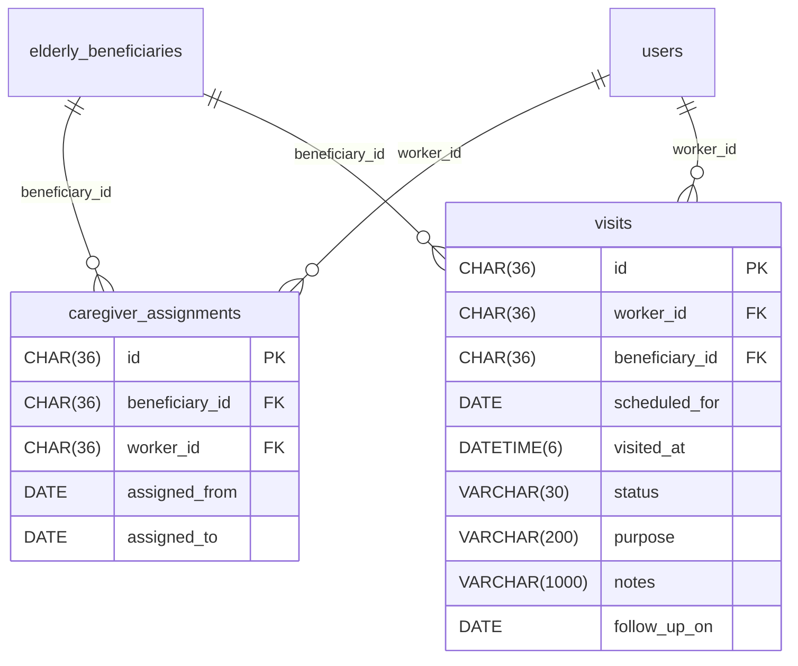
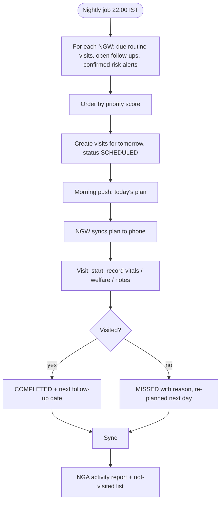

# Module 12: NGO Worker & Caregiver Management

- **Pillar:** 2 – Elderly women care & safety
- **Priority:** Medium
- **Status:** Planned

## Overview

An NGO's care depends on field workers visiting regularly. NGO coordinators today plan visits on WhatsApp and paper, cannot see who was
actually visited, and find out about overloaded workers or neglected beneficiaries too late. When a worker leaves or falls ill, there is no
clean handover.

This module manages **NGO workers and caregivers**: registration, assignment of beneficiaries (caseload), daily visit scheduling, visit history,
follow-ups, pending task notifications and activity reports. It also decides who receives a beneficiary's SOS ([Module 10](10-emergency-sos.md)).

## User roles & permissions

| Role | View | Create | Edit | Delete | Approve |
|---|---|---|---|---|---|
| SA | All | Yes | Yes | Deactivate | Yes |
| NGA | Own NGO workers, assignments, visits, reports | Workers (with [Module 01](01-authentication.md)), assignments, visit plans | Same | Deactivate worker, end assignment | Approve visit plans / reassignments |
| NGW | Own profile, own schedule, own beneficiaries' visit history | Follow-up tasks, unplanned visits | Own visits (status, notes) | — | — |
| AWW, HP, PG, GS | — | — | — | — | — |

## Features

| Feature | Description |
|---|---|
| Worker registration | NGA creates the NGW user (name, mobile, villages covered, languages). The account is activated through [Module 01](01-authentication.md) |
| Caregiver assignment | Assign beneficiaries to a worker. Each assignment has a from/to date, so the history is kept. One current worker per beneficiary |
| Beneficiary allocation | Caseload view: beneficiaries per worker, by village. Suggestions to balance load (max caseload configurable, e.g. 40) |
| Daily visit scheduling | Auto-generated plan from rules (living alone → weekly, others → fortnightly, open follow-ups, risk alerts) + manual additions. Ordered by the priority score ([ml-overview.md](../ml-overview.md#6-risk-based-prioritisation)) |
| Visit recording | Check-in (time, optional coarse location), purpose, notes, vitals shortcut ([Module 09](09-elderly-healthcare.md)), welfare shortcut ([Module 11](11-welfare-ngo-assistance.md)), next follow-up |
| Visit history | Per beneficiary and per worker |
| Follow-ups | Tasks with due dates created from visits, readings, applications, SOS outcomes |
| Pending task notifications | Morning digest of today's visits + overdue tasks |
| Activity reports | Visits planned vs. done, beneficiaries not visited in N days, average visits per worker, SOS response times |
| Handover | On reassignment, the new worker gets a summary of open tasks and recent notes |

## User stories

1. As an **NGO Administrator**, I want to assign 30 beneficiaries in two villages to a new worker so that every woman has someone responsible.
2. As an **NGO worker**, I want to see today's visit list in order of priority so that the most at-risk women are seen first.
3. As an **NGO worker**, I want to record a visit offline in 1–2 minutes so that documentation doesn't take longer than the visit.
4. As an **NGO Administrator**, I want to see women not visited in the last 21 days so that nobody is forgotten.
5. As an **NGO Administrator**, I want to reassign a worker's caseload when she goes on leave so that SOS alerts and visits continue.
6. As an **NGO worker**, I want reminders for follow-ups I promised so that I keep my word to the beneficiaries.
7. As an **NGO Administrator**, I want a monthly activity report per worker so that I can support struggling workers (not punish them).

## Screens

| Screen | Key fields / actions |
|---|---|
| **Today's Visits** (NGW) | Ordered list: name, village, reason chips (follow-up, high risk, routine), *Start visit*, *Can't visit* (reason) |
| **Visit Form** | Check-in time (auto), purpose, quick actions (*Add vitals*, *Add assistance*, *Raise SOS*), notes (text/voice TODO), outcome, next follow-up date, *Complete* |
| **Follow-up Tasks** | Due / overdue, *Done*, *Reschedule* |
| **Workers** (NGA) | List: name, villages, caseload, visits this month, last sync time. *Add worker*, *Deactivate* |
| **Assign Beneficiaries** (NGA) | Pick worker → multi-select beneficiaries (filter by village, unassigned), *Assign*, warnings over max caseload |
| **Visit Calendar** (NGA) | Week view by worker, drag to reschedule |
| **Activity Report** (NGA) | Month, per worker: planned/completed/missed visits, not-visited list, follow-up completion %, *Export* |

## Data model

<!-- DATA_MODEL: caregiver_assignments, visits -->
<!-- generated:start -->

**`caregiver_assignments`**: History of which NGO worker is responsible for which beneficiary. JPA entity: [`CaregiverAssignment`](../../backend/src/main/java/in/jansetu/caregiver/entity/CaregiverAssignment.java)

| Column | MySQL type | Null | Notes |
|---|---|---|---|
| `id` | `CHAR(36)` | no | PK, UUID (client-generated for offline-created rows) |
| `beneficiary_id` | `CHAR(36)` | no | FK → `elderly_beneficiaries.id` |
| `worker_id` | `CHAR(36)` | no | FK → `users.id` |
| `assigned_from` | `DATE` | no |  |
| `assigned_to` | `DATE` | yes | null = current |

**`visits`**: Planned and completed home visits by NGO workers. JPA entity: [`Visit`](../../backend/src/main/java/in/jansetu/caregiver/entity/Visit.java)

| Column | MySQL type | Null | Notes |
|---|---|---|---|
| `id` | `CHAR(36)` | no | PK, UUID (client-generated for offline-created rows) |
| `worker_id` | `CHAR(36)` | no | FK → `users.id` |
| `beneficiary_id` | `CHAR(36)` | no | FK → `elderly_beneficiaries.id` |
| `scheduled_for` | `DATE` | no |  |
| `visited_at` | `DATETIME(6)` | yes |  |
| `status` | `VARCHAR(30)` | no | enum: `SCHEDULED`, `COMPLETED`, `MISSED`, `CANCELLED` |
| `purpose` | `VARCHAR(200)` | no |  |
| `notes` | `VARCHAR(1000)` | yes |  |
| `follow_up_on` | `DATE` | yes |  |

All tables also have the common columns `created_at`, `updated_at`, `created_by`, `updated_by`, `version`, `deleted`. See [data-model.md](../data-model.md#conventions). Schema: [`V1__init.sql`](../../backend/src/main/resources/db/migration/V1__init.sql).
<!-- generated:end -->

Notes:
- Workers are `users` with role `NGO_WORKER` and `ngo_id` ([Module 01](01-authentication.md#data-model)). Villages covered: TODO(team): `worker_areas (user_id, village, district)` in V3.
- `elderly_beneficiaries.assigned_worker_id` is the *current* worker (fast lookups for SOS). `caregiver_assignments` keeps the history. Both are updated in one transaction.
- Follow-up tasks are generic: TODO(team): a `tasks (assignee_id, subject_type, subject_id, type, due_on, status, source_ref)` table in V3, used by modules 03/05/09/11/12.

## API endpoints

`ROLE_SUPER_ADMIN` may call every endpoint and is omitted below.

| Method | Path | Description | Allowed roles |
|---|---|---|---|
| GET | `/api/v1/workers` | NGO workers with caseload | `ROLE_NGO_ADMIN` |
| POST | `/api/v1/workers` | Create worker (creates user with role NGO_WORKER) | `ROLE_NGO_ADMIN` |
| PATCH | `/api/v1/workers/{workerId}` | Edit / deactivate | `ROLE_NGO_ADMIN` |
| GET | `/api/v1/workers/{workerId}/beneficiaries` | Current caseload | `ROLE_NGO_ADMIN`, `ROLE_NGO_WORKER` (self) |
| POST | `/api/v1/caregiver-assignments` | Assign `{workerId, beneficiaryIds[], from}` (ends previous assignment) | `ROLE_NGO_ADMIN` |
| GET | `/api/v1/caregiver-assignments?beneficiaryId=` | Assignment history | `ROLE_NGO_ADMIN` |
| GET | `/api/v1/visits?workerId=&date=` | Visit plan / history | `ROLE_NGO_ADMIN`, `ROLE_NGO_WORKER` (self) |
| POST | `/api/v1/visits` | Schedule visit (or unplanned visit by NGW) | `ROLE_NGO_ADMIN`, `ROLE_NGO_WORKER` |
| PATCH | `/api/v1/visits/{visitId}` | Complete / miss / cancel / reschedule, notes, follow-up | `ROLE_NGO_WORKER`, `ROLE_NGO_ADMIN` |
| POST | `/api/v1/visits/generate-plan?date=` | Generate next day's plans from rules | `ROLE_NGO_ADMIN` (also nightly job) |
| GET | `/api/v1/elderly/{beneficiaryId}/visits` | Beneficiary's visit history | `ROLE_NGO_WORKER`, `ROLE_NGO_ADMIN` |
| GET | `/api/v1/workers/reports/activity?month=` | Activity report | `ROLE_NGO_ADMIN` |
| GET | `/api/v1/elderly/not-visited?days=21` | Beneficiaries not visited in N days | `ROLE_NGO_ADMIN` |

## Workflow

## Business rules & validation

- A beneficiary has **exactly one current assignment** (`assigned_to IS NULL`). A new assignment ends the previous one the day before.
- A worker can only be assigned beneficiaries of the **same NGO**. Max caseload (default 40, configurable) → warning, not a hard block.
- Visit frequency rules (configurable): lives alone or high risk → every 7 days. Others → every 14 days. Open urgent follow-up → by its due date.
- `visitedAt` must be on `scheduledFor` ± 1 day for `COMPLETED`, otherwise it is recorded as an unplanned visit.
- `MISSED` requires a reason (beneficiary away, worker unavailable, weather, other).
- Deactivating a worker requires reassigning their caseload first (blocked otherwise), so no beneficiary is left without an SOS responder.
- Coarse check-in location (optional, worker consent) is stored rounded to ~1 km and only used for "visit happened in village" checks. No tracking.

## Offline behaviour

- The NGW's next 7 days of visits, their beneficiaries and open follow-ups are cached. Visits are recorded **offline** (`visits` table in [`schema.ts`](../../mobile/src/db/schema.ts)).
- Plan generation and reassignment happen on the server. Changes arrive on the next pull.
- On reassignment, the old worker's device removes the beneficiary's data on the next sync (after pushing any pending changes).
- Conflicts: visit status/notes → last-write-wins. Reschedules by NGA vs. completion by NGW → completion wins (the visit happened).

## AI / ML

The visit order uses the transparent priority score ([ml-overview.md](../ml-overview.md#6-risk-based-prioritisation)), which includes confirmed elderly risk alerts from [Module 13](13-ai-analytics.md).
No ML decides assignments.

## Notifications triggered

| Event | To |
|---|---|
| Today's visit plan (07:00 IST) | NGW |
| Follow-up due / overdue | NGW |
| New assignment / reassignment | NGW (new + old) |
| Beneficiary not visited in 21 days | NGA |
| Worker not synced for 3 days | NGA (the worker may be offline, so SOS cover is at risk) |
| Monthly activity report ready | NGA |

## Privacy & security considerations

- Reports are for **supporting** workers. Individual performance data is visible only to the NGA, not other workers.
- No continuous location tracking of workers. Check-in location is optional and coarse.
- Reassignment immediately changes data access (server-side scope + device purge).

## Dependencies on other modules

- [01 – Authentication](01-authentication.md): worker accounts.
- [08 – Elderly Registration](08-elderly-registration.md): beneficiaries.
- [09 – Elderly Healthcare](09-elderly-healthcare.md), [11 – Welfare](11-welfare-ngo-assistance.md): visit actions.
- [10 – Emergency SOS](10-emergency-sos.md): assigned worker receives SOS.
- [13 – AI Analytics](13-ai-analytics.md), [14 – Notifications](14-notifications.md), [15 – Admin Dashboard](15-admin-dashboard-reports.md).

## Acceptance criteria

- [ ] Assigning a beneficiary to a new worker ends the old assignment, and the old worker loses access after sync.
- [ ] A worker with caseload cannot be deactivated until the caseload is reassigned.
- [ ] The nightly job creates visits for beneficiaries due per the frequency rules, ordered by priority.
- [ ] An NGW can complete a visit offline with notes and a follow-up date, and it syncs later.
- [ ] The not-visited report lists exactly the beneficiaries without a completed visit in the last N days (test data).
- [ ] An NGW cannot see another worker's visits (`404`).

## Future enhancements

- Route optimisation for visits across villages.
- Worker training modules and attendance.
- Caregiver (family member) role with limited access, if NGOs want it.
