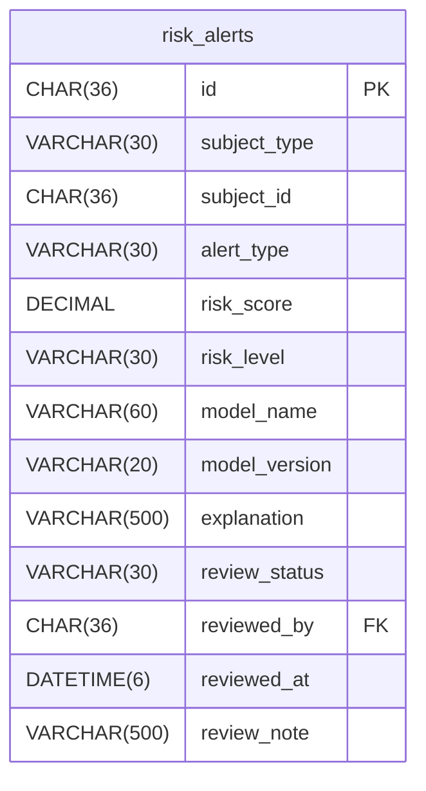
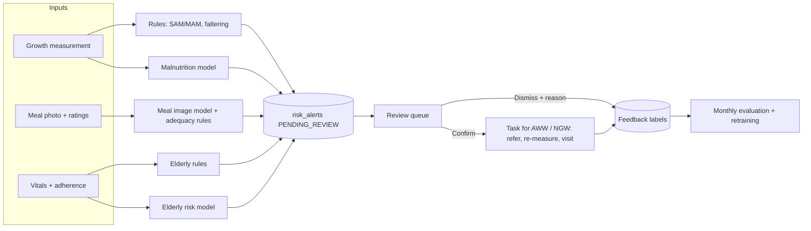

# Module 13: AI-Based Intelligence & Analytics

- **Pillar:** 3 – Common AI, notifications, admin & offline sync
- **Priority:** Medium (models), High (the human-review workflow)
- **Status:** Planned

## Overview

Field workers and supervisors are responsible for many children and elderly women, but have limited time. Data collected by the other modules
can help them **notice early** who is at risk (a child sliding towards malnutrition, a poor-quality meal pattern, an elderly woman whose BP
keeps rising) and **prioritise** their effort.

This module is the shared intelligence layer: growth trend analysis, malnutrition risk prediction, meal image analysis, nutritional adequacy,
elderly health trends, risk-based prioritisation, automated alerts and predictive analytics. **Every output is a recommendation that a human
reviews. Nothing is decided automatically.** Full technical detail: [ml-overview.md](../ml-overview.md).

## User roles & permissions

| Role | View | Create | Edit | Delete | Approve |
|---|---|---|---|---|---|
| SA | All alerts, model versions, thresholds | — | Thresholds, model activation | — | Deploy model versions |
| AWW | Alerts for own centre's children ("Under review" until decided), confirmed tasks | — | — | — | — |
| NGW | Alerts for assigned beneficiaries, confirmed tasks | — | — | — | — |
| HP | Alerts for referred/scope subjects | — | Review note | — | **Confirm / dismiss** (clinical: child + elderly) |
| GS | Child alerts in jurisdiction, meal alerts | — | Review note | — | **Confirm / dismiss** child + meal alerts |
| NGA | Elderly alerts of own NGO | — | Review note | — | **Confirm / dismiss** elderly alerts |
| PG | — | — | — | — | — |

## Features

| Feature | Description | Approach |
|---|---|---|
| Growth trend analysis | Z-score trajectory, growth faltering detection | Deterministic WHO LMS + rules ([Module 03](03-growth-nutrition.md)) |
| Malnutrition risk prediction | Risk of becoming MAM/SAM or faltering in 90 days | Logistic Regression → Random Forest |
| Meal image analysis | Photo quality + reuse check + ACCEPTABLE/POOR | OpenCV features + RF/SVM ([Module 07](07-midday-meal-quality.md)) |
| Nutritional adequacy | kcal/protein per child vs. norms | Rules + IFCT food composition |
| Elderly health trends | BP/glucose trends, repeated abnormal readings | Rules → Logistic Regression ([Module 09](09-elderly-healthcare.md)) |
| Risk-based prioritisation | Ordered worklists for AWW/NGW | Transparent weighted score |
| Automated alerts | All of the above create `risk_alerts` for review | Backend + notifications |
| Predictive analytics | Centre/NGO-level trends and simple forecasts on dashboards | Moving averages, linear trend ([Module 15](15-admin-dashboard-reports.md)) |
| Review queue | One screen for reviewers: pending alerts with factors and history, confirm/dismiss | Backend workflow |
| Model registry | Model name, version, metrics, active flag, thresholds | Config + model cards |

## User stories

1. As a **Government Supervisor**, I want a short list of children the model flags as high risk, with reasons, so that I can decide whom to visit this week.
2. As a **Healthcare Professional**, I want to see *why* a child was flagged (e.g. "WAZ dropped 0.8 SD in 2 months, 40 % attendance") so that I can judge whether the alert makes sense.
3. As an **Anganwadi worker**, I want the app to order my follow-ups by need so that I see the most vulnerable children first.
4. As an **NGO Administrator**, I want elderly risk alerts reviewed in one queue so that urgent cases aren't buried in notifications.
5. As a **Super Admin**, I want to switch the active model version back if a new model performs badly so that field users aren't affected.
6. As a **Government Supervisor**, I want to see the trend of malnutrition prevalence in my centres over 12 months so that I can plan interventions.
7. As a **team member (data)**, I want reviewer decisions stored with each alert so that we can measure and improve the model.

## Screens

| Screen | Key fields / actions |
|---|---|
| **Review Queue** (HP/GS/NGA) | Tabs: Child, Meal, Elderly. Each alert: subject (name, age, centre/village), risk level chip (LOW/MEDIUM/HIGH, no raw numbers), top 3 factors, model version, created date. Banner **"AI suggestion – please verify"**. *Open*, *Confirm*, *Dismiss* (reason required) |
| **Alert Detail** | Factors, recent measurements/readings chart, previous alerts and decisions, *Confirm → create task* (referral, extra visit, re-measure), *Dismiss* |
| **My Alerts** (AWW/NGW) | Read-only: "Under review" or confirmed tasks |
| **Insights** (GS/NGA/SA) | Trend charts: % MODERATE/SEVERE by month, growth faltering count, meal-quality trend, elderly high-risk count, alert confirmation rate |
| **Model Settings** (SA) | Active version per model, thresholds, last evaluation metrics, *Roll back* |

The mobile placeholder for these is the `insights` module (a `ReviewQueueScreen` is to be built in [`mobile/src/screens/insights/`](../../mobile/src/screens/insights)).

## Data model

<!-- DATA_MODEL: risk_alerts -->
<!-- generated:start -->

**`risk_alerts`**: AI/rule-based risk alerts awaiting or after human review. JPA entity: [`RiskAlert`](../../backend/src/main/java/in/jansetu/analytics/entity/RiskAlert.java)

| Column | MySQL type | Null | Notes |
|---|---|---|---|
| `id` | `CHAR(36)` | no | PK, UUID (client-generated for offline-created rows) |
| `subject_type` | `VARCHAR(30)` | no | enum: `CHILD`, `ELDERLY` |
| `subject_id` | `CHAR(36)` | no |  |
| `alert_type` | `VARCHAR(30)` | no | enum: `MALNUTRITION_RISK`, `GROWTH_FALTERING`, `ELDERLY_HEALTH_RISK`, `MEAL_QUALITY` |
| `risk_score` | `DECIMAL(4,3)` | no | 0-1 |
| `risk_level` | `VARCHAR(30)` | no | enum: `LOW`, `MEDIUM`, `HIGH` |
| `model_name` | `VARCHAR(60)` | no |  |
| `model_version` | `VARCHAR(20)` | no |  |
| `explanation` | `VARCHAR(500)` | yes | top contributing features, plain language |
| `review_status` | `VARCHAR(30)` | no | enum: `PENDING_REVIEW`, `CONFIRMED`, `DISMISSED` |
| `reviewed_by` | `CHAR(36)` | yes | FK → `users.id` |
| `reviewed_at` | `DATETIME(6)` | yes |  |
| `review_note` | `VARCHAR(500)` | yes |  |

All tables also have the common columns `created_at`, `updated_at`, `created_by`, `updated_by`, `version`, `deleted`. See [data-model.md](../data-model.md#conventions). Schema: [`V1__init.sql`](../../backend/src/main/resources/db/migration/V1__init.sql).
<!-- generated:end -->

Notes:
- `subject_type` + `subject_id` point to a child or an elderly beneficiary (meal alerts use `MEAL_QUALITY` with the child-side reviewer, and `subject_id` = meal record id, TODO(team): add `MEAL` to `SubjectType` in V3).
- `explanation` holds plain-language top factors (no raw health values beyond what reviewers already see).
- Model registry: TODO(team): `ml_models (name, version, metrics_json, threshold_medium, threshold_high, active, deployed_at)` in V3. V1 stores name/version on each alert.

## API endpoints

`ROLE_SUPER_ADMIN` may call every endpoint and is omitted below.

| Method | Path | Description | Allowed roles |
|---|---|---|---|
| GET | `/api/v1/risk-alerts?subjectType=&reviewStatus=&riskLevel=` | Alerts in scope | `ROLE_HEALTH_PROFESSIONAL`, `ROLE_GOVT_SUPERVISOR`, `ROLE_NGO_ADMIN`, `ROLE_ANGANWADI_WORKER`, `ROLE_NGO_WORKER` |
| GET | `/api/v1/risk-alerts/{alertId}` | Alert detail with factors + context | same as above |
| POST | `/api/v1/risk-alerts/{alertId}/review` | `{decision: CONFIRMED / DISMISSED, note, followUpAction?}` | `ROLE_HEALTH_PROFESSIONAL`, `ROLE_GOVT_SUPERVISOR` (child, meal), `ROLE_NGO_ADMIN` (elderly) |
| GET | `/api/v1/insights/child-nutrition?centreId=&months=12` | Prevalence trend | `ROLE_GOVT_SUPERVISOR`, `ROLE_HEALTH_PROFESSIONAL` |
| GET | `/api/v1/insights/elderly-health?months=12` | Elderly risk trend | `ROLE_NGO_ADMIN`, `ROLE_HEALTH_PROFESSIONAL` |
| GET | `/api/v1/insights/priority-list` | Ordered worklist for the caller | `ROLE_ANGANWADI_WORKER`, `ROLE_NGO_WORKER` |
| GET | `/api/v1/ml/models` | Models, versions, metrics | `ROLE_SUPER_ADMIN` only |
| PATCH | `/api/v1/ml/models/{name}` | Activate version, set thresholds | `ROLE_SUPER_ADMIN` only |

**AI service (internal, API key, not reachable from the app):**

| Method | Path | Purpose | Status |
|---|---|---|---|
| GET | `/health` | Liveness | ✅ implemented |
| POST | `/v1/growth/zscores` | WAZ/HAZ/WHZ + flags | formula done, tables TODO(team) |
| POST | `/v1/malnutrition/predict` | Child risk | stub (501) |
| POST | `/v1/meal-image/analyze` | Meal photo label | stub (501), input validation done |
| POST | `/v1/elderly-risk/predict` | Elderly risk | stub (501) |

## Workflow

## Business rules & validation

- **No automatic decisions.** Model outputs never change `nutrition_status`, create referrals, alter eligibility, or close incidents. Only a reviewer's `CONFIRMED` creates a task.
- Rule-based urgent findings (SAM, crisis BP) bypass the model and alert immediately. They still go to review for follow-up tracking, but the field worker sees the rule result at once.
- Deduplication: at most one open alert per subject per alert type. A new prediction updates the open alert's score instead of creating another.
- Risk level thresholds come from config (per model), e.g. MEDIUM ≥ 0.4, HIGH ≥ 0.7 (TODO(team): set after evaluation).
- Alerts not reviewed in 7 days → reminder to reviewer. In 14 days → escalate to SA/NGA.
- `DISMISSED` requires a reason (picklist: data error, already known/treated, not at risk, other).
- AI service failures never fail the user's request. Predictions are retried with backoff (max 24 h).
- **No model goes live** without a model card meeting the release bar in [ml-overview.md](../ml-overview.md) (beats rule baseline, subgroup check passed).

## Offline behaviour

- Models run on the server only. Offline, the device shows **rule-based** results (z-score status, BP bands) computed locally, plus cached alerts from the last sync.
- Review decisions can be made offline by reviewers who have the queue cached (queued with `PRIORITY.HEALTH`). Conflict: the first decision wins, and a second reviewer sees "already reviewed by …".
- The priority list is cached daily.

## AI / ML

This module *is* the AI layer. Summary per model:

| Model | Input features | Output | Endpoint | Human review |
|---|---|---|---|---|
| Malnutrition risk (LR → RF) | Age, sex, WAZ/HAZ/WHZ, MUAC, WAZ change/slope, birth weight, attendance %, overdue vaccines, referral history, month | score, level, factors | `/v1/malnutrition/predict` | HP / GS |
| Meal image (OpenCV + RF/SVM) | HSV histograms, LBP texture, edges, plate coverage, blur/brightness | label, score, reasons | `/v1/meal-image/analyze` | GS |
| Elderly risk (rules → LR) | Age, lives alone, BP mean/variability, glucose, missed doses/appointments, SOS count | score, level, factors | `/v1/elderly-risk/predict` | HP / NGA |

**Training data we still need (TODO(team)):** labelled growth histories with outcomes, ≥ 500 labelled meal photos, elderly vitals with outcomes.
All of it requires consent + ethics approval ([ai-service/data/README.md](../../ai-service/data/README.md)).

**Evaluation metrics:** recall for the at-risk class (primary), precision at threshold, PR-AUC, ROC-AUC, Brier score / calibration, subgroup recall (sex, age band, centre/village),
comparison with the rule-only baseline. For the meal model: F1/recall for POOR, % UNCERTAIN, Cohen's κ between labellers.

## Notifications triggered

| Event | To |
|---|---|
| New HIGH alert | Reviewer(s) for that subject type (push) |
| Daily digest of pending alerts | Reviewers |
| Alert confirmed → task created | AWW / NGW |
| Alert not reviewed in 7 / 14 days | Reviewer / escalation |
| Model version changed | SA |

## Privacy & security considerations

- DPDP s. 9: no behavioural monitoring of children. Models are used **only** for health care purposes, with no profiling for anything else and no sharing with third parties.
- Features sent to the AI service are pseudonymous. The AI service has no database and keeps no logs of payloads.
- Sensitive attributes (caste, religion, income) are **not** features. Fairness is checked by sex, age and location subgroups.
- Reviewers see factors, not opaque scores. Labels avoid stigma ("needs attention" rather than "malnourished child" on parent-facing screens).
- Model artefacts and training data never go in git ([.gitignore](../../.gitignore)).

## Dependencies on other modules

- Inputs: [03](03-growth-nutrition.md), [04](04-vaccination-healthcare.md), [05](05-attendance.md), [07](07-midday-meal-quality.md), [09](09-elderly-healthcare.md), [10](10-emergency-sos.md).
- Outputs: tasks in [03](03-growth-nutrition.md) / [12](12-ngo-worker-caregiver.md), notifications [14](14-notifications.md), dashboards [15](15-admin-dashboard-reports.md).

## Acceptance criteria

- [ ] Every prediction creates or updates exactly one `PENDING_REVIEW` alert per subject + type.
- [ ] No code path changes `nutrition_status`, referrals or SOS status from a model output (covered by a test).
- [ ] The review queue shows top factors and model version. Dismissal without a reason is rejected.
- [ ] With the AI service stopped, growth/meal/vitals saves still succeed, and predictions are created once it is back.
- [ ] The AI service rejects calls without the correct `X-API-Key` (✅ test exists in `ai-service/tests`).
- [ ] `lms_zscore` matches the WHO formula including restricted tails (✅ tests exist). WHO table validation against WHO Anthro: TODO(team).
- [ ] A model card exists for any model before it is activated.

## Future enhancements

- On-device (TFLite / ONNX) image-quality check so workers retake bad photos offline.
- Explainability with SHAP values for RF models.
- Federated or district-level models if data volumes allow.
- Anaemia risk (with Hb data from Anemia Mukt Bharat camps).
