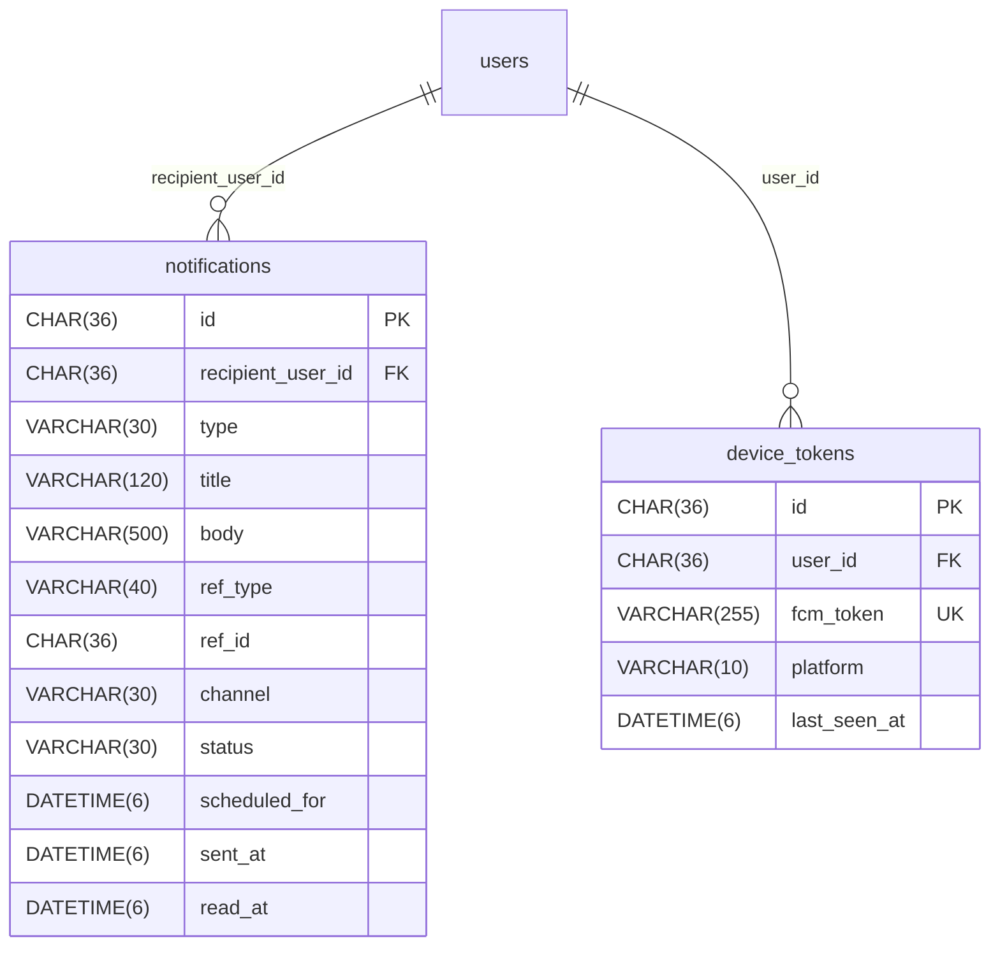
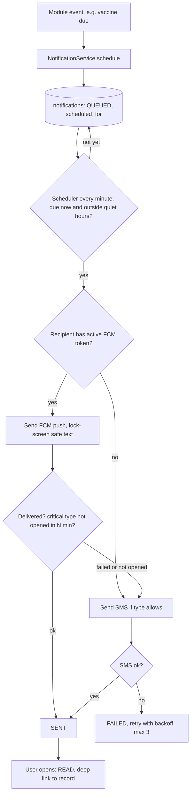

# Module 14: Notifications & Reminders

- **Pillar:** 3 – Common AI, notifications, admin & offline sync
- **Priority:** High
- **Status:** Planned

## Overview

Most of the value of JanSetu comes from reminding the right person at the right time: a vaccine due on Thursday's VHSND, a medicine at 8 pm, a
follow-up the worker promised, an SOS that needs a response now. Rural users have intermittent data, shared phones, often switch phones off
to save battery, and may not read English, so notifications must be **multi-channel** (push, local, SMS), **bilingual**, **reliable offline**
and must **never reveal health details** on a lock screen.

This module is the single notification service used by all other modules: templates, scheduling, channel selection with fallback, delivery
tracking, user preferences and the in-app inbox.

## User roles & permissions

| Role | View | Create | Edit | Delete | Approve |
|---|---|---|---|---|---|
| SA | All notification logs, templates | System broadcasts, templates | Templates | Purge old logs | — |
| NGA | Own inbox | Broadcast to own NGO's workers | Own preferences | — | — |
| GS | Own inbox | Broadcast to own centres' AWWs | Own preferences | — | — |
| AWW, NGW, HP, PG | Own inbox | — | Mark read, own preferences | — | — |

## Features

| Notification type | Trigger (owning module) | Typical recipients |
|---|---|---|
| Vaccination | Dose due in 2 days, overdue, VHSND list ([04](04-vaccination-healthcare.md)) | AWW, PG |
| Medicine | Medicine time ([09](09-elderly-healthcare.md)) | Beneficiary / family device (local) |
| Checkup | Appointment tomorrow, missed, next checkup ([04](04-vaccination-healthcare.md), [09](09-elderly-healthcare.md)) | NGW, PG, beneficiary contact |
| Meal quality | Poor-quality alert, meal not logged ([07](07-midday-meal-quality.md)) | GS, AWW |
| Emergency | SOS raised, acknowledged, escalated, resolved ([10](10-emergency-sos.md)) | NGW, NGA, contacts, HP |
| Attendance | Not marked by 11:00, repeated absence ([05](05-attendance.md)) | AWW, GS |
| Welfare updates | Application status, delays ([11](11-welfare-ngo-assistance.md)) | NGW, NGA, beneficiary contact |
| Caregiver follow-ups | Visit plan, follow-up due, not visited ([12](12-ngo-worker-caregiver.md)) | NGW, NGA |
| Risk alerts | New alert to review, confirmed tasks ([13](13-ai-analytics.md)) | HP, GS, NGA, AWW, NGW |
| System | Account, sync problems, app update | Any |

| Capability | Description |
|---|---|
| Channels | **FCM push** (app users), **local notifications** (scheduled on device, offline), **SMS** (OTP, SOS, people without the app, push fallback), **in-app inbox** |
| Fallback | Push not delivered/opened within N min for critical types → SMS (SOS: immediate SMS in parallel) |
| Templates | Per type, per language (`en`, `hi`), with placeholders. Lock-screen-safe text (no health data) |
| Scheduling | `scheduled_for` time, IST quiet hours 21:00–07:00 for non-urgent types (medicine and SOS exempt) |
| Preferences | Per user: language, which optional types, SMS opt-in for parents |
| Delivery tracking | QUEUED → SENT → (READ) / FAILED with retry. Shown in logs |
| Inbox | List of the user's notifications, tap to open the related record (deep link) |
| Broadcast | NGA/GS/SA send a short message to their workers (e.g. "VHSND moved to Friday") |

## User stories

1. As a **parent**, I want an SMS in Hindi two days before my child's vaccine, even though I don't use the app daily, so that I remember to go.
2. As an **elderly woman**, I want a medicine reminder at the right time even without internet so that I take my tablets.
3. As an **NGO worker**, I want SOS alerts to ring loudly even when my phone is on silent so that I never miss an emergency.
4. As an **Anganwadi worker**, I want one morning summary instead of 20 separate notifications so that I'm not overwhelmed.
5. As a **Government Supervisor**, I want to broadcast a message to all my AWWs so that schedule changes reach everyone.
6. As a **user on a shared phone**, I want notifications to not show health details on the lock screen so that my family doesn't see private information.
7. As a **Super Admin**, I want to see failed SMS deliveries so that we can fix gateway or number problems.

## Screens

| Screen | Key fields / actions |
|---|---|
| **Notification Inbox** | List (newest first), unread dot, type icon, title, time. Tap → open related record. *Mark all read* |
| **Notification Settings** | Language, toggles per optional type, quiet hours (display), SMS for parent reminders (opt-in) |
| **Broadcast** (NGA/GS/SA) | Audience (all my workers / a centre / a village), message (160 chars, Hindi/English), *Preview*, *Send* |
| **Delivery Log** (SA) | Filter by type/channel/status/date, retry failed |

## Data model

<!-- DATA_MODEL: notifications, device_tokens -->
<!-- generated:start -->

**`notifications`**: Push/SMS/in-app notifications and their delivery status. JPA entity: [`Notification`](../../backend/src/main/java/in/jansetu/notification/entity/Notification.java)

| Column | MySQL type | Null | Notes |
|---|---|---|---|
| `id` | `CHAR(36)` | no | PK, UUID (client-generated for offline-created rows) |
| `recipient_user_id` | `CHAR(36)` | no | FK → `users.id` |
| `type` | `VARCHAR(30)` | no | enum: `VACCINATION_DUE`, `MEDICINE_REMINDER`, `CHECKUP_DUE`, `MEAL_QUALITY`, `SOS`, `ATTENDANCE`, `WELFARE_UPDATE`, `CAREGIVER_FOLLOW_UP`, `RISK_ALERT`, `SYSTEM` |
| `title` | `VARCHAR(120)` | no |  |
| `body` | `VARCHAR(500)` | no | no health values in push text |
| `ref_type` | `VARCHAR(40)` | yes |  |
| `ref_id` | `CHAR(36)` | yes |  |
| `channel` | `VARCHAR(30)` | no | enum: `PUSH`, `SMS`, `IN_APP` |
| `status` | `VARCHAR(30)` | no | enum: `QUEUED`, `SENT`, `FAILED`, `READ` |
| `scheduled_for` | `DATETIME(6)` | no |  |
| `sent_at` | `DATETIME(6)` | yes |  |
| `read_at` | `DATETIME(6)` | yes |  |

**`device_tokens`**: FCM tokens per user device. JPA entity: [`DeviceToken`](../../backend/src/main/java/in/jansetu/notification/entity/DeviceToken.java)

| Column | MySQL type | Null | Notes |
|---|---|---|---|
| `id` | `CHAR(36)` | no | PK, UUID (client-generated for offline-created rows) |
| `user_id` | `CHAR(36)` | no | FK → `users.id` |
| `fcm_token` | `VARCHAR(255)` | no | unique |
| `platform` | `VARCHAR(10)` | no | android | ios |
| `last_seen_at` | `DATETIME(6)` | no |  |

All tables also have the common columns `created_at`, `updated_at`, `created_by`, `updated_by`, `version`, `deleted`. See [data-model.md](../data-model.md#conventions). Schema: [`V1__init.sql`](../../backend/src/main/resources/db/migration/V1__init.sql).
<!-- generated:end -->

Notes:
- `body` is lock-screen safe. Details are fetched only when the user opens the notification in the authenticated app.
- Templates live in code/config for Phase I (`messages_en.properties`, `messages_hi.properties`), TODO(team): DB table if non-developers need to edit them.
- Local notifications (medicine, offline reminders) are scheduled on the device and are **not** rows in this table.

## API endpoints

`ROLE_SUPER_ADMIN` may call every endpoint and is omitted below.

| Method | Path | Description | Allowed roles |
|---|---|---|---|
| GET | `/api/v1/notifications?status=&page=` | Own inbox | any authenticated |
| POST | `/api/v1/notifications/{notificationId}/read` | Mark read | any authenticated (own) |
| POST | `/api/v1/notifications/read-all` | Mark all read | any authenticated |
| GET | `/api/v1/notifications/preferences` | Own preferences | any authenticated |
| PUT | `/api/v1/notifications/preferences` | Update preferences | any authenticated |
| POST | `/api/v1/devices` | Register/refresh FCM token `{fcmToken, platform}` | any authenticated |
| DELETE | `/api/v1/devices/{tokenId}` | Unregister (on logout) | any authenticated (own) |
| POST | `/api/v1/notifications/broadcast` | Broadcast `{audience, message}` within scope | `ROLE_NGO_ADMIN`, `ROLE_GOVT_SUPERVISOR` |
| GET | `/api/v1/notifications/log?type=&status=&channel=` | Delivery log | `ROLE_SUPER_ADMIN` only |
| POST | `/api/v1/notifications/{notificationId}/retry` | Retry failed | `ROLE_SUPER_ADMIN` only |

Internal (Java service, not REST): `NotificationService.schedule(recipient, type, refType, refId, params, when)` is used by all modules.

## Workflow

## Business rules & validation

- **Lock-screen safe:** no child/beneficiary health values, conditions, nutrition status or medicine names in title/body. Names only where needed (SOS: first name + village). Reviewed per template.
- Quiet hours 21:00–07:00 IST for non-urgent types. Exempt: SOS, urgent health alerts, medicine reminders, OTP.
- Digest: AWW/NGW routine items (due vaccines, follow-ups) are bundled into one 07:00 notification per day.
- SOS uses a dedicated Android notification channel with `IMPORTANCE_HIGH`, alarm sound, full-screen intent, bypass DND where permitted.
- SMS: DLT-registered templates only (Indian regulation), max 160 chars (Hindi uses Unicode, so 70 chars per segment; keep Hindi SMS short).
  OTP + SOS + consenting parents only. TODO(team): gateway + DLT registration.
- Retry: FCM/SMS failures retry 3 times (1 min, 5 min, 30 min). Then `FAILED` and visible to SA.
- Stale FCM tokens (FCM "unregistered" error) are deleted.
- Broadcasts: max 160 chars, rate-limited (5/day per sender), audience restricted to sender's scope, audited.

## Offline behaviour

- **Local notifications** are scheduled on the device from cached data: medicine times, attendance/meal reminders, follow-ups due, vaccine due lists.
  They work with no network. On each sync the app re-schedules them (idempotent, keyed by record id).
- Push notifications received while offline arrive when the device reconnects (FCM stores up to 4 weeks). Critical ones also go by SMS.
- The inbox is cached locally. Mark-read actions are queued.
- Server-side, notifications are created regardless of the recipient's connectivity.

## AI / ML

None. (Notification timing optimisation is a future idea.)

## Notifications triggered

This module delivers the notifications defined in every other module. Its own events: "Notification delivery failing for user X for 3 days" → SA. "SMS balance low" → SA.

## Privacy & security considerations

- No health data in push payloads: FCM `data` contains only `type`, `refType`, `refId`. The app fetches details after authentication.
- SMS to parents is opt-in, and SMS never contains health information beyond vaccine name and date.
- FCM tokens are tied to user + device and deleted on logout.
- Broadcast content is audited, and no personal data is allowed in broadcasts (UI warning).
- Firebase: only FCM is used. No Firebase Analytics or Crashlytics with personal data (TODO(team): if crash reporting is added, disable PII collection).

## Dependencies on other modules

- Used by all modules. Depends on [01 – Authentication](01-authentication.md) (users, devices) and [16 – Offline Sync](16-offline-sync.md) (local scheduling from cached data).
- External: Firebase Cloud Messaging, SMS gateway (TODO(team)).

## Acceptance criteria

- [ ] A vaccine due in 2 days creates a push to the AWW digest and an SMS to an opted-in parent, with no child name in the SMS.
- [ ] Medicine local notifications fire on time with the phone in airplane mode.
- [ ] A non-urgent notification scheduled at 22:00 is delivered at 07:00. An SOS at 22:00 is delivered immediately.
- [ ] Push payloads contain no health data (checked by a test on every template).
- [ ] A failed push for an SOS falls back to SMS within the configured time.
- [ ] A GS cannot broadcast to centres outside their jurisdiction.
- [ ] Logging out deletes the device's FCM token on the server.

## Future enhancements

- IVR voice calls in Hindi for elderly users who can't read.
- WhatsApp Business messages where users prefer them (with consent).
- Smart batching based on each user's open times.
