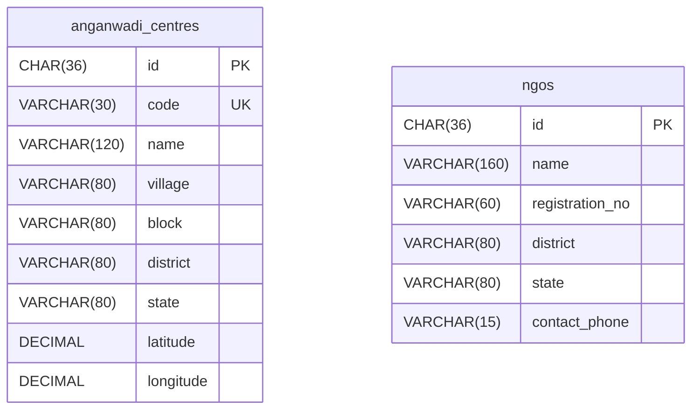
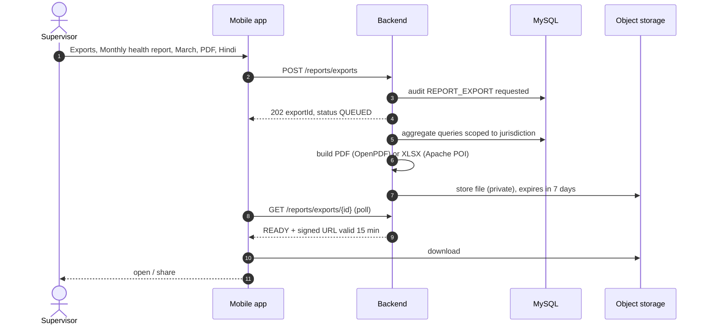

# Module 15: Admin Dashboard & Reports

- **Pillar:** 3 – Common AI, notifications, admin & offline sync
- **Priority:** Medium
- **Status:** Planned

## Overview

ICDS supervisors and NGO coordinators must report monthly to their departments and donors. Today they compile these by hand from paper
registers, which takes days and is error-prone. They also lack a quick view of where things are going wrong: which centre has rising malnutrition,
falling attendance or poor meals, and which village has slow SOS responses.

This module provides **role-gated dashboard and admin screens inside the mobile app** (no separate web portal in Phase I) for SA, GS and NGA,
plus **monthly/yearly PDF and Excel exports generated by the backend**. It also holds the master data: Anganwadi centres, NGOs and worker management screens.

## User roles & permissions

| Role | View | Create | Edit | Delete | Approve |
|---|---|---|---|---|---|
| SA | All dashboards, all master data | Centres, NGOs, users | Yes | Deactivate | — |
| GS | Dashboards for jurisdiction, centre list | — | Centre details (non-identifying fields) | — | — |
| NGA | Dashboards for own NGO, NGO profile | — | Own NGO profile | — | — |
| AWW, NGW, HP, PG | — | — | — | — | — |

Exports follow the same scope. Every export is audited.

## Features

| Feature | Description |
|---|---|
| Totals | Children enrolled (by age band, sex), elderly beneficiaries (by village, living alone), active workers, centres, NGOs |
| Anganwadi centre management | Add/edit centre: code, name, village, block, district, state, location (SA). Assign AWW ([Module 01](01-authentication.md)) |
| NGO management | Add/edit NGO, its admins (SA) |
| Worker management | Links to user management ([01](01-authentication.md)) and NGO workers ([12](12-ngo-worker-caregiver.md)) |
| Health risk dashboard | % MODERATE / SEVERE (wasting), underweight, stunting by centre and month. Open referrals. Pending risk alerts |
| Attendance dashboard | Average attendance % by centre, centres below threshold, repeated-absence alerts |
| Meal quality dashboard | Meals logged vs. working days, % flagged/confirmed poor, adequacy, supplier issues |
| Vaccination coverage | Fully immunised %, overdue doses by centre |
| Welfare distribution | Assistance by category/month, scheme applications by status, delays |
| Emergency incident reports | SOS count, time-to-acknowledge / time-to-resolve (median, P90), false-alarm rate, by village/worker |
| Exports | Monthly / yearly reports as **PDF** (OpenPDF) and **Excel** (Apache POI), generated by the backend, downloaded or shared |
| Data freshness | Every dashboard shows "Data as of …" and the number of devices not synced for > 3 days (so numbers aren't trusted blindly) |

## User stories

1. As a **Government Supervisor**, I want the monthly report for my centres as a PDF so that I can submit it without copying registers.
2. As a **Government Supervisor**, I want to see which centres have the highest % of severely wasted children so that I visit them first.
3. As an **NGO Administrator**, I want an Excel export of assistance given this quarter so that I can report to our donors.
4. As an **NGO Administrator**, I want to see SOS response times by village so that I can fix coverage gaps.
5. As a **Super Admin**, I want to add a new Anganwadi centre and assign its worker so that the centre can start using the app.
6. As a **Government Supervisor**, I want to know if numbers are incomplete because some phones haven't synced so that I don't report wrong figures.

## Screens

| Screen | Key fields / actions |
|---|---|
| **Dashboard Home** (SA/GS/NGA) | Scope picker (district/block/centre or NGO), month picker, KPI tiles (totals, % SAM/MAM, attendance %, meals flagged, SOS median response), "Data as of" + unsynced devices |
| **Health Risk Report** | Table by centre: enrolled, measured this month, normal/moderate/severe counts and %, open referrals. Trend chart (12 months) |
| **Attendance Report** | Centre × month table, below-threshold highlights |
| **Meal Quality Report** | Centre × week: logged, flagged, confirmed poor, adequacy. Supplier table |
| **Welfare Report** (NGA) | Category totals, applications by status, delayed list (counts + codes, no names in export) |
| **Emergency Incidents Report** (NGA/SA) | Incidents list, response time stats, by village/worker |
| **Exports** | Report type, period (month/year), format (PDF/Excel), language (Hindi/English for PDF), *Generate* → progress → *Download / Share* |
| **Centres** (SA, GS read-only) | List + add/edit centre form |
| **NGOs** (SA) | List + add/edit NGO form |

Charts on low-end phones: simple bar/line charts (react-native-svg based, lazy-loaded), max 12 points per series. Tables are paginated.

## Data model

<!-- DATA_MODEL: anganwadi_centres, ngos -->
<!-- generated:start -->

**`anganwadi_centres`**: An Anganwadi centre (AWC). Scope for AWW data. JPA entity: [`AnganwadiCentre`](../../backend/src/main/java/in/jansetu/admin/entity/AnganwadiCentre.java)

| Column | MySQL type | Null | Notes |
|---|---|---|---|
| `id` | `CHAR(36)` | no | PK, UUID (client-generated for offline-created rows) |
| `code` | `VARCHAR(30)` | no | unique; Govt AWC code |
| `name` | `VARCHAR(120)` | no |  |
| `village` | `VARCHAR(80)` | yes |  |
| `block` | `VARCHAR(80)` | yes |  |
| `district` | `VARCHAR(80)` | no |  |
| `state` | `VARCHAR(80)` | no |  |
| `latitude` | `DECIMAL(9,6)` | yes |  |
| `longitude` | `DECIMAL(9,6)` | yes |  |

**`ngos`**: A partner NGO. Scope for NGW/NGA data. JPA entity: [`Ngo`](../../backend/src/main/java/in/jansetu/admin/entity/Ngo.java)

| Column | MySQL type | Null | Notes |
|---|---|---|---|
| `id` | `CHAR(36)` | no | PK, UUID (client-generated for offline-created rows) |
| `name` | `VARCHAR(160)` | no |  |
| `registration_no` | `VARCHAR(60)` | yes | TODO(team): confirm which registration id partner NGOs share |
| `district` | `VARCHAR(80)` | no |  |
| `state` | `VARCHAR(80)` | no |  |
| `contact_phone` | `VARCHAR(15)` | yes |  |

All tables also have the common columns `created_at`, `updated_at`, `created_by`, `updated_by`, `version`, `deleted`. See [data-model.md](../data-model.md#conventions). Schema: [`V1__init.sql`](../../backend/src/main/resources/db/migration/V1__init.sql).
<!-- generated:end -->

Notes:
- Dashboards read **aggregates**. For Phase I they are computed by SQL queries on demand with indexes ([V1__init.sql](../../backend/src/main/resources/db/migration/V1__init.sql)).
  TODO(team): if slow, add a nightly `monthly_centre_stats` summary table (V3+).
- Export jobs: TODO(team): `report_exports (id, requested_by, type, period, format, status, file_url, created_at)` in V3 for async generation.

## API endpoints

`ROLE_SUPER_ADMIN` may call every endpoint and is omitted below.

| Method | Path | Description | Allowed roles |
|---|---|---|---|
| GET | `/api/v1/admin/dashboard/summary?scope=&month=` | KPI tiles | `ROLE_GOVT_SUPERVISOR`, `ROLE_NGO_ADMIN` |
| GET | `/api/v1/admin/dashboard/health-risk?centreId=&month=` | Health risk report data | `ROLE_GOVT_SUPERVISOR` |
| GET | `/api/v1/admin/dashboard/attendance?month=` | Attendance report data | `ROLE_GOVT_SUPERVISOR` |
| GET | `/api/v1/admin/dashboard/meal-quality?month=` | Meal quality report data | `ROLE_GOVT_SUPERVISOR` |
| GET | `/api/v1/admin/dashboard/vaccination?month=` | Coverage report data | `ROLE_GOVT_SUPERVISOR` |
| GET | `/api/v1/admin/dashboard/welfare?month=` | Welfare distribution data | `ROLE_NGO_ADMIN` |
| GET | `/api/v1/admin/dashboard/emergencies?month=` | SOS statistics | `ROLE_NGO_ADMIN` |
| GET | `/api/v1/admin/sync-health` | Devices not synced > 3 days in scope | `ROLE_GOVT_SUPERVISOR`, `ROLE_NGO_ADMIN` |
| POST | `/api/v1/reports/exports` | Request export `{type, period, format, language}` → job id | `ROLE_GOVT_SUPERVISOR`, `ROLE_NGO_ADMIN` |
| GET | `/api/v1/reports/exports/{exportId}` | Status + download link (short-lived) | requester only |
| GET | `/api/v1/admin/centres` | List centres in scope | `ROLE_GOVT_SUPERVISOR` |
| POST | `/api/v1/admin/centres` | Create centre | `ROLE_SUPER_ADMIN` only |
| PUT | `/api/v1/admin/centres/{centreId}` | Edit centre | `ROLE_SUPER_ADMIN`, `ROLE_GOVT_SUPERVISOR` (limited fields) |
| GET | `/api/v1/admin/ngos` | List NGOs | `ROLE_SUPER_ADMIN` only |
| POST | `/api/v1/admin/ngos` | Create NGO | `ROLE_SUPER_ADMIN` only |
| PUT | `/api/v1/admin/ngos/{ngoId}` | Edit NGO | `ROLE_SUPER_ADMIN`, `ROLE_NGO_ADMIN` (own) |

## Workflow

## Business rules & validation

- All aggregates are scoped by the caller's jurisdiction / NGO. SA can choose any scope.
- **Small-number suppression:** in exports and dashboards below district level, counts 1–4 for sensitive indicators (SAM, SOS, legal aid) are shown as "< 5" so individuals can't be identified in a small village.
- Exports contain **aggregates and codes, not names**, except the AWW's own centre operational lists (TODO(team): confirm which official formats need names).
- Indicator definitions are fixed in code and documented in the export footer (e.g. "% severe wasting = children 0–59 m with WHZ < −3 or MUAC < 11.5 or oedema / children measured").
- Export period: month (YYYY-MM) or year (financial year April–March, TODO(team): or calendar year). Max 1 concurrent export per user. Files expire after 7 days.
- Centre `code` unique, matches the official AWC code if available.
- "Data as of" = latest successful sync time across devices in scope.

## Offline behaviour

- Dashboards need the network (aggregates on server). The **last viewed dashboard is cached** with its "as of" time, so supervisors can open it in the field.
- Exports are online only. Downloaded files are kept in app-private storage until shared/deleted.
- Centre/NGO master edits: online only.

## AI / ML

Shows outputs from [Module 13](13-ai-analytics.md): risk alert counts, confirmation rates and simple trend projections (clearly labelled as projections, with uncertainty).

## Notifications triggered

| Event | To |
|---|---|
| Export ready | Requester |
| Monthly report period closed (1st of month) | GS, NGA: "March report ready to generate" |
| Many devices not synced in scope | GS / NGA |

## Privacy & security considerations

- Aggregates by default, with small-number suppression. Names appear only where operationally required.
- Every export is audited (who, what, scope, when). Files are private with short-lived download links.
- PDF/Excel files may be shared via WhatsApp by users. The app shows a warning before sharing and adds a footer: "Confidential – contains data of beneficiaries. Do not forward."
- GS cannot see NGO-held elderly data and NGA cannot see child data (pillar separation).

## Dependencies on other modules

- Reads from [02](02-child-management.md)–[12](12-ngo-worker-caregiver.md) and [13](13-ai-analytics.md).
- [01 – Authentication](01-authentication.md): user/worker management, scopes.
- [16 – Offline Sync](16-offline-sync.md): sync-health data for "data as of".

## Acceptance criteria

- [ ] A GS sees only centres in their jurisdiction on every dashboard and export.
- [ ] The monthly health report PDF opens on Android, is in the chosen language, and numbers match the SQL check queries on test data.
- [ ] The Excel export opens in LibreOffice/Excel with one sheet per indicator.
- [ ] A village with 3 SAM children shows "< 5" in exports below district level.
- [ ] Each export creates an `audit_logs` entry. Download links expire after 15 min.
- [ ] Dashboard Home loads in < 3 s on 3G for a jurisdiction of 50 centres.
- [ ] SA can create a centre, and an AWW assigned to it can register children there.

## Future enhancements

- Web dashboard for office use (same API), if partners prefer a PC.
- Scheduled monthly exports emailed to the supervisor.
- Map view of centres/villages coloured by indicator.
- Export in official ICDS formats (once templates are shared by partners).
