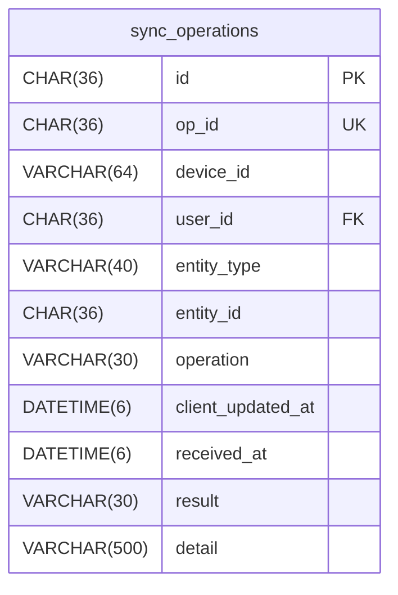
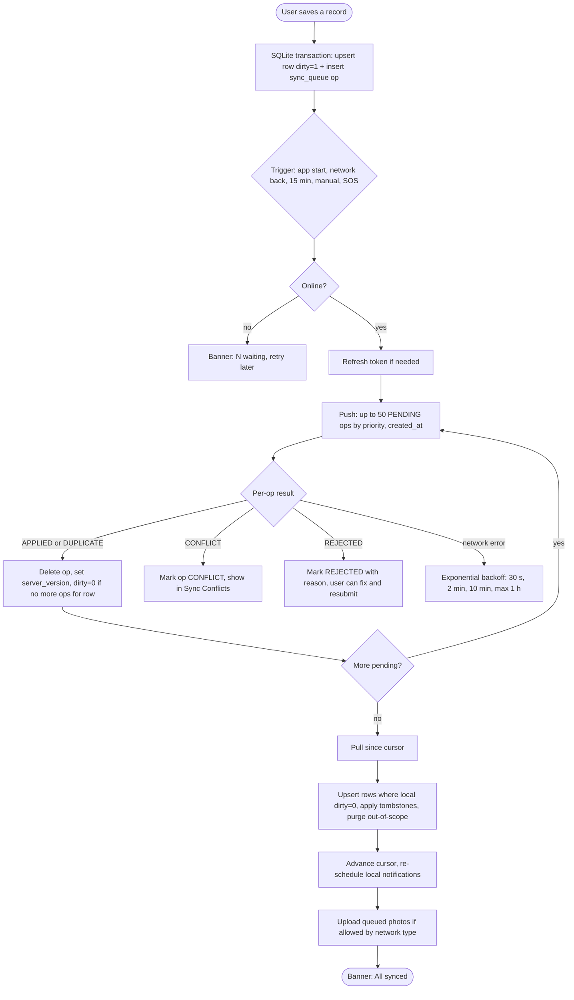

# Module 16: Offline Mode & Data Sync

- **Pillar:** 3 – Common AI, notifications, admin & offline sync
- **Priority:** **High** (core requirement)
- **Status:** Planned

## Overview

Anganwadi centres and the homes of elderly women are often in villages with **2G/no data for hours or days**, and workers use low-end phones
with limited storage and battery. If the app needs the internet to save a record, workers go back to paper and the system fails.

JanSetu is **offline-first**: the phone's encrypted SQLite database is the working copy. All field work (child registration, growth entry, attendance,
meal records, visits, vitals) is saved locally first and **synced automatically** when the network returns, with **duplicate detection**, **conflict resolution**
and a clear **sync status** so the worker always knows what has reached the server. The overall design is in [architecture.md](../architecture.md#offline-sync-design).
This document is the detailed spec.

## User roles & permissions

| Role | View | Create | Edit | Delete | Approve |
|---|---|---|---|---|---|
| SA | All devices' sync health, all conflicts | — | — | Purge stuck ops | Resolve any conflict |
| AWW, NGW, HP | Own device sync status, own conflicts | Push own changes | Resolve own conflicts (non-identity) | Discard own unsynced draft | — |
| GS | Sync health + conflicts of centres in jurisdiction | — | — | — | Resolve identity conflicts / duplicate merges for children |
| NGA | Sync health + conflicts of NGO | — | — | — | Resolve identity conflicts / duplicate merges for beneficiaries |
| PG | — (PG features are online, read-only) | — | — | — | — |

## Features

| Feature | Description |
|---|---|
| Offline child registration | [Module 02](02-child-management.md): full registration incl. guardian + consent, client UUID, "Pending ID" |
| Offline health entry | Growth ([03](03-growth-nutrition.md)), vaccinations ([04](04-vaccination-healthcare.md)), vitals ([09](09-elderly-healthcare.md)) |
| Offline attendance | [05](05-attendance.md) |
| Offline meal records | [07](07-midday-meal-quality.md), incl. photos queued for later upload |
| Offline visits & welfare | [12](12-ngo-worker-caregiver.md), [11](11-welfare-ngo-assistance.md) |
| Local storage | SQLite encrypted with SQLCipher ([`db/index.ts`](../../mobile/src/db/index.ts), [`schema.ts`](../../mobile/src/db/schema.ts)) |
| Sync queue (outbox) | Every local change appends an op to `sync_queue` in the same transaction ([`syncQueue.ts`](../../mobile/src/sync/syncQueue.ts)) |
| Automatic sync | On app start, network regained, every 15 min online, immediately for SOS. Also manual *Sync now* |
| Pull | Server changes since the last cursor, scoped to the user (centre / NGO / assignments) |
| Duplicate detection | On device at entry time + on server at push time |
| Conflict resolution | LWW for low-risk fields, manual review for clinical/identity fields |
| Sync status display | Banner on home: offline / syncing / "12 records waiting" / "2 need attention". Sync Status screen with details |
| Data purge | Records no longer in scope (transfer, reassignment) are removed from the device after their pending ops are pushed |

## User stories

1. As an **Anganwadi worker**, I want to register children and record weights all day without network so that my work never stops.
2. As an **Anganwadi worker**, I want to see how many records are waiting to sync so that I know when to go somewhere with signal.
3. As an **NGO worker**, I want my visit records to upload by themselves when I reach the town so that I don't have to remember.
4. As an **Anganwadi worker**, I want the app to warn me if a child I'm registering might already exist so that I don't create duplicates.
5. As a **Government Supervisor**, I want to resolve cases where two phones changed the same child's date of birth differently so that the record is correct.
6. As an **NGO worker**, I want photos to upload only when the network is good so that my data pack isn't used up and other records go first.
7. As a **Super Admin**, I want to see which devices haven't synced for days so that we can help those workers before data is lost.

## Screens

| Screen | Key fields / actions |
|---|---|
| **Sync status banner** (every main screen) | Offline (grey) / Syncing… (blue) / All synced ✓ (green) / "N waiting" (amber) / "N need attention" (red) |
| **Sync Status** | Last successful sync time, pending ops by type (children 3, measurements 12, photos 2), *Sync now*, data used, failed items with reason, *Retry*, *Upload photos on mobile data* toggle |
| **Sync Conflicts** | List: record, field(s), "your value" vs "server value", who/when changed. Actions: *Keep mine*, *Keep server*, *Edit*. Identity conflicts: "Sent to supervisor" (read-only) |
| **Duplicate Review** (GS/NGA) | Side-by-side profiles, matching fields highlighted, *Same person → merge* / *Different people* |
| **Device Sync Health** (GS/NGA/SA) | Users/devices with last sync time, pending count reported at last sync, app version |

## Data model

**Server side:**

<!-- DATA_MODEL: sync_operations -->
<!-- generated:start -->


**`sync_operations`**: Processed client sync ops (idempotency + conflict audit). JPA entity: [`SyncOperation`](../../backend/src/main/java/in/jansetu/sync/entity/SyncOperation.java)

| Column | MySQL type | Null | Notes |
|---|---|---|---|
| `id` | `CHAR(36)` | no | PK, UUID (client-generated for offline-created rows) |
| `op_id` | `CHAR(36)` | no | unique; client-generated; makes push idempotent |
| `device_id` | `VARCHAR(64)` | no |  |
| `user_id` | `CHAR(36)` | no | FK → `users.id` |
| `entity_type` | `VARCHAR(40)` | no |  |
| `entity_id` | `CHAR(36)` | no |  |
| `operation` | `VARCHAR(30)` | no | enum: `CREATE`, `UPDATE`, `DELETE` |
| `client_updated_at` | `DATETIME(6)` | no |  |
| `received_at` | `DATETIME(6)` | no |  |
| `result` | `VARCHAR(30)` | no | enum: `APPLIED`, `DUPLICATE`, `CONFLICT`, `REJECTED` |
| `detail` | `VARCHAR(500)` | yes |  |

All tables also have the common columns `created_at`, `updated_at`, `created_by`, `updated_by`, `version`, `deleted`. See [data-model.md](../data-model.md#conventions). Schema: [`V1__init.sql`](../../backend/src/main/resources/db/migration/V1__init.sql).
<!-- generated:end -->

Every synced server table also has `id CHAR(36)` (client UUID), `updated_at`, `version`, `deleted` ([`BaseEntity`](../../backend/src/main/java/in/jansetu/common/entity/BaseEntity.java)).

**Device side** ([`schema.ts`](../../mobile/src/db/schema.ts)):

| Table | Purpose |
|---|---|
| Domain tables (`children`, `guardians`, `growth_measurements`, `vaccination_records`, `attendance_records`, `meal_records`, `elderly_beneficiaries`, `vital_readings`, `visits`, …) | Local working copy. Extra columns: `server_version`, `dirty` (1 = has unsynced changes), `deleted` |
| `sync_queue` | Outbox: `op_id`, `entity_type`, `entity_id`, `operation`, `payload` (JSON), `client_updated_at`, `priority`, `attempts`, `status` (PENDING / CONFLICT / REJECTED), `last_error` |
| `sync_state` | Pull cursor per entity type (`last_pulled_at`) |

## API endpoints

| Method | Path | Description | Allowed roles |
|---|---|---|---|
| POST | `/api/v1/sync/push` | Batch of ≤ 50 ops → per-op result | `ROLE_ANGANWADI_WORKER`, `ROLE_NGO_WORKER`, `ROLE_HEALTH_PROFESSIONAL`, `ROLE_GOVT_SUPERVISOR`, `ROLE_NGO_ADMIN` |
| GET | `/api/v1/sync/pull?since=&entityTypes=&limit=500` | Changed rows since cursor in caller's scope, incl. tombstones (`deleted = true`) and `removedFromScope` ids | same as above |
| GET | `/api/v1/sync/bootstrap` | First-login snapshot (paged) for the caller's scope | same as above |
| POST | `/api/v1/sync/files` | Resumable media upload (meal photos), chunked | `ROLE_ANGANWADI_WORKER`, `ROLE_NGO_WORKER` |
| GET | `/api/v1/sync/conflicts` | Conflicts in scope | same as push |
| POST | `/api/v1/sync/conflicts/{opId}/resolve` | `{resolution: KEEP_CLIENT / KEEP_SERVER / MERGED, value?}` | Owner for non-identity fields; `ROLE_GOVT_SUPERVISOR` / `ROLE_NGO_ADMIN` for identity fields |
| POST | `/api/v1/sync/heartbeat` | Device reports app version, pending count, last error (no data) | any authenticated |
| GET | `/api/v1/sync/health` | Devices in scope with last sync | `ROLE_GOVT_SUPERVISOR`, `ROLE_NGO_ADMIN` |

`ROLE_SUPER_ADMIN` is allowed on all of these.

**Push request / response**

```jsonc
// POST /api/v1/sync/push
{ "deviceId": "a1b2…", "ops": [
  { "opId": "6f1e…", "entityType": "growth_measurements", "entityId": "c9d2…", "operation": "CREATE",
    "baseVersion": null, "clientUpdatedAt": "2026-03-14T05:30:00Z", "payload": { "childId": "7d0c…", "weightKg": 11.2, "...": "..." } }
]}
// 200
{ "success": true, "data": { "results": [
  { "opId": "6f1e…", "result": "APPLIED", "serverVersion": 1, "assigned": { } },
  { "opId": "77aa…", "result": "CONFLICT", "code": "DUPLICATE_SUSPECTED", "candidateId": "0b3c…" }
]}}
```

## Workflow



## Business rules & validation

**Ordering & idempotency**
- Ops are pushed in `(priority, created_at)` order. Within a record, the op order is preserved (CREATE before UPDATE). Parent records (guardian) are pushed before children.
- `opId` is unique. A repeated op returns `DUPLICATE` and is treated as success.
- The server runs **the same validation and authorization** for a pushed op as for the normal REST endpoint. Pushes are never a backdoor.

**Conflict rules** (detected when `baseVersion` ≠ the server's current `version`)

| Field class | Examples | Rule |
|---|---|---|
| Low-risk | attendance status, visit notes, meal ratings/notes, contact phone, address, appointment notes | **Last-write-wins** by `clientUpdatedAt`. The loser is stored in `sync_operations.detail` |
| Clinical | weight/height on the same measurement, vaccination `givenOn`/status, medicines, medical history, allergies | **Manual review** by the record owner (AWW/NGW), with HP as fallback |
| Identity | name, DOB, sex, guardian link, consent | **Manual review** by GS (children) / NGA (beneficiaries) |
| Append-only | new measurements, vitals, SOS events, attendance rows (unique per day) | No conflict. A unique-key clash (same child + day) is handled as a duplicate |
| Delete vs. edit | — | Edit wins, and the delete becomes a conflict |
| Status machines | referral, application, SOS | The further-along valid state wins. An invalid transition → manual review |

**Duplicate detection** (see [architecture.md](../architecture.md#duplicate-detection))
- Child: same centre + normalised name + DOB ± 30 days + guardian mobile → strong (`DUPLICATE_SUSPECTED`). Same guardian mobile + DOB → weak (warning).
- Elderly: normalised name + village + (mobile or approx age ± 2).
- Name normalisation: lower-case, Devanagari → Latin transliteration, remove spaces/punctuation, collapse common spelling variants (e.g. "devi"/"debi"). TODO(team): pick a transliteration library.

**Clock skew**
- `clientUpdatedAt` more than 24 h in the future → clamped to `receivedAt`, flagged (device clock wrong). The app warns when the device time differs from server time by > 5 min.

**Limits**
- Push batch ≤ 50 ops / 256 KB. Pull page ≤ 500 rows. Photo upload ≤ 5 MB in 256 KB chunks, resumable.
- Max local queue age 30 days. After 7 days unsynced the app shows a strong warning, and supervisors see it in Device Sync Health.

## Offline behaviour

This module *defines* offline behaviour. Summary per module:

| Module | Offline | Online-only parts |
|---|---|---|
| [01](01-authentication.md) Auth | PIN unlock, cached profile (30 days) | First login, OTP, password reset |
| [02](02-child-management.md) Children | Register, edit, search | Merge, transfer approval |
| [03](03-growth-nutrition.md) Growth | Entry, z-scores, chart, referrals | ML risk |
| [04](04-vaccination-healthcare.md) Vaccination | Schedule, record dose, local reminders | Parent SMS |
| [05](05-attendance.md) Attendance | Mark, history | Correction approval |
| [06](06-qr-health-card.md) QR card | Scan for in-scope cards | Out-of-scope scans, card printing |
| [07](07-midday-meal-quality.md) Meals | Entry, checklist, photo capture, adequacy | Photo upload, AI analysis |
| [08](08-elderly-registration.md)–[09](09-elderly-healthcare.md) Elderly | Register, vitals, medicines, reminders | Approval, assignment |
| [10](10-emergency-sos.md) SOS | SMS fallback | — |
| [11](11-welfare-ngo-assistance.md)–[12](12-ngo-worker-caregiver.md) Welfare / visits | Records, visits | Approvals, plan generation |
| [13](13-ai-analytics.md)–[15](15-admin-dashboard-reports.md) AI / dashboards | Cached views | Everything else |

**Storage budget:** target < 50 MB local data for a centre of 150 children with 2 years of history (photos excluded, since they are deleted 7 days after upload).

## AI / ML

None. (Sync health stats feed dashboards only.)

## Notifications triggered

| Event | To |
|---|---|
| Conflict needs your decision | Record owner (AWW/NGW) |
| Identity conflict / duplicate to review | GS / NGA |
| Data unsynced > 3 days (local) | The worker |
| Device not synced > 3 days | GS / NGA |
| Op rejected (validation) | The worker |

## Privacy & security considerations

- Local DB encrypted with SQLCipher. The key lives in the Android Keystore ([privacy-and-security.md](../privacy-and-security.md#encryption)).
- The device holds **only the user's scope**. Data out of scope (transfer/reassignment) is purged after pending ops are pushed.
- Pushed ops pass the same authorization as normal APIs. A tampered device cannot write outside its scope.
- Heartbeat and sync logs contain counts and IDs, never payloads.
- Lost device: revoke tokens ([Module 01](01-authentication.md)). Unsynced data on that device is lost, which is a known risk, mitigated by the "unsynced > 3 days" alerts.

## Dependencies on other modules

- All field modules (02–12) store data through this mechanism.
- [01 – Authentication](01-authentication.md): tokens, device id. [14 – Notifications](14-notifications.md): local notification re-scheduling after pull.

## Acceptance criteria

- [ ] With airplane mode on, a worker can register 10 children, record 30 measurements and mark attendance. After reconnecting, all records reach the server within 2 sync cycles with no duplicates.
- [ ] Killing the app during a push and restarting it causes no data loss and no duplicate records (idempotent `opId`).
- [ ] Two devices editing the same child's address offline → the later `clientUpdatedAt` wins, and the other value is in `sync_operations.detail`.
- [ ] Two devices editing the same child's DOB differently → `CONFLICT`, visible to the GS, and the server value is unchanged until resolved.
- [ ] The same child registered on two phones → `DUPLICATE_SUSPECTED`, and the GS can merge. After merge, all measurements point to one child.
- [ ] A pushed op for a child of another centre is `REJECTED` (scope check).
- [ ] The sync banner shows the correct pending count, and SOS ops are pushed before all others.
- [ ] Photos do not upload on mobile data when the toggle is off.
- [ ] After a worker is reassigned, the old beneficiary data disappears from their device after sync (once their pending ops are pushed).
- [ ] Sync of 500 pending ops completes in < 2 min on a throttled 3G profile (TODO(team): test setup).

## Future enhancements

- Delta compression for pull payloads on 2G.
- Peer-to-peer sync between the AWW's and the supervisor's phones (Bluetooth/Wi-Fi Direct) for areas with no network at all.
- CRDT-based merge for free-text notes.
